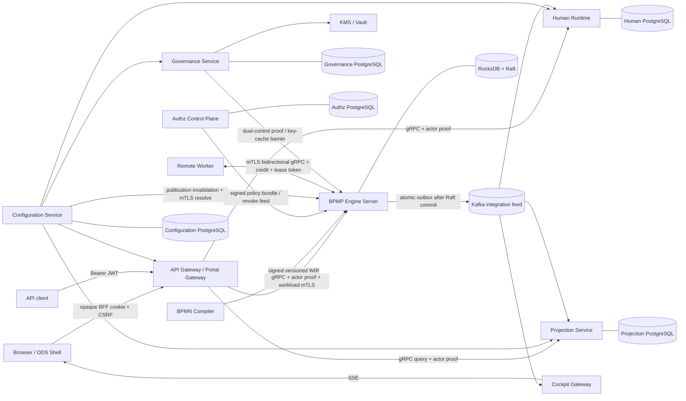

# BPMP Architecture Documentation

- Status: Current architecture index
- Last verified: 2026-10-30
- Scope: deployables, trust boundaries, consistency boundaries, workflows, and
  production background processing present in this repository

This directory is the navigation and traceability layer for BPMP architecture.
It does not replace the normative requirements, logical design, accepted ADRs,
or service-specific runbooks. When documents disagree, use the precedence rules
below and open a documentation defect rather than silently choosing the most
convenient interpretation.

## Source-of-truth precedence

1. Durable safety invariants in accepted ADRs and `requirements.md`.
2. Versioned contracts in `contracts/proto` and their compatibility gates.
3. Ownership and deployment boundaries in `microservices-architecture.md`.
4. Current implementation and executable tests.
5. Logical examples in `design.md` and future-state plans.

Code is evidence of current behavior, but it does not override a safety
invariant. A code/document conflict must be resolved explicitly.

## Architecture map

Kafka is never the authoritative workflow log. A Kafka outage may increase
outbox or projection lag, but it cannot invalidate a command already committed
through RocksDB/Raft.

## Current deployable inventory

| Deployable | Repository location | Owns | Authoritative state | Status |
|---|---|---|---|---|
| BPMN compiler | `apps/rust/bpmn-compiler` | Parse, validate, lower, and sign WIR | Signed WIR artifact | Current |
| Engine server | `apps/rust/bpmp-engine-server` | Network/Raft host for engine, schedulers, dispatch, outbox | RocksDB replicated through Raft | Current; Linux production adapter |
| Engine application/core | `apps/rust/bpmp-engine`, `crates/bpmp-domain-core` | WIR interpretation, `decide`, `evolve`, transition authz/idempotency | Engine event stream and snapshots | Current; in-process, not a separate service |
| Authz control plane | `apps/rust/authz-control-plane` | Policy administration, signed publication, query revoke source, tenant lifecycle | Authz PostgreSQL | Current; must not become transition authority |
| API/Portal gateway | `apps/go/api-gateway` | Public REST/BFF, coarse authn, CSRF, limits, routing | No workflow state; Redis session/rate-limit state is ephemeral | Current |
| Human runtime | `apps/go/human-runtime` | Work-item projection, assignment, delegation, SLA escalation | Human PostgreSQL | Current |
| Configuration service | `apps/go/configuration-service` | Immutable configuration versions, resolution, publication, rollback, audit | Configuration PostgreSQL | Current |
| Projection service | `apps/go/projection-service` | Rebuildable read model, query authorization, saved queries, exports | Projection PostgreSQL | Current |
| Governance service | `apps/rust/governance-service` | Approval workflow, revocation barrier, KMS lifecycle orchestration | Governance PostgreSQL | Current; production KMS hardening remains gated |
| Cockpit gateway | `apps/go/cockpit-gateway` | Kafka-to-SSE fan-out and cursor lifecycle | Ephemeral connection state | Current |
| Cockpit web | `apps/web/cockpit-web` | Existing operations UI | Browser session state only | Current, legacy surface during ODS migration |
| ODS shell | `apps/web/ods-shell` | ODS navigation, federation host, isolation | No backend authority | Current Phase 1 foundation |
| Task MFE | `apps/web/task-mfe` | Task presentation and command intent | No backend authority | Current vertical slice |
| Process Copilot | Not present | AI drafts and analysis only | Service-local store if introduced | Planned |
| Case, Document, Integration services | Not present | ODS domain ownership described by ADR-011 | Separate PostgreSQL per real bounded context | Planned |

## Consistency boundaries

| Boundary | Commit rule | Cross-boundary propagation |
|---|---|---|
| Workflow transition | Event, state/snapshot metadata, authz audit, idempotency result, and outbox references commit through one authoritative Raft command where required | Kafka integration events after commit |
| Service-local PostgreSQL aggregate | Aggregate change, inbox/outbox, audit, and checkpoint commit in one local transaction where the flow requires them | Versioned gRPC or committed event |
| Projection | Apply effect, deduplicate, and advance checkpoint in one local transaction | Query APIs expose staleness; projection can rebuild |
| Governance erasure | Engine first commits terminal/reconciliation obligations; governance then completes revocation barrier and KMS shred | Signed governance command and explicit acknowledgements |
| Configuration | Immutable version and publication record commit in Configuration PostgreSQL | Kafka invalidation followed by authoritative mTLS resolve |

No service may query another service's database. No projection, gateway, or
worker may interpret WIR or make an authoritative workflow transition.

## Detailed architecture documents

| Document | Purpose | Status |
|---|---|---|
| [Service workflows](service-workflows.md) | Command, query, event, worker, configuration, and governance sequences including recovery | Current |
| [Identity and trust flows](identity-and-trust-flows.md) | OIDC/BFF/JWT, mTLS, actor proof, authz, policy, and revocation boundaries | Current with explicitly marked external/planned OIDC lifecycle |
| [Background processing catalog](background-processing-catalog.md) | Consumers, publishers, schedulers, leases, retries, checkpoints, and shutdown behavior | Current implementation inventory |
| [Traceability matrix](traceability-matrix.md) | Service to contract/topic/store/job/runbook/test evidence | Current |

## Document status registry

| Document | Classification | Notes |
|---|---|---|
| `requirements.md` | Current, normative | Product and safety requirements; completion is tracked separately |
| `design.md` | Current logical baseline | Component-level design; not a literal deployable inventory |
| `microservices-architecture.md` | Current deployment baseline | Bounded-context ownership and deployment rules |
| `docs/adr/ADR-*.md` | Current when `Accepted` | Decisions override examples in older plans |
| `docs/api-and-observability-contract.md` | Current contract | Transport metadata and observability invariants |
| `docs/kafka-topology.md` | Current contract | Existing topic naming and configuration-publication behavior |
| `docs/dynamic-configuration-p1.md` | Current implementation contract | Phase 1 configuration behavior |
| `docs/boundary-runtime-adapter.md` | Current implementation contract | Timer/message/error boundary adapter |
| `docs/query-*.md` | Current implementation/runbook | Projection query, PDP, revoke, and export behavior |
| `docs/ods-browser-session-contract.md` | Current consumer contract | Session producer remains external to this repository |
| `docs/ods-microfrontend-microservices-refactor-plan.md` | Mixed: target plan | Future services are not current simply because they appear in this plan |
| `docs/ods-refactor-progress.md` | Current evidence snapshot | Use with the plan to distinguish delivered from planned work |
| `docs/repository-gap-remediation.md` | Current evidence snapshot | Not a statement that all roadmap work is complete |

## Required update rule

A change that adds or materially changes a deployable, RPC, Kafka topic,
authoritative store, trust boundary, long-running worker, scheduler, lease,
retry/DLQ policy, or recovery procedure must update the relevant document in
this directory in the same change. A new background loop is incomplete until
its ownership, bounds, idempotency, recovery, telemetry, and shutdown behavior
are documented.
