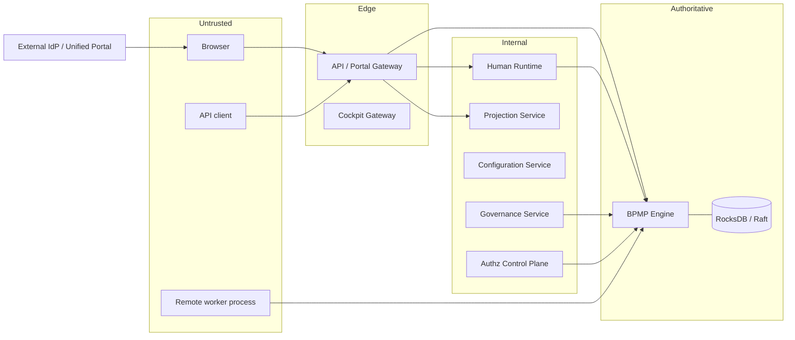
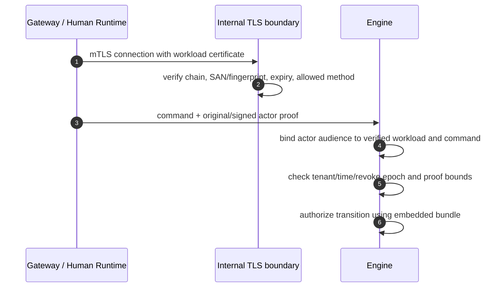

# BPMP Identity and Trust Flows

- Status: Current trust-boundary contract with planned/external OIDC steps marked
- Last verified: 2026-10-30
- Security invariant: workload identity authenticates a service; it never grants
  the end user's workflow authority

## Identity types

| Identity/evidence | Issuer | Consumer | Purpose | Must not be used for |
|---|---|---|---|---|
| Bearer JWT | External Identity Provider | API/Cockpit Gateway, actor verifier | External client authentication and actor claims | Trusting an unverified tenant/header or bypassing resource authz |
| Opaque browser session cookie | Unified Portal (external producer) | API/Portal Gateway | Browser authentication without exposing access/refresh tokens | Engine authorization or direct service-to-service identity |
| CSRF token | Unified Portal bootstrap | API/Portal Gateway | Bind unsafe browser requests to the session | Actor authorization |
| Signed internal actor context | Trusted identity adapter/Portal | Gateway, Human Runtime, Engine, query services | Short-lived, tenant/command/audience-bound actor evidence | Granting new capabilities at a trusted hop |
| Workload certificate/context | Platform workload PKI | Every internal server | Authenticate service/process and authorize RPC method access | Substituting for actor proof |
| Signed authz policy bundle | Authz Control Plane | Embedded engine evaluator | Immutable transition policy data | Remote decision RPC on the command critical path |
| Signed revoke update | Authz Control Plane | Engine/query PDP consumers | Monotonic tenant/actor revoke floors | A fail-open cache hint |
| Dual-control proof | Governance Service after maker/checker approval | Engine | Authorize a concrete governance transition | General workflow authorization |
| Remote assignment token | Engine | Remote Worker and Engine ACK path | Bind task, lease, worker, tenant, session, and expiry | Reuse across assignments or leases |

## Trust zones



Every arrow crossing a zone validates size, schema, tenant, identity, deadline,
and authorization appropriate to that boundary. TLS alone is not authorization.

## 1. Non-browser Bearer flow (current)

```mermaid
sequenceDiagram
    autonumber
    participant C as API client
    participant G as API Gateway
    participant V as JWT/JWKS verifier
    participant E as Engine

    C->>G: Authorization: Bearer JWT + tenant + command
    G->>V: verify signature, issuer, audience, time, size, key bounds
    V-->>G: verified subject/tenant/claims
    G->>G: reject tenant mismatch; coarse route/rate checks
    G->>E: mTLS + original JWT or signed actor context
    E->>E: independently verify workload and actor proof
    E->>E: evaluate embedded policy for concrete transition
```

Duplicate Authorization headers, malformed schemes, expired tokens, unknown
keys, issuer/audience mismatch, tenant mismatch, or oversized evidence fail
closed. Caller-provided actor fields never replace the verified subject.

## 2. Browser OIDC/BFF flow

The Gateway's session **consumption** contract is current. Unified Portal's
OIDC endpoints, cookie issuance, refresh-token lifecycle, and signing-key
operations are external dependencies and remain a production activation gate.

```mermaid
sequenceDiagram
    autonumber
    participant B as Browser
    participant P as Unified Portal (External)
    participant I as OIDC Provider (External)
    participant S as Session Store
    participant G as Portal Gateway

    B->>P: login
    P->>I: Authorization Code + PKCE (Planned/External)
    I-->>P: code
    P->>I: token exchange (server side)
    P->>S: opaque-token hash -> bounded signed actor session
    P-->>B: __Host cookie + bootstrap CSRF token
    B->>G: cookie; CSRF for unsafe method
    G->>S: bounded lookup by SHA-256(cookie)
    S-->>G: tenant + actor + signed context + expiry + CSRF digest
    G->>G: validate schema/size/expiry/tenant/CSRF
    G->>E: mTLS + signed actor context
```

Current session invariants:

- Cookie is `HttpOnly`, `Secure`, `SameSite`, `Path=/`, and opaque.
- Redis keys contain the lowercase SHA-256 digest, never the raw token.
- Access and refresh tokens do not enter browser storage.
- Unsafe methods require exactly one CSRF header with constant-time digest
  comparison; `GET`, `HEAD`, and `OPTIONS` do not.
- Bearer and BFF credentials together, duplicate cookies/headers, malformed or
  oversized records, expiry, and store errors fail closed.
- Session tenant is authoritative; an optional tenant header must match it.

Production flow still requiring an external contract/runbook:

- authorization endpoint, redirect/callback allowlist, and PKCE verifier state;
- refresh rotation, reuse detection, maximum/idle lifetime, and IdP outage mode;
- logout, back-channel/front-channel logout, session revocation, and device list;
- signing-key rotation overlap and emergency key compromise procedure;
- step-up/fresh-auth result binding for high-risk governance operations.

## 3. Service-to-service mTLS and actor forwarding



The workload is authorized to call an RPC; the actor is authorized to perform
the concrete resource transition. Both checks are required. Forwarded actor
proofs are short-lived and bound to tenant, command, audience, and revoke state
so a service cannot replay them for a different operation.

## 4. Engine transition authorization

Order is security-significant:

1. Verify transport/workload identity and method access.
2. Parse and bound the command envelope.
3. Verify actor proof signature, issuer/audience, tenant, time, and revoke epoch.
4. Resolve the locally verified immutable policy bundle.
5. Authorize the concrete workflow/version/node/transition resource.
6. Only after ALLOW, look up the actor-scoped idempotency result.
7. Rehydrate and decide with explicit time/config inputs.
8. Commit authorization audit, event, idempotency result, and outbox atomically.

The evaluator performs no network, database, wall-clock, or external attribute
I/O. Unknown bundle keys, bad signatures, sequence rollback, revoke rollback,
or missing bundle data fail closed.

## 5. Query authorization

Projection owns read models but not authorization policy. The query path verifies
the credential, resolves row predicates and field capabilities through the
typed PDP, canonicalizes the authorized query, and applies only permitted
filters/fields. Saved queries and exports preserve policy/version and authorized
shape; they do not persist reusable credentials.

The Kafka revoke feed improves local rejection speed but is not a fail-open
authority. If feed state is stale or unavailable, the service must use the
authoritative PDP/fail-closed behavior described in `docs/query-pdp.md` and
`docs/query-revoke-kafka.md`.

## 6. Policy bundle lifecycle

1. Authz Control Plane validates an administrative change under its PostgreSQL
   transaction and immutable audit rules.
2. It canonicalizes and signs an immutable tenant-scoped bundle with a monotonic
   sequence and rotation-safe key identifier.
3. The engine verifies key, signature, content hash, canonical encoding, tenant,
   size/grant limits, and sequence before atomic installation.
4. The previous verified bundle remains active until replacement validation is
   complete. Rollback is a newly signed monotonic publication, never sequence
   regression or historical mutation.
5. Emergency revoke advances a signed monotonic floor. Epoch regression or a
   bundle-sequence mismatch is rejected.

## 7. Governance fresh-auth and dual control

`AbortAndReconcile` requires a dedicated capability, distinct requester and
approver, the same tenant, fresh authentication/assurance, short approval TTL,
and signatures over the current canonical digest of tenant, policy, legal
deadline, key scope/epoch, and pending compensation ledger. The engine
revalidates the proof against current state at commit time. Any changed input
invalidates the approval; Governance cannot reinterpret an old proof.

## 8. Remote worker trust

Remote registration requires both mTLS certificate binding and a signed workload
proof bound to tenant, worker, stream session, protocol version, and lifetime.
Credit limits dispatch. Each assignment receives a signed lease-bound token,
whose digest is stored durably. Completion requires the exact token and is
re-authorized through the normal engine command path. Late, cross-session,
cross-tenant, or substituted acknowledgements fail closed.

## 9. Revocation and failure matrix

| Condition | Edge behavior | Engine/query behavior |
|---|---|---|
| Unknown/rotated JWT key | Reject; refresh/rotation follows bounded operator policy | No transition/query effect |
| Expired actor proof | Reject or require reauthentication | Fail before idempotency lookup |
| Valid workload, missing actor | May call only workload-only operational RPCs | Reject actor transition |
| Session store unavailable | Stable retryable authentication failure, no fallback to client actor headers | No downstream command |
| Revocation feed delayed | Existing connection may continue only within verified proof rules | Authoritative revoke/PDP check remains fail closed |
| Authz bundle publication unavailable | Administration delayed | Engine continues last verified non-revoked bundle; never installs partial data |
| Bundle/key compromise | Stop accepting affected key, advance revoke/rotation procedure | Unknown/revoked key fails closed |
| mTLS certificate mismatch/expiry | Reject connection/method | Actor proof cannot compensate for workload failure |
| Governance proof stale | Reject and require new maker/checker approval | State and key remain unchanged |

## 10. Logging and telemetry restrictions

Never log raw JWTs, cookies, CSRF tokens, signed actor contexts, private keys,
DEKs, plaintext sensitive payloads, or full KMS responses. Security telemetry
uses non-PII references such as tenant-safe identifiers, command/correlation ID,
policy/bundle version, decision code, and key identifier where policy permits.
High-cardinality actor/resource values do not become metric labels.
