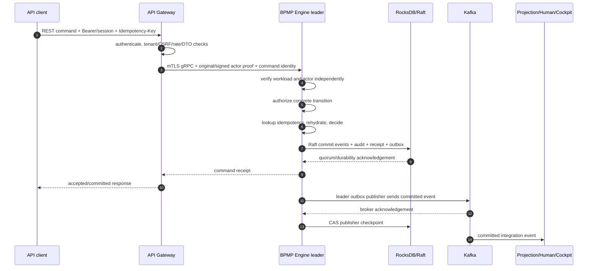
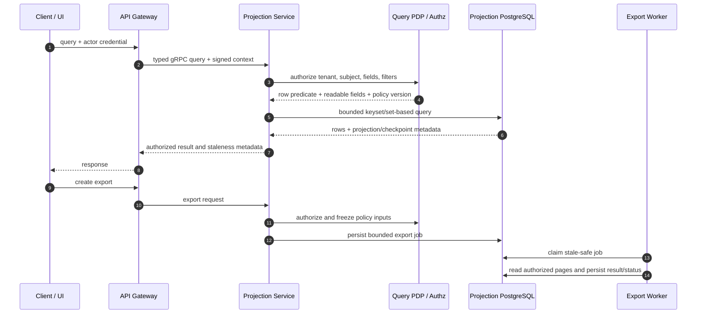
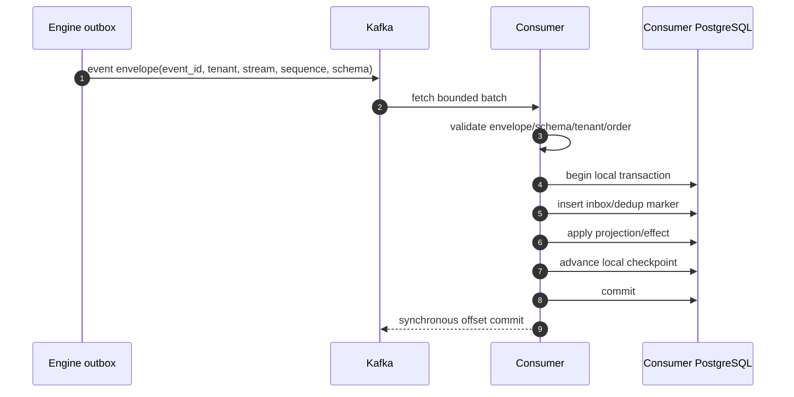
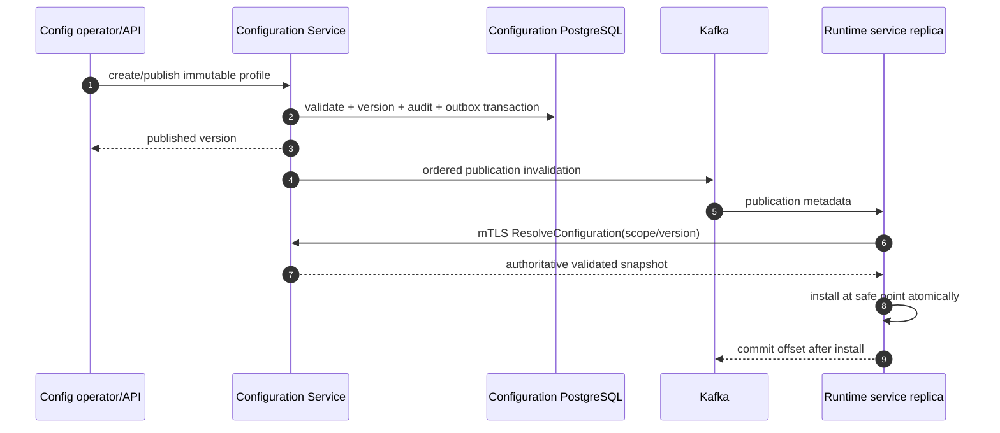
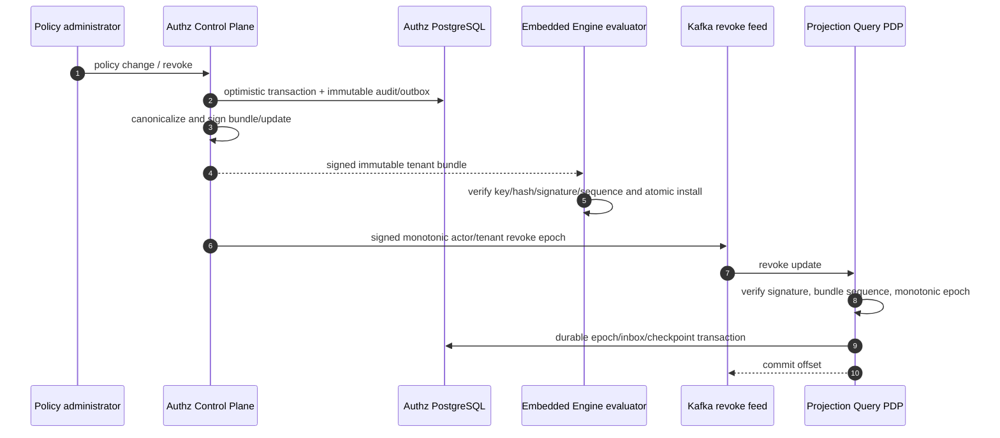
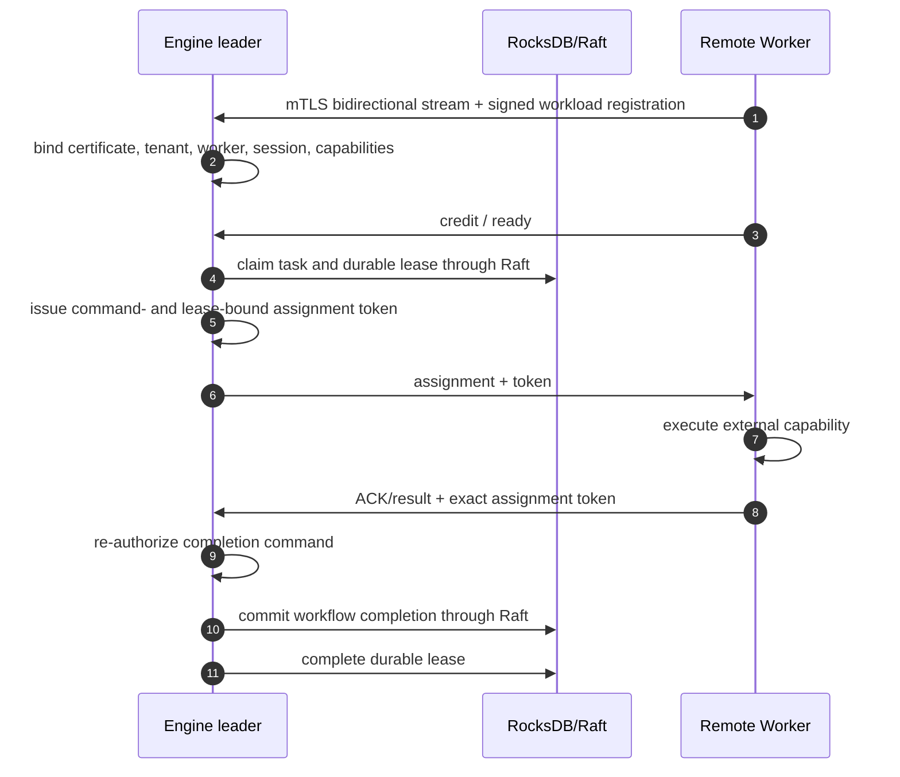
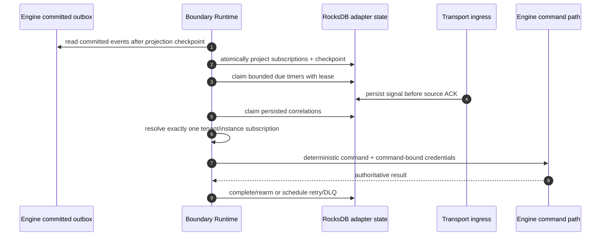
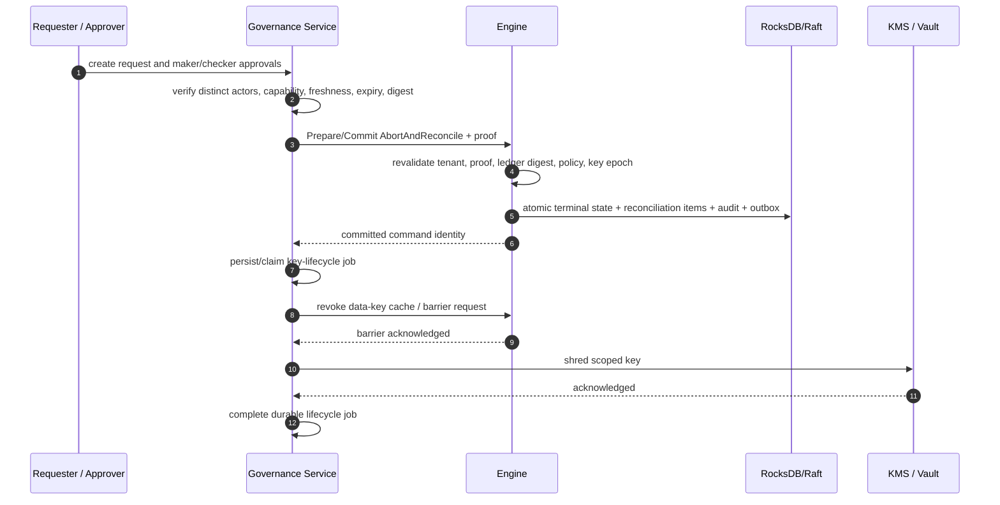

# BPMP Service Workflows

- Status: Current architecture workflow catalog
- Last verified: 2026-10-30
- Related: `microservices-architecture.md`, ADR-001, ADR-002, ADR-004,
  ADR-005, ADR-008, ADR-010, and ADR-011

These flows describe current repository behavior unless a step is marked
`Planned` or `External`. They intentionally show the commit boundary and the
recovery path; a happy-path-only diagram is not a distributed-system contract.

## Shared rules

- Every command preserves tenant, command/idempotency identity, actor proof,
  workload identity, correlation, and trace metadata as applicable.
- Engine authorization runs before idempotency lookup. A prior receipt must not
  leak to an actor who no longer has permission.
- RocksDB/Raft is authoritative for workflow state. Kafka is a replayable
  integration feed, not the commit authority.
- Consumers disable unsafe auto-commit, apply idempotently, and checkpoint only
  after durable local success.
- Retries are bounded, deadline-aware, and allowed only with a stable identity.

## 1. Direct workflow command



Failure and recovery:

| Failure point | Required outcome |
|---|---|
| Gateway rejects token, tenant, CSRF, limit, or DTO | No engine call and no state change |
| Workload valid but actor proof missing/invalid | Engine fails closed before idempotency or transition |
| Leader changes before commit | No success receipt; retry uses the same idempotency key |
| Client times out after possible commit | Return indeterminate/retryable semantics; retry the identical command identity |
| Kafka unavailable after commit | Command remains committed; outbox retains the record and retries |
| Crash after broker ACK before checkpoint | Event may be republished with the same `event_id`; consumers deduplicate |

## 2. Human task activation and completion

```mermaid
sequenceDiagram
    autonumber
    participant E as Engine
    participant K as Kafka
    participant H as Human Runtime
    participant D as Human PostgreSQL
    participant U as Task UI / API Gateway

    E->>E: commit HumanTaskActivated through Raft
    E->>K: publish committed event through outbox
    K->>H: HumanTaskActivated
    H->>D: inbox/dedup + work item + audit + checkpoint transaction
    H-->>K: commit offset after durable success
    U->>H: Complete/Delegate + expected_version + actor proof
    H->>D: validate assignment and optimistic version; persist intent
    H->>E: idempotent gRPC command preserving actor proof
    E->>E: authoritative authz + transition commit
    E-->>H: receipt, but work item is not final yet
    E->>K: committed completion/delegation event
    K->>H: authoritative event
    H->>D: finalize work item + audit + checkpoint
```

The Human Runtime never interprets WIR and never finalizes a workflow
transition from an RPC response alone. If the Engine RPC times out, the durable
intent is retried with the same identity. Duplicate or reordered Kafka delivery
cannot create a second work-item effect. Optimistic version conflicts are
returned to the caller for reconciliation rather than retried as blind writes.

## 3. Query and export



Query authorization is fail-closed. Revocation lag never converts a PDP deny
into allow: the authoritative PDP remains the fallback safety boundary. Export
jobs persist authorized field/filter policy, not reusable actor credentials.
Claims are reclaimable after failure and output remains bounded by row and byte
limits documented in `docs/query-api.md`.

## 4. Committed event fan-out and projection recovery



| Condition | Behavior |
|---|---|
| Duplicate `event_id` | Return prior/no-op effect and safely advance delivery position |
| Gap or impossible sequence | Stop/fail closed; alert and reconcile rather than fabricate state |
| Poison/unknown schema | Bounded DLQ or operator path where implemented; never silently skip |
| Crash before local commit | Kafka redelivers; no effect is visible |
| Crash after local commit before offset commit | Kafka redelivers; inbox/dedup prevents double effect |
| Projection loss | Rebuild from retained committed events and reset an explicit checkpoint |

## 5. Configuration publication and hot reload



Every process replica requires a distinct stable reloader group because the
publication is a broadcast invalidation, not a work queue. Invalid metadata,
signature, resolution, or snapshot stops the reloader/process according to the
service contract; it is not skipped. The last valid snapshot remains active
until a replacement has been completely validated and installed.

## 6. Authz policy publication and query revocation



Unknown keys, tampering, rollback, cross-tenant data, non-canonical artifacts,
or epoch regression fail closed. Policy administration availability is not on
the engine command critical path: the engine evaluates a locally verified
bundle without network or database I/O.

## 7. Remote service task dispatch



Disconnect, heartbeat timeout, or lease expiry is processed by the leader-only
reaper. It schedules bounded retry or dead-letter according to the pinned
policy. A late or substituted ACK fails because the stored token digest, lease
version, tenant, task, and session must match. Local WASM bindings remain on the
local-task path and are not offered to remote workers.

## 8. Boundary timer and message/error correlation



Claims become reclaimable after lease expiry. Ambiguous correlation, scope
mismatch, invalid proof, or empty credentials fails closed. Timer credentials
map only to an explicitly configured system capability. Calendar years/months
are not accepted without a separate calendar/time-zone policy.

## 9. SLA escalation

Human Runtime periodically claims due work-item escalation records using its
service-local PostgreSQL policy and publishes the escalation event with broker
acknowledgement. A failed acknowledgement remains retryable; the work item is
not silently marked published. Multiple replicas rely on database claim/lease
isolation, and committed engine workflow state remains authoritative.

## 10. Dual-control abort, reconciliation, and key shred



KMS shredding is forbidden before the engine commit and revocation barrier.
Transient engine/KMS errors leave the durable job retryable under a bounded
policy. An expired or changed approval digest cannot be refreshed implicitly;
the actors must approve the new state.

## 11. Cockpit realtime update

Cockpit Gateway consumes committed events with its own group and publishes
bounded SSE hints to authenticated tenant-scoped connections. SSE is a
reconciliation hint, not the authoritative read model: reconnect uses a cursor
and the UI refetches Projection/Human APIs. Slow consumers are bounded or
disconnected; they must not block Kafka consumption or other tenants.

## 12. ODS case/document/integration flows

These flows are **planned**, not current deployables. ADR-011 fixes their
ownership rules. The target sequences remain in
`docs/ods-microfrontend-microservices-refactor-plan.md`; they become current
only when a real producer/consumer contract, storage migration, worker, runbook,
and executable evidence are added to the traceability matrix.
