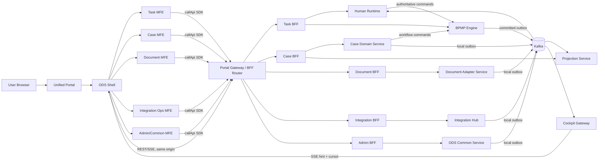

# ODS Microfrontend & Microservices Refactor Plan

## 1. Mục tiêu và phạm vi

Tài liệu này đề xuất kiến trúc đích và kế hoạch refactor BPMP Platform để bổ sung lớp ODS theo Domain-Driven Design, microfrontend (MFE), BFF và SDK, đồng thời giữ nguyên các invariant của workflow platform hiện tại.

Kết quả mong muốn:

- Mỗi bounded context có ownership rõ ràng đối với code, API, event và dữ liệu.
- Mỗi domain UI được build và deploy độc lập, được Shell nạp động tại runtime.
- Browser chỉ gọi Portal Gateway/BFF qua SDK chuẩn; không gọi trực tiếp domain service.
- Command đồng bộ dùng REST ở public edge và gRPC/Protobuf trong nội bộ; query public dùng REST; integration event/callback dùng Kafka.
- Mỗi request/operation được trace xuyên MFE -> Portal Gateway -> service -> Kafka consumer.
- Một MFE lỗi hoặc rollout lỗi không làm sập Shell hay MFE khác.
- Việc tách ODS không sao chép workflow state machine hoặc làm suy yếu quyền sở hữu của `bpmp-engine`.

Ngoài phạm vi của đợt refactor này:

- Viết lại WIR interpreter, `decide()`, `evolve()`, Raft hoặc Event Store.
- Chuyển authoritative event log từ RocksDB/Raft sang Kafka hoặc PostgreSQL.
- Cho ODS domain service ghi trực tiếp vào database của BPMP service.
- Big-bang rewrite toàn bộ Cockpit và toàn bộ backend.

## 2. Đánh giá hiện trạng và gap

Repo hiện tại đã có nền tảng microservices tương đối đúng ranh giới:

| Khối hiện tại | Vai trò giữ lại | Gap cần xử lý |
|---|---|---|
| `bpmp-engine` (Rust) | Workflow state, transition authz, idempotency, event log, outbox | Không tách hoặc đưa logic sang Workflow Adapter |
| `human-runtime` (Go) | Work-item projection, assignment, delegation, SLA | Mở contract phục vụ Task BFF; không trở thành owner workflow transition |
| `projection-service` (Go) | Rebuildable query/read model | Bổ sung projection theo nhu cầu Case 360/monitoring, không nhận command |
| `api-gateway` (Go) | Public REST facade, authn, rate limit, upstream resilience | Tiến hóa thành Portal Gateway; tách route composition khỏi domain policy |
| `cockpit-gateway` (Go) | SSE fan-out và reconnect cursor | Dùng chung realtime transport; thêm domain channel nhưng không thành source of truth |
| `configuration-service` | Versioned runtime policy/configuration | Bổ sung MFE catalog/runtime config có ký và version |
| `cockpit-web` | React shell + các feature page hiện tại | Tách dần thành Shell và remote MFE |
| Go observability packages | Correlation/tracing/logging plumbing | Chuẩn hóa thành SDK/middleware bắt buộc cho service mới |

Các chênh lệch công nghệ cần có quyết định trước khi code:

- `cockpit-web` hiện dùng React 19, TypeScript 7, TanStack Query và Zod; yêu cầu đích nêu TypeScript 5.8, SWR/Axios, Formik/Yup và MUI 7.
- Không nên duy trì hai data-fetching stack hoặc hai validation stack lâu dài. Phase 0 phải chọn một baseline duy nhất và lập migration rule.
- Nếu TypeScript 5.8/MUI 7 là chuẩn bắt buộc của Unified Portal, các package frontend mới phải pin theo chuẩn đó và Cockpit hiện tại cần compatibility lane trước khi hạ version. Nếu không phải constraint bắt buộc, giữ toolchain repo hiện tại và chỉ áp dụng React 19, MUI/shared-ui, Formik/Yup, Axios/SWR cho các form/domain mới theo ADR.
- MUI không được import trực tiếp từ MFE. Chỉ package `@ods/shared-ui` được phép phụ thuộc MUI và Emotion.

## 3. Nguyên tắc kiến trúc bắt buộc

1. `bpmp-engine` tiếp tục là owner duy nhất của WIR interpretation, workflow state, transition authorization và write-side idempotency.
2. Kafka là integration feed; Kafka outage không được rollback một command đã commit trong engine.
3. Mỗi service chỉ truy cập database/schema và credential của chính nó. Nhu cầu dữ liệu chéo đi qua API hoặc committed event.
4. Không tạo `common` chứa business logic. ODS Common là một bounded context nghiệp vụ cụ thể, không phải nơi đổ mọi đoạn code dùng chung.
5. Shared library chỉ chứa stable contract hoặc technical plumbing: UI primitives, generated client, telemetry, auth context, event envelope.
6. Browser không giữ client secret và không tự quyết định authorization. Mọi capability/role/task permission phải được backend kiểm lại trên resource cụ thể.
7. Mọi queue, retry, cache, connection pool, fan-out, batch và payload đều có giới hạn và overflow policy.
8. Không dùng distributed transaction giữa các service. Dùng local transaction + outbox/inbox + idempotency + saga/compensation khi cần.

## 4. Kiến trúc đích

### 4.1 Logical topology



`Portal Gateway` là public edge duy nhất cho ODS. Domain BFF có thể bắt đầu dưới dạng module trong cùng deployable để giảm chi phí vận hành, sau đó chỉ tách thành deployable độc lập khi có ít nhất một trong các dấu hiệu: release cadence khác biệt, tải khác biệt đáng kể, team ownership riêng, security boundary riêng hoặc blast radius không chấp nhận được.

### 4.2 Deployment topology

- Static assets của Shell và từng MFE được publish độc lập lên object storage/CDN bằng immutable path: `/assets/<app>/<version>/...`.
- Một signed `mfe-catalog.json` theo environment/tenant ánh xạ logical remote name tới `mf-manifest.json` cụ thể.
- Shell lấy catalog sau khi thiết lập session, validate schema/signature/allowlist rồi mới đăng ký remote.
- Portal Gateway, BFF và stateless domain services chạy Kubernetes `Deployment`, tối thiểu 2 replica production, topology spread qua AZ.
- `bpmp-engine` tiếp tục chạy `StatefulSet` 3 hoặc 5 member theo Raft quorum; không scale bằng HPA như stateless service.
- PostgreSQL/RDS, Kafka/MSK, Redis/Valkey và object storage là managed HA services hoặc operator được chuẩn hóa.

## 5. Bounded contexts và ownership

### 5.1 Service catalog đề xuất

| Bounded context / deployable | Owns | Data store | Không được sở hữu |
|---|---|---|---|
| Portal Gateway | OIDC/BFF session, CSRF, coarse authn, routing, rate limit, REST facade | Redis chỉ cho session/rate limit nếu cần | Domain decision, workflow state |
| Task BFF | UI-shaped worklist/task DTO, aggregation có giới hạn | Không có DB mặc định; cache ngắn hạn tùy nhu cầu | Work-item authoritative state |
| Case Service | Case aggregate, case number, product/case policy, draft version | PostgreSQL riêng | BPMP tokens/task state, document bytes |
| Case BFF | Case 360 composition và command facade | Không DB; optional bounded response cache | Case aggregate hoặc projection authoritative state |
| Document Adapter | CSP metadata mapping, upload session, signed URL policy, checklist link | PostgreSQL riêng cho ODS metadata | CSP object bytes nếu CSP là owner |
| Integration Hub | Adapter state, callback inbox, external operation ledger, circuit state | PostgreSQL riêng | Case aggregate, workflow state |
| ODS Common - Master Data | Versioned catalog, validity interval, code mapping | PostgreSQL riêng + bounded cache | Domain-specific rules |
| ODS Common - Notification | Notification preference/delivery/status | PostgreSQL riêng | Audit source of truth |
| ODS Audit Projection | Searchable audit projection từ committed events | OpenSearch/PostgreSQL riêng | Thay thế immutable business audit tại owner |
| BPMP Engine | Workflow state/event log/transition authz/idempotency | RocksDB + Raft | Case master data hoặc UI projection |
| Human Runtime | Work-item projection, assignment/delegation/SLA | PostgreSQL riêng | WIR interpretation |
| Projection Service | Rebuildable process/case-linked read model | PostgreSQL; OpenSearch chỉ sau benchmark | Commands |

Khuyến nghị không triển khai một `ods-common-service` khổng lồ. Có thể dùng một repository subtree và một product team, nhưng Master Data, Notification và Audit Projection cần module, schema migration, API và topic ownership riêng. Khi tải hoặc lifecycle khác nhau, tách deployable mà không đổi contract.

### 5.2 Aggregate và consistency boundary

| Aggregate | Owner | Transaction boundary | Cross-domain behavior |
|---|---|---|---|
| Case | Case Service | Case + draft + local audit ref + outbox trong một PostgreSQL transaction | Start workflow sau local commit; reconcile bằng event |
| Work Item | BPMP Engine authoritative; Human Runtime projection | Engine Raft command; Human Runtime local projection transaction | Không dùng Redis lock làm correctness boundary |
| Document Link | Document Adapter | Metadata + upload state + outbox | CSP operation dùng idempotency key; callback qua inbox |
| External Operation | Integration Hub | Request ledger + attempt + outbox/inbox | Retry bounded; compensation explicit |
| Master Data Set | Master Data | Version publication + outbox | Consumers cache immutable version, không remote call trên mỗi command |
| Notification | Notification Service | Notification record + delivery outbox | Delivery retry không rollback nghiệp vụ gốc |

## 6. Microfrontend architecture

### 6.1 Shell ownership

Shell chỉ sở hữu:

- Bootstrap OIDC/PKCE/BFF session và logout.
- Global layout, navigation, tenant/context selector và capability-driven route discovery.
- Runtime MFE catalog, remote loader, timeout, retry và compatibility checks.
- Shared providers: theme, locale, telemetry, API client, feature flags và realtime connection.
- Top-level ErrorBoundary, fallback UI và remote health telemetry.
- Cross-MFE navigation thông qua typed navigation contract.

Shell không sở hữu domain form, case rule, task rule hay document policy.

### 6.2 Remote MFE catalog

| MFE | Routes chính | Exposes | Team/domain owner |
|---|---|---|---|
| `task-mfe` | `/tasks/*` | route module, task widgets | Task/Human Workflow |
| `case-mfe` | `/cases/*` | route module, CaseSummary widget | Case Management |
| `document-mfe` | `/documents/*` và case tab | route module, DocumentPanel | Document/CSP |
| `integration-mfe` | `/integrations/*` | route module, OperationStatus | Integration |
| `admin-mfe` | `/admin/master-data/*`, notification settings | route module | ODS Common |
| `monitoring-mfe` | `/monitoring/*` | route module, SLA cards | Operations/Projection |

Mỗi remote chỉ expose một public surface nhỏ. Không import source file nội bộ giữa các MFE.

### 6.3 Module Federation runtime contract

- Dùng manifest thay vì hardcode `remoteEntry.js`; catalog trỏ tới `mf-manifest.json` immutable.
- Shared singleton bắt buộc: `react`, `react-dom`, router adapter, `@ods/shared-ui`, `@ods/call-api`, telemetry SDK.
- Không share mọi dependency. Formik/Yup/SWR/Axios chỉ share khi version policy và runtime test chứng minh an toàn.
- Remote export `mount`/route descriptor theo contract version, không truy cập trực tiếp global mutable state của Shell.
- Catalog có `contractVersion`, `minShellVersion`, `integrity`, `enabledTenants`, `requiredCapabilities` và rollback target.
- CSP chỉ cho phép CDN/asset origins đã pin; không nạp URL remote tùy ý do tenant/client gửi lên.
- CI chạy host-remote compatibility matrix cho current, previous và canary version.

### 6.4 Error isolation

Mỗi remote có ba lớp cô lập:

1. Loader boundary: timeout, manifest/schema/integrity failure -> fallback “module unavailable”.
2. React ErrorBoundary quanh route/widget -> lỗi render không làm unmount Shell.
3. Network boundary trong SDK -> typed `ProblemDetails`, retry chỉ cho idempotent request, circuit state hiển thị riêng.

Shell phải tiếp tục navigation và logout khi remote lỗi. Remote retry không reload toàn trang. Một widget embedded lỗi không làm hỏng route host.

### 6.5 Shared UI policy

- Chỉ `packages/frontend/shared-ui` được import `@mui/*` và `@emotion/*`.
- MFE import public components/tokens từ `@ods/shared-ui`.
- ESLint `no-restricted-imports` và dependency graph check chặn import MUI trực tiếp.
- Theme/token contract được version hóa; breaking token/component change tạo major version.
- Shared UI không chứa domain component như `CreditApprovalForm`; domain component ở MFE owner.
- Accessibility, keyboard, focus, contrast và visual regression là release gate của shared UI.

### 6.6 State ownership

- Server state: SWR hoặc stack được ADR chọn; cache key luôn gồm tenant và canonical query.
- Form state: Formik; validation UX dùng Yup nhưng server vẫn validate lại toàn bộ rule.
- URL state: router/Shell.
- Auth/session: BFF cookie `HttpOnly`, `Secure`, `SameSite`; browser không lưu refresh token.
- Realtime event: chỉ là hint để invalidate/refetch versioned server state.
- Cross-MFE state: route params, typed events hoặc SDK; cấm shared mutable store toàn cục cho domain data.

## 7. BFF, SDK và API contract

### 7.1 BFF pattern

Public path đề xuất:

```text
/api/tasks/v1/*          -> Task BFF
/api/cases/v1/*          -> Case BFF
/api/documents/v1/*      -> Document BFF
/api/integrations/v1/*   -> Integration BFF
/api/common/v1/*         -> Admin/Common BFF
/realtime/v1/*           -> Cockpit Gateway
```

BFF được phép compose một số query có deadline/fan-out/bulkhead rõ ràng. BFF không được tạo distributed transaction hoặc giữ business invariant. Command phải đi đến đúng owner và mang nguyên actor proof/idempotency/correlation context.

### 7.2 `callApi` SDK

`@ods/call-api` là đường duy nhất để MFE gọi API, với contract tối thiểu:

```ts
type CallApiOptions<TBody> = {
  method: "GET" | "POST" | "PUT" | "PATCH" | "DELETE";
  path: string;
  body?: TBody;
  signal?: AbortSignal;
  idempotencyKey?: string;
  timeoutMs?: number;
};

type ApiResult<T> =
  | { ok: true; data: T; requestId: string; correlationId: string }
  | { ok: false; problem: ProblemDetails; requestId: string; correlationId: string };
```

SDK chịu trách nhiệm:

- Same-origin base URL, credentials/CSRF header và content negotiation.
- Tạo `X-Request-ID`; nhận hoặc tạo `X-Correlation-ID` ở đầu business operation.
- Propagate W3C `traceparent` bằng OpenTelemetry browser instrumentation, không tự tạo `X-Trace-ID` tin cậy.
- Timeout, cancellation, response size guard và typed `application/problem+json`.
- Retry bounded chỉ cho GET hoặc command có idempotency key và policy cho phép.
- Không log token, request body nhạy cảm hoặc response PII.
- Generated endpoint clients/types từ OpenAPI 3.1; không copy DTO bằng tay giữa MFE.

### 7.3 API và event standards

- Public REST: OpenAPI 3.1, Problem Details, keyset pagination cho tập lớn.
- Internal synchronous: gRPC + versioned Protobuf; REST chỉ dùng khi dependency bên ngoài bắt buộc.
- Async: Protobuf payload trong Kafka envelope versioned.
- Callback từ external system đi qua Integration Hub ingress, verify signature/mTLS, ghi inbox trước khi ACK.
- Contract CI: lint, breaking check, clean codegen và consumer/provider tests.

Event envelope bắt buộc có:

```text
event_id, event_type, schema_version, tenant_id,
aggregate_type, aggregate_id, aggregate_version,
occurred_at, producer, correlation_id, causation_id,
traceparent (nếu có), payload
```

Topic naming theo topology repo: `bpmp.<bounded-context>.<purpose>.v<schema>.<environment>`. Partition key là aggregate ID khi cần ordering. Consumer dùng inbox/dedup, apply effect và checkpoint trong cùng local transaction.

## 8. Các luồng nghiệp vụ trọng yếu

### 8.1 Create Case và start workflow

1. `case-mfe` gửi command qua SDK với idempotency key.
2. Portal Gateway xác thực session, tenant, CSRF, capability thô; giữ correlation ID.
3. Case Service validate domain rule, commit Case + audit ref + outbox cục bộ.
4. Workflow start được gửi bằng idempotent command tới engine, mang actor proof và case business key.
5. Engine tái kiểm authorization, commit Raft/Event Store và outbox.
6. Nếu bước 4 thất bại tạm thời, Case ở trạng thái `WorkflowStartPending`; worker retry bounded. Không rollback/xóa Case.
7. Projection nhận committed events, cập nhật Case 360; UI hiển thị “accepted/synchronizing” cho tới khi projection bắt kịp.

### 8.2 Complete task

1. Task MFE nạp work item và `expected_version` từ Human Runtime qua Task BFF.
2. Submit mang idempotency key, expected version, form schema version và sanitized payload.
3. Domain validation cần thiết được Case Service kiểm trước hoặc được model hóa thành engine service task; không nhét arbitrary policy vào BFF.
4. Human Runtime forward original actor proof tới engine.
5. Engine là nơi cuối cùng authorize transition và commit.
6. UI nhận command receipt trước; trạng thái projection được reconcile qua SSE + refetch.

### 8.3 Document upload tối đa 50 MB

1. MFE xin upload session từ Document BFF.
2. Adapter kiểm capability, file metadata/size/type và tạo CSP upload intent/idempotency key.
3. Browser upload trực tiếp bằng signed URL nếu CSP hỗ trợ; token OIDC không nằm trong URL.
4. CSP/AV callback vào Integration Hub hoặc Document Adapter, được verify và deduplicate.
5. Chỉ sau `scan_passed` mới publish `DocumentAvailable`; file quarantine không được preview/download.
6. Download dùng signed URL TTL ngắn sau resource-level authorization.

### 8.4 External integration callback

1. Integration Hub authenticate source bằng mTLS/signature và enforce payload/time bounds.
2. Ghi callback inbox với external operation ID trong local transaction.
3. Duplicate trả lại kết quả trước đó; không apply effect lần hai.
4. Publish normalized integration event hoặc gửi signal command idempotent tới engine.
5. Circuit breaker state và retry/dead-letter được quan sát độc lập; failure không làm cạn goroutine/connection pool.

## 9. Security architecture

### 9.1 Authentication và session

- Unified Portal thực hiện OIDC Authorization Code + PKCE.
- Portal Gateway áp dụng BFF session: refresh/access token ở server-side encrypted session store hoặc encrypted `HttpOnly` cookie phù hợp policy; không lưu trong localStorage.
- Service-to-service dùng mTLS/workload identity. Workload identity không thay thế end-user actor proof.
- Tenant ID chỉ được derive/validate từ authenticated context; không tin header client độc lập.

### 9.2 Authorization model

- Portal capability quyết định module/menu có thể thấy, nhưng chỉ là UX/coarse gate.
- ODS domain role/policy được service owner kiểm trên resource/action.
- Task-based authorization được engine tái kiểm tại transition.
- BFF không tổng hợp quyền mới từ việc nó là trusted service.

### 9.3 Sensitive data, encryption và audit

- TLS 1.3 tại edge và mTLS nội bộ nơi platform hỗ trợ; at-rest encryption dùng KMS-managed keys cho RDS/S3/EBS.
- `@Masked`, `@Encrypted`, `@Auditable` được hiện thực bằng schema annotation/code generation hoặc typed wrapper + middleware, không bằng reflection/magic annotation không có enforcement.
- `mask-keys` là denylist bổ sung; mặc định logging dùng allowlist field. Token, actor proof, idempotency key, plaintext payload và PII không được log.
- Audit nghiệp vụ là committed record/event tại owner. OpenSearch chỉ là searchable projection, có thể rebuild, không phải immutable source of truth.
- Encrypted workflow event tiếp tục fail closed khi KMS/DEK lỗi; không có plaintext fallback.

## 10. Observability và monitoring

### 10.1 Correlation và tracing

Chuỗi định danh:

- Request ID: một HTTP/gRPC hop; gateway accept hợp lệ hoặc tạo mới và echo.
- Correlation ID: một business operation qua sync/async/retry/replay.
- Trace ID: chỉ lấy từ W3C Trace Context hợp lệ.
- Command ID/idempotency key: business correctness, không dùng thay correlation ID.

MFE -> Portal Gateway dùng `X-Request-ID`, `X-Correlation-ID`, `traceparent`, `tracestate`. Internal gRPC dùng metadata chuẩn repo. Outbox phải persist correlation/causation/trace context để publisher không phụ thuộc request context đã kết thúc.

### 10.2 Structured logging

JSON log schema tối thiểu:

```text
timestamp, severity, service.name, service.version, environment,
request_id, correlation_id, trace_id, span_id,
transport, operation, status_code, duration_ms,
tenant_id/actor_id/workflow_instance_id (chỉ sau auth và policy),
error.code, retryable
```

Collector nhận OTLP/log stream, mask lần hai, route về OpenSearch. Không dùng tenant/customer/case ID làm Prometheus label có cardinality cao.

### 10.3 Metrics và SLO

Mỗi service có RED metrics (rate, errors, duration) và USE metrics (utilization, saturation, errors). Dashboard tối thiểu:

- HTTP/gRPC/Kafka rate, error, p50/p95/p99 latency.
- CPU, memory, GC, goroutine/task count, pool saturation, queue depth.
- Kafka consumer lag, outbox age, inbox duplicate count, DLQ depth.
- Raft quorum/leader change/commit latency, RocksDB disk/compaction, KMS failures.
- Process instance duration, task completion rate, SLA/deadline breach, projection lag.
- External dependency availability, response time, timeout/retry và circuit state.
- MFE load time, remote load failure, render error, web vital và API error by logical app version.

Alert yêu cầu (`error > 5%`, `p95 > 5s`, `restart > 3/hour`) là baseline, nhưng production nên thêm duration/traffic window và burn-rate để tránh flapping. Alert bắt buộc cho quorum loss, outbox/projection lag, KMS fail-closed, disk pressure và reconciliation debt.

## 11. Availability, scaling và Kubernetes

- Stateless service: multi-AZ topology spread, anti-affinity, minimum 2 replicas, HPA theo CPU/memory và metric phù hợp như RPS, queue depth hoặc active connections.
- Engine: quorum-aware StatefulSet, PDB bảo vệ majority; scale bằng shard/Raft group, không HPA replica tùy ý.
- `readiness`: chỉ true khi service có thể phục vụ contract (DB/schema, required config snapshot, critical upstream/cache state).
- `liveness`: chỉ phát hiện process deadlock/unrecoverable state; không fail vì một dependency tạm thời lỗi.
- `startupProbe`: dành cho migration/cache/replay/startup dài.
- Graceful shutdown: mark unready -> ngừng nhận request -> drain HTTP/gRPC/SSE -> dừng poll Kafka -> hoàn tất bounded in-flight -> checkpoint/flush -> exit trước `terminationGracePeriodSeconds`.
- Rolling update: `maxUnavailable: 0` cho stateless critical service, readiness gate và preStop/drain; canary/traffic split cho Shell/MFE catalog.
- RDS Multi-AZ + PITR; Redis/Valkey cluster/failover nhưng không dùng làm source of truth; Kafka >= 3 broker, replication factor 3, `min.insync.replicas` phù hợp durability.
- PDB không thể tự bảo đảm HA; phải kết hợp replica count, topology, rollout policy, capacity headroom và AZ disruption test.

## 12. Target repository structure

```text
apps/
  web/
    ods-shell/
    task-mfe/
    case-mfe/
    document-mfe/
    integration-mfe/
    admin-mfe/
    monitoring-mfe/
  go/
    portal-gateway/          # evolve from api-gateway or new edge facade
    case-service/
    document-adapter/
    integration-hub/
    master-data-service/
    notification-service/
    ...existing BPMP services
packages/
  frontend/
    shared-ui/
    call-api/
    mfe-contract/
    telemetry/
    auth-session/
contracts/
  openapi/ods/{task,case,document,integration,common}/v1/
  proto/ods/{case,document,integration,common}/v1/
  events/                    # schema ownership/compatibility metadata
db/
  case-service/migrations/
  document-adapter/migrations/
  integration-hub/migrations/
  master-data-service/migrations/
  notification-service/migrations/
platform/
  helm/<one chart per deployable>/
  observability/{dashboards,alerts,collectors}/
  policies/{network,admission}/
tests/
  contract/
  mfe-compatibility/
  integration/
  chaos/
  performance/
```

Frontend nên dùng workspace package manager và lockfile duy nhất. Mỗi MFE vẫn có pipeline/image/artifact độc lập; shared source package không đồng nghĩa deploy cùng nhau.

## 13. Kế hoạch migration theo phase

### Phase 0 - Discovery, ADR và baseline (2-3 tuần)

Deliverables:

- Context map, data classification, API/event inventory, dependency graph và workload/SLO baseline.
- ADR cho MFE runtime, frontend stack, BFF granularity, database isolation, event envelope, ODS Common boundary và auth session.
- Chọn một vertical slice: Personal Worklist + Case Summary read-only.
- Ghi traffic/cardinality: concurrent users, task/case count, query ratio, payload, document throughput, latency/SLA và retention.

Exit criteria:

- Không còn ownership mơ hồ cho Case, Task, Document, Integration, Master Data, Notification, Audit.
- Quyết định rõ TypeScript 5.8 so với toolchain hiện tại, SWR so với TanStack Query, Yup so với Zod.
- Có rollback plan và measurable success criteria.

### Phase 1 - Platform foundations (3-5 tuần)

Deliverables:

- `ods-shell`, signed runtime catalog, remote loader và remote ErrorBoundary.
- `@ods/shared-ui`, `@ods/call-api`, MFE contract và lint boundary.
- Portal Gateway BFF session, CSRF, standard Problem Details và telemetry propagation.
- CI template: build, test, SBOM, signing, manifest publish, compatibility matrix.
- Helm baseline: probes, drain, HPA/PDB, NetworkPolicy, OTel.

Exit criteria:

- Demo remote độc lập deploy/rollback mà không rebuild Shell.
- Remote hỏng manifest, timeout hoặc render lỗi không làm Shell sập.
- Correlation/trace đi xuyên browser -> gateway -> mock/domain service -> Kafka test consumer.

### Phase 2 - Task vertical slice (4-6 tuần)

Deliverables:

- `task-mfe` với personal/group/unit worklist, filter, claim/unclaim/complete/delegate.
- Task BFF facade trên Human Runtime/Engine contract hiện tại.
- SLA indicator, task history và idempotent submission.
- SSE hint + reconcile/refetch; projection staleness UX.

Exit criteria:

- Engine vẫn là final transition authz/idempotency owner.
- Duplicate/reordered event, retry và concurrent claim tests pass.
- P95 và error budget đạt baseline dưới representative load.

### Phase 3 - Case domain (5-8 tuần)

Deliverables:

- Case Service database/migrations/outbox/inbox.
- `case-mfe`, Case BFF, create/search/360/timeline/process tracker.
- Saga tạo Case -> start workflow và reconciliation state.
- Projection event mapping, OpenSearch chỉ nếu PostgreSQL FTS/query benchmark không đạt.

Exit criteria:

- Không cross-service SQL.
- Create Case retry không sinh duplicate case/workflow.
- Case 360 thể hiện rõ projection version/staleness.

### Phase 4 - Document và integrations (6-10 tuần)

Deliverables:

- Document Adapter + `document-mfe`: upload/download/list/preview/checklist/OCR trigger.
- Integration Hub với adapter ports cho T24/ESB, AML, RPA, IDP/OCR và callback inbox.
- Circuit/bulkhead/deadline/retry/compensation ledger cho từng external dependency.
- Quarantine/virus scan và signed URL flow.

Exit criteria:

- 50 MB boundary, malware, timeout, duplicate callback, late callback và partial failure tests pass.
- External outage không gây cascade hoặc unbounded queue.

### Phase 5 - ODS Common và operations (4-6 tuần)

Deliverables:

- Versioned Master Data và cache invalidation.
- Notification persistence/delivery outbox.
- Audit projection/search và retention policy.
- `admin-mfe`, `monitoring-mfe`, dashboards, alert rules, runbooks.

Exit criteria:

- Audit source/projection distinction được kiểm chứng bằng rebuild.
- Mất Redis/OpenSearch không làm mất authoritative business state.
- Alert drill và on-call runbook được thực hành.

### Phase 6 - Cutover và hardening (3-5 tuần)

Deliverables:

- Route-by-route strangler cutover từ `cockpit-web` sang Shell/remotes.
- Canary theo tenant/capability, rollback catalog trong vài phút.
- Load/soak/chaos/DR/security test, data migration reconciliation và decommission checklist.

Exit criteria:

- Hai release ổn định không cần rollback; SLO và business reconciliation đạt ngưỡng.
- Route cũ chỉ xóa sau khi telemetry chứng minh không còn traffic và dữ liệu đã đối soát.
- Restore RDS, Kafka replay, projection rebuild và Raft recovery đã diễn tập.

Tổng thời lượng tham chiếu: 27-43 tuần cho một chương trình nhiều team. Có thể song song Phase 3 và 4 sau khi Phase 1 hoàn thành, nhưng không song song hóa contract nền khi chưa freeze.

## 14. Work breakdown và team topology

| Stream | Trách nhiệm | Phụ thuộc chính |
|---|---|---|
| Platform/MFE Enablement | Shell, federation, shared UI, SDK, CI/CD | ADR frontend và security |
| Portal/API | Gateway, BFF session, OpenAPI, authn, rate limit | Unified Portal/OIDC |
| Task/Workflow | Task MFE/BFF, Human Runtime contracts | Engine/Human Runtime |
| Case | Case MFE/BFF/service/data | Task/workflow contracts |
| Document | Document MFE/adapter/CSP | CSP, AV, KMS |
| Integration | Hub, connectors, callbacks, operations | External system owners |
| Common/Data | Master data, notification, audit projection | Kafka/configuration |
| SRE/Security | K8s, observability, HA, threat model, DR | Tất cả streams |

Mỗi stream có một domain owner, một technical owner và SRE/security reviewer. Shared packages có maintainer và compatibility policy riêng; không để mọi team merge trực tiếp không review.

## 15. Quality gates

### Frontend/MFE

- Unit/component tests, React Testing Library, Playwright critical flow, visual/a11y regression.
- Host/remote compatibility matrix current-1/current/current+canary.
- Bundle budget, initial load, remote load P95, memory/listener leak và error isolation test.
- ESLint chặn direct MUI import, raw Axios/fetch ngoài `callApi`, cross-MFE source import.

### Contracts/data/messaging

- OpenAPI/Buf lint + breaking check + generated-code drift.
- Consumer/provider contract tests.
- Outbox/inbox crash tests: before commit, after commit-before-publish, after effect-before-checkpoint.
- Migration forward/rollback compatibility, representative query plan và rebuild test.

### Security/reliability

- Authz negative tests: cross-tenant, forged tenant header, confused deputy, stale actor proof, replayed idempotency key.
- SAST/SCA, image scan, SBOM, provenance/signature, secret scan.
- Chaos: Kafka outage, RDS failover, Redis loss, external timeout, pod/AZ disruption, Raft leader loss, KMS failure.
- Graceful shutdown, connection drain, retry storm, slow consumer và overload shedding.

### Performance acceptance

Threshold phải được chốt sau Phase 0. Tối thiểu đo:

- Portal API p50/p95/p99 và error rate theo endpoint.
- Worklist/Case search với production-like cardinality và filter distribution.
- Case create/task complete end-to-end commit latency và projection convergence lag.
- 50 MB upload throughput/memory; không buffer toàn file trong BFF.
- Kafka lag/recovery, SSE concurrent connections và per-connection bounded memory.

## 16. Cutover, rollback và data migration

- Dùng route-level strangler: Shell có thể mount trang legacy qua adapter trong thời gian chuyển tiếp, nhưng không cho legacy và new owner cùng ghi một aggregate.
- Chọn một write owner tại mọi thời điểm. Dual-read/shadow-read được phép; dual-write chỉ dùng outbox/event replication có reconciliation, không ghi trực tiếp hai DB từ request path.
- Backfill theo snapshot + watermark + CDC/event catch-up; kiểm count, checksum/business invariant trước cutover.
- Mỗi migration có `expand -> migrate/backfill -> switch -> contract`, tối thiểu một release compatibility giữa expand và contract.
- Rollback frontend bằng đổi signed catalog về manifest cũ. Rollback service chỉ khi contract và migration backward-compatible; nếu không thì roll-forward.
- Không rollback/xóa committed engine event. Projection lỗi được sửa và rebuild/replay.

## 17. Rủi ro chính và biện pháp

| Rủi ro | Tác động | Biện pháp |
|---|---|---|
| Tách service theo danh từ kỹ thuật thay vì domain | Chatty network, distributed monolith | Context map + aggregate/transaction boundary trước khi tạo repo/module |
| MFE chia quá nhỏ | Bundle/runtime/version complexity | Tách theo team/domain/route; widget chỉ khi có reuse thật |
| Shared UI/SDK trở thành monolith | Release coupling | Public API nhỏ, semver, deprecation window, compatibility test |
| BFF chứa business logic | Policy drift và khó audit | Handler/composition only; domain decision tại owner |
| “ODS Common” thành shared database | Mất ownership | Module/schema/API/event riêng, credential riêng |
| Redis lock cho task claim | Split brain/correctness loss | Engine/versioned command là authoritative |
| Kafka được coi là event store | Mất durability/order semantics | RocksDB/Raft authoritative; transactional outbox |
| Version stack bị ép downgrade | Regression/tooling fragmentation | ADR + compatibility spike trước Phase 1 |
| High-cardinality telemetry/PII | Chi phí và data leak | Label allowlist, log field allowlist, collector masking |
| Big-bang cutover | Rollback khó, downtime | Vertical slice + route/tenant canary + strangler |

## 18. ADR cần phê duyệt trước Phase 1

1. ADR-MFE-001: Module Federation runtime, signed manifest/catalog và compatibility contract.
2. ADR-FE-002: Frontend baseline chính thức và migration từ stack hiện tại.
3. ADR-API-003: Portal Gateway, BFF granularity và `callApi`/OpenAPI generation.
4. ADR-DATA-004: Database-per-bounded-context, outbox/inbox và migration ownership.
5. ADR-EVENT-005: Kafka event envelope, topic ownership, partitioning và schema evolution.
6. ADR-COMMON-006: Master Data, Notification và Audit boundaries; cấm shared business database.
7. ADR-SEC-007: Unified Portal OIDC/PKCE/BFF session, actor proof và tenant trust.
8. ADR-OBS-008: W3C trace/correlation/log schema, masking và telemetry retention.
9. ADR-DEPLOY-009: Multi-AZ, probes, HPA/PDB, rollout/canary và DR objectives.

## 19. Definition of Done toàn chương trình

Refactor chỉ được coi là hoàn thành khi:

- Tất cả route mục tiêu chạy qua Shell/MFE độc lập; catalog có rollback đã diễn tập.
- Mỗi bounded context có owner, contract, DB credential, migration và runbook riêng.
- Không có cross-service SQL, direct MUI import từ MFE, raw API call ngoài SDK hoặc workflow decision ngoài engine.
- Correlation/trace hoạt động qua sync + async; logs đã mask và audit có thể đối soát.
- SLO, alert, graceful shutdown, failover, backup/restore, projection rebuild và Kafka replay có bằng chứng test.
- Security gates, contract gates, chaos/load tests và business reconciliation pass.
- Legacy route/service/schema chỉ bị loại bỏ sau deprecation window và xác nhận zero traffic/zero dependency.

## 20. Bước tiếp theo trong 10 ngày làm việc

1. Workshop context mapping với BPMP, ODS, Portal, CSP và Integration owners.
2. Thu thập workload/SLO và inventory API/database/topic hiện tại.
3. Chốt ba ADR đầu: frontend baseline, federation/catalog, Portal Gateway/BFF.
4. Tạo spike `ods-shell` nạp một `task-mfe` read-only qua manifest runtime.
5. Tạo `@ods/call-api` dựa trên contract observability hiện có của repo.
6. Trace một flow demo browser -> gateway -> Human Runtime -> Kafka -> SSE.
7. Chạy failure demo: remote 404, render exception, gateway timeout và Kafka unavailable.
8. Từ kết quả spike, estimate lại Phase 1/2 và freeze contract v1.

## 21. Tài liệu tham chiếu trong repo

- `requirements.md`
- `design.md`
- `microservices-architecture.md`
- `docs/cockpit-web-architecture.md`
- `docs/api-and-observability-contract.md`
- `docs/kafka-topology.md`
- `docs/production-deployment-process.md`
- `docs/build-and-deploy.md`
