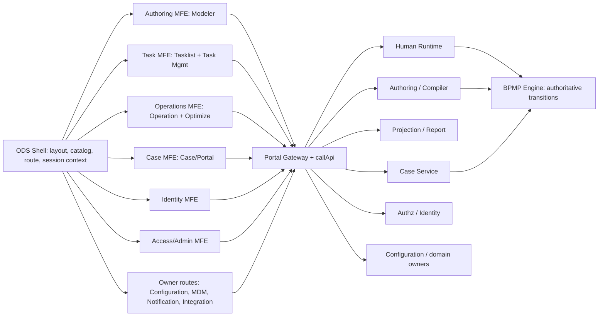

# BPMP Prototype UI → ODS Architecture Map

Ngày rà soát: 2026-11-24 (Asia/Saigon)

Tài liệu này phân loại các workspace trong `bpmp-prototype/` vào ODS Shell, domain MFE và API owner. Đây là hướng dẫn triển khai theo bounded context, không xác nhận những API `proposed` đã tồn tại hay phê duyệt các quyết định còn mở. Inventory từng control vẫn nằm trong [UI/API mapping](refactor-prototype/ui-api-mapping.md) và [CSV](refactor-prototype/ui-api-mapping.csv); trạng thái API được đối chiếu ở [BPMP Feature API Coverage](bpmp-feature-api-coverage.md).

Kế hoạch port theo journey, inventory counts, source risks, implementation waves, dependencies và acceptance criteria chi tiết: [ODS Prototype Porting Plan](ods-prototype-porting-plan.md).

## Quy tắc phân lớp

| Lớp | Trách nhiệm | Không đặt ở lớp này |
|---|---|---|
| ODS Shell | Logo, sidebar/navbar, route discovery từ signed catalog, tenant/session context đã được xác thực, capability-based visibility, breadcrumb, theme/locale, remote loading/error boundary và typed navigation | Form nghiệp vụ, danh sách nghiệp vụ, domain validation, policy/transition hoặc dữ liệu giả để làm menu có vẻ hoạt động |
| `@ods/shared-ui` | Primitive trình bày/accessibility dùng lại: button, field, table shell, dialog, status/loading/error, spacing/token | API call, tenant rule, domain form, permission decision hoặc event business |
| Domain MFE | Trang, form, filter, selection, action dialog, pending/conflict/reconciliation UI của đúng bounded context | Gọi service nội bộ trực tiếp, giữ bearer token, tự cho phép command hoặc coi click là commit |
| Portal Gateway/BFF + `@ods/call-api` | Same-origin REST, session/CSRF, coarse authn, request mapping, bounded query composition, correlation/idempotency metadata, Problem Details | Aggregate/domain policy, database chéo, authoritative workflow state |
| Domain service / BPMP owners | Authorization theo resource, validation, persistence, version/idempotency, audit và event outbox tại consistency boundary sở hữu | Ghi sang database của service khác |
| Realtime | Shell/Gateway xác thực subscription; event chỉ mang cursor/invalidation hint; MFE query lại qua BFF | Browser đọc Kafka hoặc coi payload SSE là state chuẩn |

Event handler được phân loại theo effect: điều hướng thuộc Shell; tab/modal/theme/sort draft không có business effect thuộc local UI state; query đi tới read API owner; command đi tới domain BFF với `expected_version`/idempotency khi contract yêu cầu. `401/403`, validation, `409`, timeout-indeterminate, upstream failure, partial receipt và projection lag phải có trạng thái UX riêng. Retry chỉ dùng đúng command identity và payload cũ. Các nút prototype đang đổi `useState`/mock data không được coi là persistence.

## Bản đồ workspace prototype

| Prototype area | UI thuộc về | API/data owner và hướng nối | Hiện trạng ODS / bước triển khai |
|---|---|---|---|
| **Client Portal** | Case MFE cho create/search/detail/timeline của Case. Nếu có portal dành riêng cho khách hàng, tách route/MFE persona sau khi chốt DOM-03; Shell chỉ cung cấp route/session context. | Case BFF → Case Service cho aggregate; start workflow qua saga idempotent tới Engine. Workflow catalog/start phải gọi owner API; không tự thêm instance vào React state. | Đã có Case service/MFE local preview và loopback boundary, nhưng dùng identity cố định, chưa phải authenticated Gateway BFF hoặc live workflow start. Không công bố như production route. Chờ Phase 1/2 gates và live Authz/Engine/inbox/freshness evidence. |
| **Modeler** | Authoring MFE: BPMN, DMN, Form draft/editor/version/validate/check-in. Canvas/editor state ở MFE; source revision thuộc Authoring. | Gateway Authoring facade → Authoring Service; Compiler validate/produces artifact; Engine chỉ nhận deployment/activate intent theo contract. | Đã có Studio MFE/API-backed authoring slice. Giữ giới hạn BPMN canvas đã nêu; topology chưa hỗ trợ vẫn source-only. Khi tách, đặt dưới `authoring-mfe`, không đưa editor vào Shell hoặc shared-ui. |
| **Operation** | Operations/Monitoring MFE cho process explorer, instance detail, event/timeline read, saved query và export status. Các task action deep-link sang Task MFE hoặc dùng Task command facade. | Query/export → Projection/Report owner; mọi workflow transition vẫn đi Task BFF/Human Runtime → Engine. Projection chỉ là read model. | Cockpit hiện có một số trang query, nhưng chưa có ODS Operations MFE trong catalog. Port theo từng route với pagination, permission-before-aggregate, `asOf`/freshness và export lifecycle; không thêm command vào Projection. |
| **Optimize** | Operations/Monitoring MFE (dashboard, throughput/health/heatmap) dùng widget/query contract; chart không phải owner riêng. | Projection aggregate/saved dashboard/query; Report service chỉ khi report API/owner được phê duyệt. Authorization phải ở query owner trước aggregate/export. | Chưa có ODS remote. Prototype metrics dùng mock data; trước khi port mỗi số liệu phải ghi định nghĩa, query source, permission, refresh/checkpoint và stale state. Không tạo API giả chỉ để lấp chart. |
| **Identity** | Identity MFE/route riêng, tách khỏi policy editor nếu lifecycle, persona hoặc security boundary độc lập. Shell chỉ hiển thị route theo capability hiện tại. | Keycloak là credential/directory source; Authz sở hữu tenant membership, subject link, role grant/revoke và audit theo API Gateway/Authz contract. Organization tree có owner/API riêng. | Gateway có OIDC session và một phần identity profile/role operations; không đồng nghĩa toàn bộ directory/org/branch parity đã xong. Chỉ bật controls có runtime route, upstream readiness và resource authorization; tenant switching không được đổi client-side header tùy ý. |
| **Access** | Access/Admin MFE cho action/resource catalog, policy draft/validate/publish, bundle rollout/acknowledgement và audit. Không trộn với Shell menu policy. | Gateway Access facade → Authz Control Plane; resource owners là PEP và cung cấp action catalog; assignment/queue policy thuộc Human Runtime. | Studio hiện có AccessWorkspace và API facade cho catalog/assignment policy. Có thể giữ trong Studio làm migration bridge; kiến trúc đích đặt Access dưới Admin/Access route riêng khi release/security ownership cần tách. Nút publish phải gắn immutable validated version và acknowledgement result, không optimistic success. |
| **Task Mgmt** | Task MFE admin route/section cho queue và assignment policy; tách khỏi Tasklist bằng route, capability và navigation group. | Task BFF → Human Runtime assignment/queue API; Engine vẫn quyết định transition cuối. Authz/resource owner cấp capability và row policy; queue config không tự cấp quyền complete. | Queue read/assignment policy hiện có; Studio có UI policy lifecycle. Đưa về Task MFE khi domain owner/API boundary thống nhất, không copy policy logic. Branch/unit worklist còn chờ DOM-02/cursor contract; không thêm bộ lọc unit trước approval. |
| **Tasklist** | Task MFE: personal/group worklist, detail, form output, claim/unclaim/delegate/complete, history và partial bulk result. | Task BFF → Human Runtime query/assignment; Engine quyết định và commit workflow transition; Authoring cung cấp published form; history compose bounded Engine + Human Runtime evidence. | ODS Task MFE đã có list/detail/actions/history/partial bulk. Realtime SSE và latency/freshness acceptance còn mở; command receipt phải tách khỏi projection convergence. Unit worklist và atomic bulk hiện chưa được bật. |
| **Foundation** | Chia theo owner thay vì một “Foundation MFE”: configuration profile vào Configuration/Admin route; MDM vào Master Data route; notification preference/delivery vào Notification route; endpoint/integration setup vào Integration Ops route; endpoint catalog chỉ là environment-admin tooling nếu có owner/secret flow. | Configuration Service sở hữu versioned profile; MDM, Notification, Integration Hub có persistence/API riêng. Secrets/credentials giữ trong secret manager/service boundary, không gửi browser hoặc lưu local/session storage. | Studio có ConfigurationWorkspace và current profile lifecycle API. Master Data, Notification và Integration còn proposed; prototype endpoints modal/local settings không được port như business feature. Không đưa URL/secret arbitrary vào browser. |

## Thứ tự triển khai và bật menu

1. **Hoàn tất local Phase 1 release rehearsal trên Docker Desktop.** Signed catalog promotion, readiness failure và rollback được kiểm tra trong namespace/release local riêng; ghi nhận đây là bằng chứng local, không phải staging. Không chờ cloud để tiếp tục implementation.
2. **Tiếp tục Phase 2 Task song song với local rehearsal.** Review DOM-02 Unit Worklist/cursor contract; sau đó làm session-authenticated invalidation proxy, bounded SSE reconciliation, cross-tenant/revoke/cursor-gap coverage và workload đại diện cho p95/projection freshness. Authorized staging promotion là deployment gate riêng; Authoring/Engine live restart evidence vẫn theo dõi riêng trong ledger.
3. **Case tiếp tục là implementation pre-entry.** Nối authenticated Case BFF, live Engine start/reconciliation, inbox/dedup và Case 360 freshness trước khi catalog bật Case như domain route đủ chức năng.
4. **Port prototype đã có API theo owner, route-by-route.** Modeler/Authoring, Access, Configuration, Task Mgmt và Operation không cần rewrite vào Shell; trước khi bật từng control, nối current API, capability và loading/empty/403/409/retry states. Cập nhật UI/API mapping với browser walkthrough.
5. **Tạo domain slice mới sau owner contract.** Client persona/Case, Documents, Integrations, Identity directory/org, MDM, Notification, Reporting chỉ bật sau contract v1, data/event owner, authorization, idempotency, retention và failure acceptance của service tương ứng.

Catalog production chỉ liệt kê remote đã publish, tương thích contract, allowed origin và capability đáp ứng. Local preview có thể chọn một remote để cô lập demo; không dùng danh sách static prototype hoặc route name làm bằng chứng một API/service sẵn sàng.

## Review evidence và giới hạn

- API/action inventory: [UI/API mapping](refactor-prototype/ui-api-mapping.md), [interaction inventory](refactor-prototype/interaction-inventory.md), [domain readiness](refactor-prototype/domain-readiness.md).
- Runtime vs proposed operation: [BPMP Feature API Coverage](bpmp-feature-api-coverage.md) và Gateway runtime OpenAPI. Route registration/upstream configuration không đồng nghĩa deployment acceptance.
- Phase 1/2/3 gates và blockers: [ODS Refactor Progress](ods-refactor-progress.md).
- `bpmp-prototype/` là nguồn UI tham khảo nguyên khối, có local/mock state. UI owner phải walkthrough từng action; `reviewState=PENDING_SOURCE_AND_BROWSER_REVIEW` không được tự đổi thành approved chỉ qua source scan.
