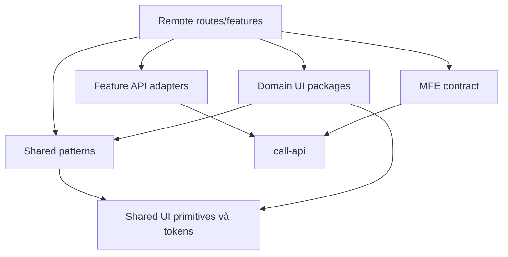

# Component system cho BPMP microfrontend

## Nguyên tắc và baseline

`packages/frontend/shared-ui/src/index.tsx` hiện cung cấp MUI theme, Page, ShellHeader, LoadingPanel, ErrorPanel, SimpleList, SlaBadge, StalenessIndicator và StatusPanel. Prototype dùng Tailwind và rất nhiều JSX lặp. Đích là mở rộng component API dựa trên package đang có; tái tạo visual language bằng design tokens, không đưa đồng thời hai bộ primitive toàn cục vào Shell. Lựa chọn này là đề xuất theo baseline repo, chưa có visual parity approval.

Tái sử dụng theo semantics và behavior, không chỉ vì hai màn hình cùng có một hộp trắng. Business logic thuộc domain; generic primitive không import domain DTO, không fetch hoặc biết tenant. Không ép mọi feature vào DataTable có hàng chục boolean props.

## Phân tầng và dependency graph



Các package mới dưới đây là đề xuất, không phải package đã tồn tại:

| Tầng | Package / thành phần | Contract và điều cấm |
|---|---|---|
| Tokens/primitives | `@ods/shared-ui`: colors, spacing, density, typography, focus, motion; Button/IconButton, Field, Badge, Dialog, Drawer, Tabs, Tooltip | Controlled props, semantic HTML, no API/tenant/business imports; icon-only phải có accessible name |
| Patterns | `@ods/ui-patterns`: PageLayout, FilterBar, QueryTable, Pagination, EmptyState, ConfirmAction, BulkActionBar, CommandStatus, AsyncBoundary | Loading/empty/error/forbidden/stale states; typed slots; không biết TaskItem hoặc ProcessInstance |
| Forms | `@ods/form-renderer`: typed field registry, renderer, error summary, conditional visibility | Versioned schema và value contract; server validation vẫn authoritative; không eval JavaScript từ schema |
| Diagram | `@ods/process-viewer`: read-only canvas, minimap, zoom, execution overlays, node inspector | Version+node IDs, immutable diagram input; không kéo cả editor/compiler vào viewer bundle |
| Domain task | `@ods/task-ui`: TaskSummary, TaskForm, AssignmentPicker, SlaIndicator, TaskHistory | Presentational; mutation thông qua callbacks typed; dùng chung Task route và officer panel |
| Domain case | `@ods/case-ui`: CaseSummary, DocumentChecklist, CommentThread, Timeline | Public/internal DTO tách riêng, không chỉ hide internal field bằng CSS |
| Domain authoring | `@ods/modeler-ui`: palette, properties, BPMN editor; `@ods/decision-ui`: table/visual editor, version diff | Draft reducer và validator dùng chung; layout components không tự publish/deploy |
| Feature | MFE `features/*/{api,model,ui}` | Orchestrate query/command, authorize UI affordances, map DTO sang view model; không import feature/remote khác |
| Shell | `ods-shell` | Navigation/session/tenant/theme/locale/catalog/error isolation; không chứa task/case aggregate state |

Trước khi tạo domain package, cần ít nhất hai consumer có cùng semantics hoặc public API đã được review. Component một consumer giữ local feature để tránh abstraction sớm. Editor/viewer là trường hợp cần boundary rõ do bundle và lifecycle khác nhau.

## API mẫu và command state

```ts
// Target shape minh họa; không thay RemoteRouteProps hiện hữu trực tiếp.
type CommandState =
  | { phase: 'idle' }
  | { phase: 'submitting'; commandId: string }
  | { phase: 'reconciling'; commandId: string; committedVersion: number }
  | { phase: 'confirmed'; committedVersion: number }
  | { phase: 'failed'; kind: 'validation' | 'forbidden' | 'conflict' | 'transport'; message: string };

interface TaskActionIntent {
  taskId: string;
  expectedVersion: number;
  outcome: 'APPROVE' | 'REJECT' | 'SENDBACK';
  formVersion: string;
  values: Readonly<Record<string, unknown>>;
  reason?: string;
}
interface TaskActionPanelProps {
  allowedOutcomes: readonly TaskActionIntent['outcome'][];
  state: CommandState;
  onSubmit(intent: TaskActionIntent): Promise<void>;
}
```

Controller tạo stable intent/key, giữ payload khi retry; view không tự tạo command ID mỗi render. Receipt có thể pending, nên component không hiện success chỉ vì HTTP 202. Disable theo submitting/reconciling nhưng server vẫn phải xử lý double-click/race. Conflict hiển thị diff/refresh, không silent retry. Announce status bằng live region; giữ focus tại lỗi hoặc action có thể sửa.

## State, caching và events

- Local state: drawer, zoom, selection, unsaved form, editor history. URL: route, resource ID, tab, authorized filter/cursor khi thích hợp. Server state: query cache có key gồm tenant + actor/policy scope + resource + filter.
- Dùng platform `callApi` hiện có; cookie/CSRF và trace theo contract hiện hữu. API adapter không trả domain class mang mutable global state.
- Shell-owned session/tenant context đổi phải abort in-flight fetch, dispose subscription và clear data từ scope cũ. Không chỉ đổi tên tenant ở header.
- Remote communication qua navigation hoặc typed invalidation hint có versioned envelope. Không dùng shared Redux store/event bus chứa toàn bộ entity; không cho một remote gọi callback sửa instance state của remote khác.
- SSE có thể lặp/mất kết nối; chỉ invalidate/refetch. Reconnect theo cursor; unknown cursor/full gap bắt buộc reload query, không giả dữ liệu đã đồng bộ.

## Tách các component nguyên khối

| Source prototype | Feature split | Phần tái sử dụng |
|---|---|---|
| IdentityModule | users, roles, permissions, resources, service-accounts; riêng query/selection/bulk controller | QueryTable, SelectionToolbar, RolePicker, BulkResultDialog |
| ClientPortalModule | service-catalog, request-wizard, request-list/detail, document-upload, comments, officer-task | FormRenderer, DocumentChecklist, TaskActionPanel, Timeline |
| DmnTableModule | draft reducer, clauses/rules, validation, evaluation, version history/diff/export | Decision schema/validator dùng chung table và visual editor |
| ModelerModule | process library, editor shell, graph controller, palette/properties, publish/deploy | Read-only ProcessViewer cho Portal/Operations/Optimize |
| OperationModule | instance query, instance detail, cancel/migrate/move command dialogs | QueryTable, DryRunSummary, ConfirmAction, per-item results |
| FoundationModule | template creation, assignment policy, document/notification settings, endpoint registry | Config editors thuộc feature owner; không generic JSON editor cho tất cả |

## Chất lượng và release contract

Mỗi shared component cần API examples và fixture states: normal, loading, empty, long text, forbidden, validation error, transport error, conflict, stale, dark/light, keyboard-only, narrow viewport và Vietnamese text. Dialog/drawer giữ focus trap/restore và Escape; destructive action có reason/confirmation khi policy yêu cầu. Form label/error liên kết input; table có header/selection label; chart có text/table equivalent; giảm animation theo user preference.

Kiểm thử behavior và accessibility bằng stack Vitest/Testing Library/Playwright hiện có; visual snapshots có review cho component chung và màn hình đại diện. Không dùng snapshot JSX làm bằng chứng correctness của workflow. Thêm component explorer khi có quyết định tooling; repo chưa có Storybook nên không ghi là công cụ hiện hữu.

Shared package release dùng semantic version và changelog; remote bundle pin phiên bản tương thích. Peer/shared React không load hai runtime không tương thích. MUI/theme/provider compatibility cần kiểm thử Shell + remote; không singleton mọi business package. CSS scope theo remote; token API qua theme/CSS variables, cấm global reset trong remote và selector phá Shell. Dependency checker chặn remote-to-remote imports, domain-to-feature imports và cycles.

MFE độc lập phải build/test/deploy mà không rebuild mọi remote. Promotion chỉ sau compatibility/render isolation/auth tests; rollback catalog không được phụ thuộc migration destructive. Bundle budget, route lazy load và diagram/editor split phải đo từ build thực; chưa chốt số KB hoặc SLO khi chưa có baseline.

## MDM Admin và reference components

MDM MFE là remote quản trị theo capability; route catalog vẫn thuộc Shell. Feature model/dataset/publication/consumer-status độc lập controller, dùng shared patterns. Tái sử dụng ReferencePicker, SchemaForm, VersionDiff và ValidationReport theo [thiết kế MDM](mdm-service.md). Form renderer nhận schema version và reference query descriptors, không import MDM feature hoặc tự gọi service cho mỗi field. Feature/BFF prefetch ResolveBatch theo dependency closure; query keys bao gồm tenant, authorized scope, model/schema, release và filter. ReferencePicker trả key + release reference; server resolve/validate lại khi submit. Không dùng object từ UI làm trusted master data evidence.
