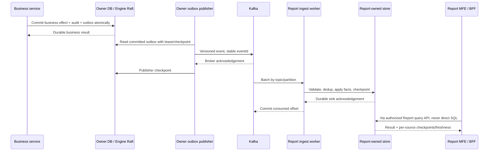

# Service–database và kiến trúc Reporting

Trạng thái: **current inventory + proposed extension**, cập nhật 2026-11-10. Dòng Current là theo source/docs hiện có; các database/contract/report worker ghi Planned chưa được triển khai. Không đổi quyền sở hữu dữ liệu ở ADR-004/011.

## 1. Service nào đi với database nào?

Các tên `*_db` dưới đây là **logical deployment names đề xuất**, không khẳng định tên database/DSN đang chạy. Database owner có credential, migrations, backup/restore và capacity budget riêng. Có thể dùng chung PostgreSQL cluster trong giai đoạn đầu với database/role riêng; khi cần failure/resource isolation mạnh thì tách instance/cluster. Không cho cross-service SQL/JOIN ngay cả khi cùng cluster.

| Service/context | Database / storage | Sở hữu và cách dùng | Trạng thái / evidence |
|---|---|---|---|
| BPMP Engine Server | RocksDB mỗi Raft node; replicated Raft log/state | Workflow events, snapshots, tokens, audit, receipts, outbox; **không PostgreSQL** và không đọc trực tiếp từ Report | Current; architecture baseline và RocksDB adapters |
| BPMN Compiler | Không có business DB; signed artifact storage | Compile artifact/WIR; library/compiler process không tự tạo DB mới | Current |
| Authz Control Plane | PostgreSQL `authz_db` | Policy, tenant lifecycle, signed publication/revocation source | Current; `apps/rust/authz-control-plane/db/` và owning migrations |
| Human Runtime | PostgreSQL `human_db` | Work items, assignments/delegation, SLA, inbox/checkpoint, escalation outbox | Current; `db/human-runtime/migrations/` |
| Configuration Service | PostgreSQL `configuration_db` | Profiles, immutable versions, publication/readiness, audit/outbox | Current; `db/configuration-service/migrations/` |
| Governance Service | PostgreSQL `governance_db` | Approval, signed evidence, key lifecycle jobs/audit | Current; `db/governance-service/migrations/` |
| Projection Service | PostgreSQL `projection_db` | Authorized operational read model, query/aggregation, saved queries, bounded async exports | Current; `db/projection-service/migrations/` |
| API/Portal Gateway + BFF modules | Không business DB; Redis session/rate-limit theo contract | Không lưu Case/workflow/report authority trong cache | Current boundary; production session producer vẫn có external gates |
| Cockpit Gateway | Không business DB mặc định | SSE fan-out, ephemeral cursor/connection state; Kafka là input | Current |
| Shell và các MFE | Không server DB; browser state/cache | Gọi BFF, không kết nối SQL/Kafka/storage admin endpoint | Shell/Task current; remotes khác planned |
| Case Service | PostgreSQL `case_db` | Hồ sơ, service offerings, comments, document refs, start saga/jobs/outbox | Planned |
| Document Service | PostgreSQL `document_db` + private object storage hoặc CSP adapter | Metadata/version/access/scan/retention; bytes ở object owner, không lưu blob vào DB nghiệp vụ chung | Planned; CSP hay local object owner phải chốt |
| Authoring Service | PostgreSQL `authoring_db` + immutable artifact storage | BPMN/DMN/form/template draft/version, deployment job, artifact refs | Planned; compiler đã current |
| Integration Service | PostgreSQL `integration_db`; secrets trong secret manager | Endpoint versions, bindings, callbacks, deliveries/probes, inbox/outbox; DB chỉ có secret refs | Planned |
| MDM Service | PostgreSQL `mdm_db` + immutable snapshot storage | Model/record versions, release/bundle, subscription; authority cho master data | Planned; [MDM design](mdm-service.md) |
| Consumer MDM synchronizer | Read replica tables/storage thuộc **chính consumer**; L1 trong process | Cache/projection scoped, không business authority; không dùng chung một DB để mọi service truy cập | Planned per consumer |
| Notification Service | PostgreSQL `notification_db` | Template versions, subscriptions, deliveries/retries/inbox/outbox | Planned |
| Audit Search | PostgreSQL hoặc search index riêng `audit_search` | Rebuildable search; evidence nguyên gốc ở service owner, không ở search index | Planned; chọn search engine khi benchmark yêu cầu |
| Report Service, nếu tách deployable | PostgreSQL `report_db`; OLAP `report_olap` khi qua gate tải; object storage export/archive | Report definitions/jobs/schedules, source checkpoints; facts/dimensions/aggregates là bản sao phân tích | Planned trong tài liệu này |
| External IdP / Vault-KMS / CSP | Storage do hệ thống đó quản lý | Platform không truy DB nội bộ của external provider | External |
| Kafka brokers | Kafka logs + retention riêng | Integration transport/replay buffer, không thay database authority | Current infrastructure |

`report_db`, `report_olap` và object bucket của Report đều thuộc **Report owner**, không phải business services dùng chung. Replication/read replica của `case_db` vẫn thuộc Case; nó không trở thành reporting warehouse toàn nền tảng. Raw event archive cũng có retention/encryption/access policy riêng, không gọi là audit authority.

## 2. Projection và Report có khác nhau không?

**Hiện tại:** Projection đã có typed query, aggregate, saved queries và async CSV exports. Dùng API đó cho operational lists, Case/Task/instance drill-down và báo cáo nhỏ trong capability/limit hiện có. Không tạo Report Service để nhân bản cùng API/schema hoặc bypass query PDP.

**Đích khi tải yêu cầu:** Report Service phục vụ cross-domain analytics, lịch sử dài, join nhiều nguồn, scheduled reports và export lớn. Tách ingest/aggregation workers và query/export workers để tải đọc không chặn ingest. Khi tách, Report sở hữu model phân tích riêng và phải áp dụng authorization tương đương Projection theo [đặc tả phân quyền và truy cập dữ liệu](../authorization-and-data-access.md); rollout bị chặn nếu chưa có policy contract tương đương.

Chưa bắt buộc ClickHouse ngay: bắt đầu bằng Projection PostgreSQL + indexed/partitioned read models và pre-aggregates khi workload còn phù hợp. OLAP columnar như ClickHouse là ứng viên cho scan/aggregation lớn; quyết định sau benchmark, ADR/dependency pin và operations qualification. Không đưa query phân tích nặng vào transaction database của Case/Human/Engine.

## 3. Report lấy dữ liệu từ business services nào?

| Producer / authority | Dữ liệu đóng góp | Transport chính | Reporting model / tránh đếm trùng |
|---|---|---|---|
| Engine | Instance/node/task lifecycle đã commit, runtime timing/outcome | **Existing** `bpmp.engine.committed-events.v1.<environment>` sau Raft commit | `fact_instance`, `fact_node_execution`; Engine là source cho workflow completion |
| Human Runtime | Claim/reassign/delegation, queue/assignment, SLA escalation | Owner committed outbox; escalation stream có, assignment reporting events cần bổ sung | `fact_assignment`, SLA facts; không đếm Human completion lần nữa như một workflow completion mới |
| Case | Submitted/request status, service/customer refs, amount/currency, branch, case-to-instance link | Planned Case domain events qua outbox | `fact_case`; phân biệt status nghiệp vụ và runtime; tiền tổng hợp theo currency và scale, không cộng khác tiền tệ |
| Document | Required/uploaded/scan/verified/rejected metadata | Planned Document events | Document compliance/SLA counts; không ingest document bytes vào Report |
| Authoring | Process/decision/form/version metadata, deployment result | Planned Authoring events hoặc immutable version snapshot | `dim_process_version`, `dim_service`; stable version IDs |
| MDM | Branch, product/category, currency/calendar, code mapping và version/validity | Scoped publication feed + immutable snapshots | Versioned dimensions; join theo pin/version hoặc event-time rule rõ ràng |
| Integration | Delivery/response/retry/callback outcomes và latency | Planned committed operation events | `fact_integration_attempt`; correlation refs, loại secret/request PII không cần thiết |
| Notification | Delivery/failure metadata | Planned committed delivery events | Channel success/failure metrics; không cần message body |
| Governance | Approval/key lifecycle outcome metadata | Versioned approved event contract, chưa có reporting feed mặc định | Compliance metrics; không tải key material/private evidence rộng rãi |
| Authz | Query scope/revocation/tenant readiness | Existing signed revoke contract cho Projection; Report consumer equivalent là planned | Phục vụ enforcement; không dùng eventual analytics role dimension làm quyền truy cập |
| Configuration | Effective config versions nếu metric cần giải thích | Version refs / approved publication contract | Dimension phục vụ lineage, không mirror toàn bộ config/secrets |

Không suy luận missing business events từ toast/UI hoặc trực tiếp scan database owner. Event thiếu thì bổ sung producer contract/outbox. Nếu chỉ cần snapshot ban đầu, owner cung cấp scoped export API có cut/checkpoint; không cho Report credential đọc SQL của owner.

## 4. Giao tiếp cụ thể

### 4.1 Business commit → reporting read model



Với PostgreSQL reporting sink ban đầu, dedup/inbox + fact upsert + aggregate effect + source checkpoint trong **một local transaction**. Commit offset sau transaction; crash sau DB commit nhưng trước Kafka ack sẽ replay và dedup, không cộng lần hai. Đây là hiệu ứng idempotent at-least-once, không tuyên bố end-to-end exactly-once tùy ý.

**Topic contract:** existing Engine topic giữ nguyên. Ví dụ topics **planned**, chỉ tạo khi có producer/consumer thật:

```text
bpmp.case.reporting-events.v1.<environment>
bpmp.human.reporting-events.v1.<environment>
bpmp.document.reporting-events.v1.<environment>
bpmp.mdm.publications.v1.<environment>
```

Tên actual phải map vào topology manifest theo repo; không phát hai contract trùng cùng business fact mà Report cộng cả hai. Engine event contract hiện hữu không bị đổi partition key trong đợt design này. Với stream mới, key thường `tenantId + aggregateId` để giữ aggregate ordering và tránh dồn cả tenant vào một partition; MDM bundle stream dùng publication scope. Thay partition count/key có thể ảnh hưởng ordering nên cần migration/repartition plan.

Các Report replicas cùng một ingest group cho mỗi pipeline/environment để chia partitions; không một group mới cho mỗi query pod. Projection, Human, Cockpit và Report có group riêng để mỗi owner nhận stream đầy đủ. Quy tắc này khác **Configuration broadcast reloader** hiện có, vốn cần group riêng theo process.

Logical normalized reporting envelope (không phải replacement cho Engine envelope đang có):

```text
schemaVersion, eventId, tenantId, producer, eventType,
aggregateType, aggregateId, aggregateVersion,
eventTime, committedAt, correlationId, causationId,
payload { stable business IDs, version refs, minimal metric fields }
```

Adapter map source Protobuf vào normalized schema; không bắt producer thay hết event contracts. `ingestedAt`, topic/partition/offset do Report bổ sung. Sequence/aggregate version dùng phát hiện stale/gap; không giả timestamp là total order xuyên services. Snapshot có baseline cut để không cộng lịch sử và live overlap lần hai.

### 4.2 Report UI → query/export

Current operational path:

```text
Browser → API Gateway (HTTPS/session + CSRF)
        → ProjectionQueryService (gRPC/mTLS + signed actor proof)
        → projection_db (typed authorized query)
```

Các route **đã có**: `/v1/process-instances/query`, `/v1/process-instances/aggregate`, `/v1/process-events/query`, `/v1/query-exports`. Limits export hiện tại 100.000 dòng/16 MiB, không nâng giới hạn chỉ để phục vụ bulk analytics; xem `docs/query-api.md`.

Path **planned** sau khi Report tách:

```text
Browser → API Gateway / Report BFF
        → ReportQueryService (gRPC/mTLS + actor proof)
        → report_db / report_olap (policy-constrained typed query)
```

| Planned facade / RPC | Yêu cầu |
|---|---|
| `POST /api/v1/reports/query` → `ReportQueryService.Query` | report definition/version, typed filters, bounded groupings/page; tenant/policy từ trusted context; không nhận SQL |
| `POST /api/v1/report-exports` → `CreateExport` | Durable async job, frozen query/report version + source cut + policy snapshot; trả jobId/202, không giữ HTTP chờ render |
| `GET /api/v1/report-exports/{id}` → `GetExport` | Owner/scope access check và status/progress; data mới không đổi query của job cũ |
| `POST /api/v1/report-exports/{id}/cancel` → `CancelExport` | Idempotent cancellation; worker fencing/cleanup |
| `POST /api/v1/report-exports/{id}/download` → `AuthorizeDownload` | Revalidate current actor/revocation; scoped short-lived download, expiry, encrypted artifact |
| Dashboard invalidation | SSE chỉ báo changed/report watermark; debounce/refetch aggregate, không stream từng raw business event tới mọi browser |

Report response trả `reportVersion`, `generatedAt`, `sources[] {producer, partitionOffsets, lastAppliedCommitTime, lastReconciledAt, status}`, dimension release refs, `consistency: eventual|cut`, `partial`, `warnings`. `lastAppliedCommitTime` không tự chứng minh completeness; dùng source heartbeat/cut/checkpoint để phân biệt source idle với ingest lag. Hết freshness budget thì hiển thị stale hoặc từ chối theo report policy.

Async export phải revalidate quyền ở worker execution và download; không chỉ tin snapshot quyền lúc submit. Worker không lưu access token dài hạn. Với dữ liệu nhạy cảm cần revocable download gateway; signed URL thông thường không thể giả định thu hồi ngay sau khi đã cấp.

## 5. Dữ liệu business realtime lớn: cách tối ưu

### Tách write path khỏi analytics

Business commit không chờ Report. Owner transaction/outbox độc lập, Kafka backlog hấp thụ biến động trong retention budget; không có sync RPC business→Report trên mỗi command. Nếu backlog vượt disk/retention/capacity thì alert/admission policy theo owner, không coi queue là vô hạn. Dashboard query chỉ đọc reporting store, nên tăng người xem không tăng RPC/SQL vào business services.

### Tách hai lớp báo cáo

| Loại | Store / cách xử lý | Freshness semantics |
|---|---|---|
| Operational detail, task/instance drill-down | Projection PostgreSQL, keyset pagination, scope/index đúng query profile | Near realtime, checkpoint/version; có thể chờ bounded read-your-write |
| Dashboard/timeseries | Incremental facts + pre-aggregated time buckets; report store; cache theo query/cut/policy scope | Eventual, per-source lag; SSE coalesced invalidation |
| Cross-domain historical, nhiều dimension, scan lớn | OLAP columnar khi đạt benchmark gate, partition/pruning theo time/tenant/workload; immutable archive cho rebuild | Event-time windows + correction policy, không “latest atomic” toàn platform |
| Report chốt kỳ / regulatory | Persist report definition, source cut vector, dimension versions, metric version, artifact digest | Repeatable cut; chỉ finalize khi source completeness/correction gates đạt |

Report service là logical boundary; có thể mở rộng query workers, ingest workers và export workers độc lập với resource quotas. Không thêm stream-processing cluster chỉ vì tên “realtime”; chỉ đưa stateful processor riêng khi window/join complexity hoặc lag benchmark chứng minh cần.

### Batch, partition và backpressure

- Kafka consumers fetch bounded byte/record batches; bulk write sink; cap in-flight batches theo memory/sink capacity. Giữ processing/checkpoint order từng partition; pause/resume partition khi sink chậm, không tạo goroutine/task không giới hạn.
- Scale workers tới mức partition/CPU/I/O thực cho phép; đo skew/hot aggregates, không partition mọi dữ liệu theo tenant duy nhất. Tenant lớn có quota và workload isolation; một aggregate vẫn cần ordered semantics.
- Aggregation dùng count/sum/state có correction rules. AVG từ sum/count; percentile cần mergeable sketch được version và sai số công bố, không average các p95. High-cardinality fields không đưa tùy ý vào group-by.
- Query có mandatory time window khi cần, allowed dimensions/metrics, scan/cost budget, timeout/concurrency limit và cancellation; cache key gồm tenant, authorized scope/policy epoch, report version, filter digest, dimension generation và source cut.
- Export chạy chunk/cursor vào object storage, có max rows/bytes/CPU/memory, rate quota theo tenant; giữ compute pool tách khỏi interactive dashboards. Output lớn không giữ toàn bộ trong RAM hoặc trả qua BFF.

### Duplicate, update, late event và join

Không aggregate trực tiếp mọi lần Kafka redeliver thành `SUM(+1)`. Fact grain là stable entity/execution/attempt + source version; duplicate event không tạo effect mới. Status update dùng versioned upsert hoặc old/new contribution. Metrics append-only cũng cần event-level dedup có retention đủ cho replay.

Với OLAP sink, checkpoint PostgreSQL và write OLAP không có transaction chung mặc định. Phải triển khai sink-specific idempotent commit protocol (stable batch identity, durable acknowledgement, fencing, correction/rebuild) và chứng minh bằng crash tests trước activation. Nếu chưa chứng minh được, giữ PostgreSQL transactional sink hoặc chỉ expose finalized snapshot generation; không cam kết exactly-once bằng việc bật Kafka transactions.

ClickHouse là ứng viên nhưng background replacement/merge không phải cơ chế bảo đảm aggregate không đếm lặp. Incremental materialized view được kích hoạt bởi insert source; thay đổi bảng dimension bên phải JOIN không tự sửa lịch sử. Vì vậy pipeline phải normalize/dedup trước aggregation, pin dimension version hoặc rebuild affected partitions bằng generation mới; không dựa vào eventual merge để sửa số tổng. Xem tài liệu chính thức ở cuối.

Cross-service join là join **local facts/dimensions** trong Report, không query liên tiếp Case→Human→MDM mỗi khi mở dashboard. Join instance–case bằng durable link event; missing dependency để pending theo bound, không drop row lặng lẽ. MDM dùng versioned/SCD2 dimension: “as was” theo release/event time và “as is” theo current classification là hai report modes khác nhau. `effectiveAt` và `observedAt` tách biệt để xử lý thay đổi có hiệu lực hồi tố.

Event-time window có allowed lateness và provisional/final status theo từng metric; dữ liệu muộn/correction tạo update hoặc revised report version. Sau khi chốt kỳ không ghi đè artifact cũ. Source checkpoint vector bảo đảm cut repeatable, **không tự tạo global transaction snapshot**; báo cáo cần consistency nghiệp vụ xuyên nguồn phải có causal completeness/barrier từ các owner trước finalize.

## 6. CDC dùng ở đâu?

Default cho BPMP là domain events từ transactional outbox; Engine tiếp tục feed sau RocksDB/Raft commit, không có PostgreSQL WAL để CDC Engine. Không đọc RocksDB file để làm report.

CDC chỉ là lựa chọn với owner/external system được chấp thuận khi thiếu event contracts hoặc cần bootstrap/change capture. Connector là adapter được owner quản lý; slot/credentials/table publication allowlist riêng; convert raw row changes sang reporting contract trước consumer. Không để Report phụ thuộc trực tiếp tên cột/schema nội bộ của business DB. Không đồng thời dùng CDC và domain event cho cùng fact mà không có reconciliation identity.

Bootstrap cần consistent snapshot + change cut/resume token để không mất hoặc đếm trùng giữa snapshot và live feed; token quá retention thì resnapshot. PostgreSQL replication slot có thể giữ WAL khi consumer tụt lại, nên phải monitor lag/retained bytes, cap và có slot-loss/resnapshot runbook. DDL evolution, deletes/tombstones và PII filtering là gate bắt buộc, không bật CDC toàn database mặc định.

## 7. Metadata và data model của Report

Nếu tách Report, bổ sung logical tables trong `report_db`: `report_definitions`, `report_definition_versions`, `report_schedules`, `report_jobs`, `report_artifacts`, `source_subscriptions`, `ingest_inbox`, `source_checkpoints`, `pipeline_generations`, `dimension_release_links`, `reconciliation_runs`. Đây là danh sách target cho physical-design slice, **chưa có DBML/migrations chi tiết**; không nhân bản `projection_query_exports` cho operational exports đang có.

Facts và dimensions: `fact_case`, `fact_instance`, `fact_node_execution`, `fact_assignment`, `fact_document_status`, `fact_integration_attempt`; `dim_process_version`, `dim_service_version`, `dim_branch_version`, `dim_calendar`, `dim_currency`, `dim_date`. Grain/source/metric definition và source-to-fact mapping phải chốt trước tạo bảng OLAP. Không ingest toàn bộ customer PII nếu report chỉ cần customer pseudonymous ID và grouping đã approved.

MDM snapshot storage, document bytes, report exports và raw event archive là các namespace/bucket riêng có IAM/retention policy độc lập ngay cả khi cùng object-storage cluster. Reports không được dùng archive để truy cập dữ liệu đã bị revoke ngoài policy.

## 8. Workers, recovery và rollout gates

| Planned worker / owner | Durable state, bounds và recovery |
|---|---|
| Owner reporting outbox publisher | Owner DB transaction, eventId + leased batch/checkpoint; bounded backoff; crash after broker ACK có thể publish lại cùng eventId |
| Report ingest | Own inbox/facts/checkpoint hoặc qualified sink protocol; bounded batches, source/tenant scope; rebalance drain/fencing; crash replay dedup |
| Dimension/MDM synchronizer | Scoped immutable staging + active pointer; atomic publication, gap recovery; no partial dimension swap |
| Aggregate/correction | Metric/pipeline generation + source cuts, durable job lease; bounds late windows/partitions; idempotent recompute, atomic publish new generation |
| Export/scheduler | Persist job/query/cut/policy context; lease token, attempts/deadline/cancel/size caps; verify current auth; temp artifact cleanup |
| Reconciliation/backfill | Snapshot cut + replay cursor + target generation; throttled isolated workers; no advancing live checkpoint from partial backfill |

Kafka outage không rollback business. Report store outage dừng ingest/offset advancement theo bounded policy; report queries báo degraded. Schema poison/gap giữ affected partition/window unready và DLQ có replay plan; không skip rồi báo đủ dữ liệu. Restore store/checkpoints cùng compatible generation; rebuild shadow store, đối soát counts/sums/hash với source contracts rồi atomic cutover. Consumer drain trước shutdown; không ack batch chưa durable.

Trước rollout phải có: source-to-fact lineage, count/amount/status reconciliation, duplicate/crash tests, correction/late-event tests, tenant/field/policy-revocation tests, backup/restore và isolation load test. Đo events/s và peak burst, bytes/event, ingest delay, business commit p95 trước/sau feed, dashboard p95/p99, export concurrency, retention/replay time, sink saturation và tenant skew. Chưa có workload thực nên chưa gán số partition, node, TTL hoặc throughput cam kết.

Warm report query phải có **0 business-service data RPCs**; authorization freshness vẫn tuân contract riêng, không được bỏ để đạt chỉ tiêu round-trip. Load test phải chứng minh report/export burst không làm business write SLO vi phạm. Đưa OLAP/CDC/stateful processing vào ADR khi có benchmark và chi phí vận hành chứng minh cần.

## Nguồn đối chiếu và evidence

- Repository: `docs/query-api.md`, `docs/query-pdp.md`, `docs/kafka-topology.md`, `docs/architecture/traceability-matrix.md`, `docs/architecture/background-processing-catalog.md`.
- [Apache Kafka design: delivery semantics](https://kafka.apache.org/40/design/design/): guarantees khi ghi Kafka khác với coordination sink bên ngoài.
- [PostgreSQL logical decoding concepts](https://www.postgresql.org/docs/16/logicaldecoding-explanation.html) và [replication slot state](https://www.postgresql.org/docs/18/view-pg-replication-slots.html): snapshot/change capture và WAL-retention monitoring; tham chiếu theo version, không yêu cầu nâng PostgreSQL của repo.
- [ClickHouse incremental materialized views](https://github.com/ClickHouse/clickhouse-docs/blob/main/docs/materialized-view/incremental-materialized-view.md): insert-trigger và JOIN behavior. ClickHouse chỉ là ứng viên, chưa được chọn/pin/triển khai.
