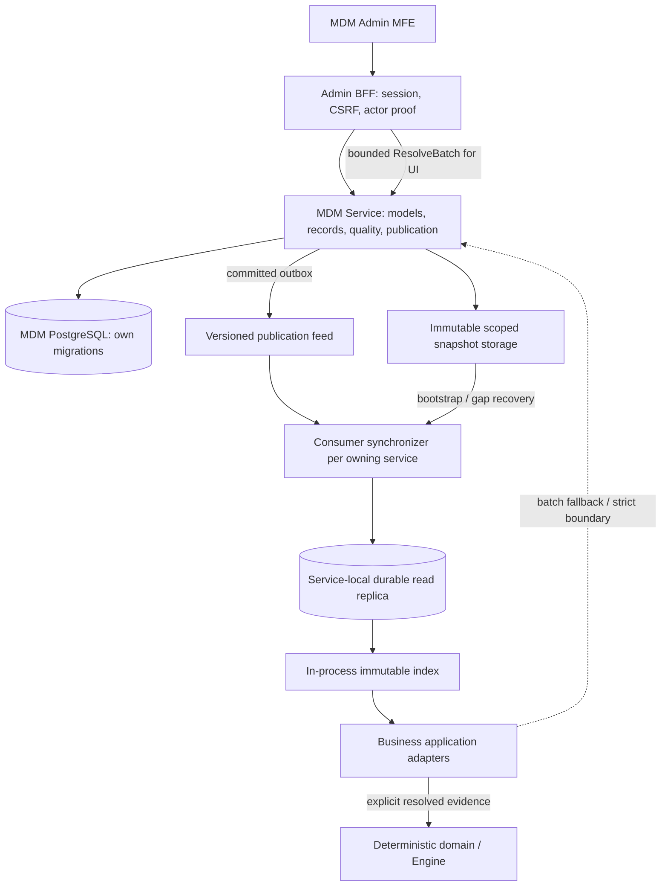

# MDM Service: quản trị tập trung, đọc phân tán

Trạng thái: **thiết kế đề xuất theo yêu cầu ngày 2026-11-10**, chưa có deployable/API/migration được triển khai. Chi tiết hóa Master Data context đã nêu trong ADR-011 và ODS roadmap; không thay thế Configuration hoặc Authz.

## Quyết định kiến trúc

MDM là authority duy nhất cho schema, dữ liệu chuẩn và publication của các master datasets. Business services đọc immutable version từ bản sao cục bộ có scope và freshness contract. Không bắt mỗi validation, mỗi field dropdown hoặc mỗi Engine transition gọi MDM qua mạng.

MDM sở hữu ví dụ: danh mục quốc gia/tiền tệ, mã chi nhánh và thông tin tham chiếu, loại giấy tờ, ngành nghề, danh mục sản phẩm tham chiếu, lịch nghiệp vụ dùng chung. Service owner nghiệp vụ vẫn quyết định quy tắc xử lý: eligibility/limit, assignment, workflow, chứng từ, approval. Nếu branch/org là master của hệ thống ngoài, MDM quản lý mapping và bản chuẩn được đồng bộ; identity membership và quyền vẫn thuộc IdP/Authz.

Không chuyển customer Case, transaction, workflow state hoặc user credential thành record động trong MDM. Giá trị security-sensitive như lock/revoke/permission không được dựa vào cache danh mục có TTL để quyết định quyền. Configuration quản lý operational config; Authoring quản lý workflow/DMN/form definitions; MDM quản lý reference records có schema, validity, hierarchy, source mappings và quality constraints.

## Control plane và data plane



Các path/package **dự kiến**: `apps/go/mdm-service`, `db/mdm-service/migrations`, `contracts/proto/bpmp/mdm/v1`, `go/platform/mdmclient`, Rust adapter crate khi có consumer Rust, `apps/web/mdm-mfe`. Chọn Go phù hợp các data-oriented services hiện có; đây chưa phải dependency/toolchain change đã thực hiện. SDK chỉ chứa transport, versioned DTO, cache/sync và errors; không chứa business rules dùng chung.

## Model và dữ liệu cấu hình từ UI

Một `DataModel` định nghĩa stable `modelKey`; các `ModelVersion` bất biến định nghĩa fields, types, unique keys, hierarchy/references, validation và UI hints. Dataset chọn model version; dataset draft chứa records và được publish thành immutable `DatasetRelease`. `PublicationBundle` pin toàn bộ releases phụ thuộc cần đọc nhất quán, ví dụ branch + business calendar + product reference.

Field types hỗ trợ ban đầu: string, integer, decimal có scale, boolean, date, timestamp, enum, reference, bounded object/list. Khai báo required/default, max length/range, immutable business key, sensitivity, searchable/indexable, reference target và temporal validity. Rules là declarative bounded DSL; không JavaScript/SQL tùy ý hoặc network call trong expression. UI builder không cấp quyền tạo physical table/DDL trực tiếp.

Lưu record payload JSONB được kiểm schema và typed constraints; các khóa, revision, code, validity và index lookup là relational metadata. Query chỉ theo approved indexed fields/operators, có page/size/cost cap; không generic SQL API. Unique/reference/hierarchy constraints phải được enforce trong owner transaction khi publish; JSON Schema validation đơn thuần không đủ. Cho phép promote model lớn sang typed projection/index sau đo tải, không đổi public record/version identity.

### Luồng quản trị và components

| Màn hình | Control / event | Kết quả và guard |
|---|---|---|
| Model catalog | Create, search/filter, duplicate, archive | Stable key; scoped permission; duplicate tạo draft identity mới |
| Schema builder | Add/reorder field, type/default, required, unique, reference, preview form | Revision CAS; validate cycles/schema; sửa field type không được silently coerce records |
| Dataset editor | Add/edit record, bulk import, validate, delete/deactivate, effective dates | Draft only; row errors và partial import report; không overwrite publication đang chạy |
| Relationship/hierarchy | Select parent/reference, mapping source code | Chặn cycle/dangling refs; same-tenant hoặc authorized shared publication |
| Quality panel | Run validation, inspect duplicates/missing refs, download errors | Persist validation report gắn exact draft revision/schema digest; sửa draft làm report cũ invalid |
| Publication | Diff, impact preview, request approval, publish/schedule | Typed capability + Governance approval khi policy yêu cầu; không tự duyệt thay người khác; base-generation CAS |
| Versions | Compare, inspect, rollback | Immutable history; rollback tạo publication generation mới trỏ release đã tồn tại; không giảm generation |
| Consumers | Subscription status, lag/checkpoint, replay/resync | Workload authorization; job bounded, không phát command cho Engine |

Dùng `QueryTable`, `SchemaForm`, `FieldEditor`, `ReferencePicker`, `HierarchyTree`, `ImportWizard`, `ValidationReport`, `VersionDiff`, `PublishDialog`, `ConsumerLagPanel`. ReferencePicker dùng same batched query adapter; không gọi API cho từng cell/row. Đây là feature/package đề xuất theo [component system](component-system.md), không nhúng domain MDM vào primitive.

Lifecycle: model `DRAFT → VALIDATED → PUBLISHED → DEPRECATED`; record draft `EDITABLE → VALIDATED`; release immutable sau `PUBLISHED`. Dataset head/bundle publication dùng generation monotonic. Archive/deactivate/tombstone giữ historical lookup; không hard-delete version đang có dependency/retention hold.

Breaking schema change tạo model version mới + migration plan/compatibility report; không publish nếu consumer chưa hỗ trợ required schema. Field rename dùng stable field key hoặc explicit mapping, không đổi meaning code đã dùng. Scheduled publication chỉ active sau scheduler transaction commit, không chỉ dựa giờ trên browser. Effective interval dùng `[valid_from, valid_to)`, chặn overlap khi business key yêu cầu duy nhất.

## Đọc hiệu quả: số round-trip theo tình huống

| Tình huống | Data path | Gọi MDM đồng bộ |
|---|---|---:|
| Repeated validation trên dữ liệu đã pin | L1 immutable index hoặc local durable replica | **0** |
| Request dùng nhiều danh mục | Resolve local theo một bundle; fallback batch tất cả misses | Tối đa 1 batch khi đã biết dependency closure |
| Form có nhiều dropdown | Một BFF aggregate/options batch theo initial form schema; lazy search có debounce/cursor | 1 lần initial, các query tìm kiếm theo nhu cầu |
| Cold start / gap / new subscription | Snapshot manifest + bounded chunks, sau đó catch-up | Nhiều request có giới hạn; ngoài business hot path |
| Check yêu cầu trạng thái hiện tại ở MDM | Authoritative ResolveBatch với revision receipt | 1 lần tại boundary đã định nghĩa; không cache thay semantics |

L1 có memory/entry cap, LRU/eviction và single-flight theo tenant/scope/bundle; request-local memoization gom repeated lookups. L2 ban đầu là read projection trong database/storage do consumer sở hữu; Redis là tùy chọn theo benchmark, không mặc định thêm network hop và không làm authority. Với dataset lớn, subscribe subset có filter/index theo scope thay vì tải toàn platform vào RAM.

`ResolveBatch` nhận list keys/queries có giới hạn; trả version/hash từng item, item errors và bundle ID. Không đẩy N+1 từ frontend vào BFF: join các reference code thành batch trước khi gọi; phân trang có cursor gắn release/query scope. Dependency closure trong bundle đã được resolve trước, không fetch dây chuyền một record một lần.

### Consistency modes bắt buộc khai báo ở consumer

1. **PINNED**: command/workflow step dùng exact bundle/release, tiếp tục dùng được khi MDM outage nếu local copy hợp lệ. Pin ở workflow start hoặc step boundary theo nghiệp vụ, không ngầm pin suốt lifetime. Retry cùng intent giữ cùng pin; muốn re-evaluate bằng release mới phải tạo intent mới sau review.
2. **BOUNDED_STALENESS**: UI/read-only hoặc nghiệp vụ chấp nhận lag khai báo maxAge/maxGenerationLag và fallback policy. Trả `asOf`, `bundleId`, `generation`, `lastReconciledAt`, `stale`. Mất heartbeat/gap quá ngưỡng chuyển unready/stale; không coi cache “vừa đọc” là dữ liệu vừa publish.
3. **AUTHORITATIVE_AT_RESOLVE**: một batch call owner để lấy committed snapshot và receipt. Chỉ đảm bảo tại thời điểm MDM resolve, không đảm bảo vẫn “latest” lúc Engine commit. Nếu quy tắc đòi validity đến lúc dùng, cần owner-defined reservation/lease/version fence với semantics revoke/expiry rõ; nếu chưa có protocol thì block hành động đó, không hứa atomicity xuyên database.

Không cache permission decision theo model cache. Policy revocation/actor validation vẫn đi theo Authz/Engine hiện hữu. Freshness của danh mục và freshness của authorization là hai contract riêng.

## Đồng bộ, publication và recovery

Publication transaction ghi immutable release/bundle manifest, head generation, audit và outbox; artifact chunks phải upload và verify checksum trước, chỉ referenced artifact mới visible qua published manifest. Upload lỗi không publish; crash để lại orphan được GC sau grace period. Release references không được trỏ draft. Bundle pin transitive reference releases và validate cross-model references trước commit; cross-tenant/shared references chỉ theo approved subscription scope.

Event logical names `MasterDataBundlePublished`, `MasterDataReleaseWithdrawn`, `MasterDataSubscriptionChanged`; envelope/topic theo quy chuẩn repo, chưa tạo topic. Event chứa publication generation, previous generation, scope, release manifest/hash, không broadcast sensitive records lên global topic. Consumer tải qua workload-authenticated API hoặc scoped artifact access; signed manifest không thay authorization.

Sync protocol:

1. Bootstrap nhận manifest bất biến, generation G, digest và resume token gắn đúng publication cut; snapshot phân chunk không đọc mutable current records.
2. Download/verify vào staging local tables; apply inbox/effect/checkpoint atomically; chỉ atomic-swap active pointer khi toàn bundle đủ, validated và authorized. Reader giữ immutable handle tới generation cũ đến hết request, không trộn release trong lúc swap.
3. Catch-up từ resume token; apply generation liên tục trong subscription scope. Duplicate bỏ qua; out-of-order buffer có bound rồi resync; gap/schema lạ không tự skip.
4. Nếu token đã hết retention: lấy snapshot mới. Định kỳ reconcile authoritative manifest/heartbeat để phát hiện missed event; không phụ thuộc TTL invalidation đơn độc. Kafka offset không tự suy ra bundle generation giữa nhiều partitions.
5. Retry có exponential backoff/jitter, attempts/deadline/lease cap; poison event vào bounded DLQ + alert. Restart dùng durable replica/checkpoint, không tải lại toàn bộ nếu còn compatible.

Revoke subscription phải cắt serving trước khi async purge local data; stale workload replica không được mở quyền lại. Cơ chế lease quyền phân phối/read scope fail-closed khi mất freshness; dataset PINNED không tự cho phép vượt quyền đã revoke. Dữ liệu nhạy cảm cần storage encryption, key lifecycle và cache eviction được thiết kế cùng retention policy. Dataset thông thường deprecate không đồng nghĩa emergency withdrawal; withdrawal policy phải chỉ rõ các consumer/command nào bị chặn.

## Engine integration và deterministic replay

Resolver chạy ở application adapter trước `decide`; deterministic core không gọi MDM, clock hoặc cache. Trusted adapter xác minh scope, schema/hash, signature khi yêu cầu, và freshness mode rồi tạo input đã resolve. Browser chỉ gửi reference/selection; backend không tin giá trị master data client tự khai.

```text
ResolvedMasterDataEvidence {
  tenantScope, subscriptionScope, bundleId, publicationGeneration,
  releaseIdsAndDigests, modelVersionIds, recordKeys,
  resolvedValues, evaluatedAt, consistencyMode
}
```

`resolvedValues` phải chứa tập giá trị thực sự dùng để ra quyết định, hoặc immutable artifact reference có retention/availability và digest đủ để replay. Chỉ lưu version/hash trong khi dữ liệu lịch sử có thể bị xóa là không đủ. Persist evidence cùng command/event theo durable contract (PII mã hóa theo policy); retry dùng cùng evidence digest. Freshness/expiry kiểm ở trusted boundary với thời điểm được ghi nhận, core nhận input tường minh. Replay dùng evidence đã commit, không resolve `latest` và không cần MDM online. Hash chứng minh integrity, không tự chứng minh dữ liệu có authority/current validity.

Không sửa core semantics hoặc Protobuf durable payload trong đợt thiết kế này; triển khai sau cần compatibility review và test replay từ lịch sử cũ.

## API contract đề xuất

| API / RPC logic | Đặc điểm |
|---|---|
| ModelDraft/Create/Update/Validate | expectedRevision, typed field schema, cost/size cap |
| DatasetDraft/UpsertBatch/Import | command ID, same-key payload digest, row errors, async job cho file lớn |
| Publication/Preview/Publish | baseGeneration CAS, bundle closure, validation revision, approval ref |
| ResolveBatch | tenant/scope từ trusted context, exact bundle hoặc explicit mode; bounded keys/filter; per-item version/error |
| GetSnapshotManifest/ReadSnapshotChunk | immutable ID, checksum, scoped auth, paging, expiry/retention metadata |
| ReadChanges/ReconcileManifest | scope-bound resume token, generation chain, token-expired response |
| ConsumerSubscriptions/Status | workload capability, allowed datasets/fields/scope, schema support và lag |

UI gọi MDM qua BFF; services gRPC/mTLS và actor/workload proof theo use case. APIs không chấp nhận tenant hoặc field visibility như dữ liệu client tự cấp. Áp dụng [đặc tả phân quyền và truy cập dữ liệu](../authorization-and-data-access.md) cho tenant/scope/field filtering và revocation. ETag cho immutable queries theo release + authorized view; không key cache chỉ bằng URL/modelKey. Query search cache cần cả tenant, scope, policy epoch, schema, release và query digest. HTTP/Protobuf names chưa chốt; reuse conventions repo khi implementation.

## Data model, ownership và index

Xem ERD `mdm` trong [data model](../data-model.md) và schema trong [DBML](../schema.dbml). MDM PostgreSQL riêng; local consumer replicas không FK vào MDM và không được nhận write từ ứng dụng.

Bốn nhóm: model/schema versions; dataset drafts và records/references/mappings; immutable releases và publication bundles; subscription/sync jobs + owner-local audit/outbox/receipts. Shared platform catalog phát hành dưới scope publisher rõ ràng; tenant phải subscribe explicit. Không dùng `tenant_id = NULL` để mở dữ liệu chung hoặc tự fallback sang global khi lookup không thấy. Tenant override chỉ qua explicit publication precedence và provenance trong bundle; không merge động không xác định tại thời điểm đọc.

Unique constraints: model key theo tenant; model version theo model/version; record business key theo dataset; record revision theo record/revision; release theo dataset/release number; bundle generation theo publication scope; bundle item theo bundle/dataset; external source mapping theo tenant/source/dataset/code và validity; subscription theo workload/dataset/view scope. Record references phải cùng tenant/authorized publisher và đúng pinned target release; model draft references được validate khi publication closure đóng.

Indexes: dataset+record key; dataset+validity; declared indexed fields theo query profile; subscription+status; outbox unpublished; jobs status+next_attempt_at. Không tạo index cho mọi JSON field và không cho UI tạo index không giới hạn. Chốt scale/partition theo cardinality và query plan đo được.

## Acceptance và rollout

Bắt đầu với branch/currency/document-type reference, Admin MFE và một Case/Task consumer, không chuyển toàn bộ dữ liệu một lần. Xác nhận source owner của branch trước khi bỏ mock data.

- Đo cold/warm request count, hit ratio, ResolveBatch size/latency, business p95, replication lag, snapshot bytes/time và memory cap. Gate **warm PINNED path = 0 synchronous MDM calls**; số latency cụ thể chốt sau baseline.
- Concurrency tests: publish/rollback monotonic generation; two editors CAS conflict; mixed-version reads không xuất hiện; unknown schema chặn activate.
- Recovery tests: missed/duplicate/out-of-order event, snapshot artifact thiếu/hỏng, token expired, crash giữa staging/swap, MDM/Kafka outage, restart consumer.
- Safety tests: tenant/scope leak, subscription revoked offline, stale authorization lease, sensitive field leakage qua search/snapshot, reference vòng và duplicate codes, temporal validity boundaries.
- Engine replay phải cho cùng kết quả sau khi MDM đã đổi/xóa current pointer hoặc offline; retry giữ pinned evidence, client forged master values bị từ chối.
- Expand migrations và contract trước consumer; canary theo tenant; rollback publication tạo generation mới; giữ artifact/schema compatible trong cửa sổ rollback. Không rollback bằng ghi đè immutable release.

Chưa lựa chọn cache TTL, size cap, retention hoặc SLO bằng số tùy ý. Các giá trị là config được kiểm bounds, cần quyết định theo freshness policy, dataset size và benchmark của consumer thật.

