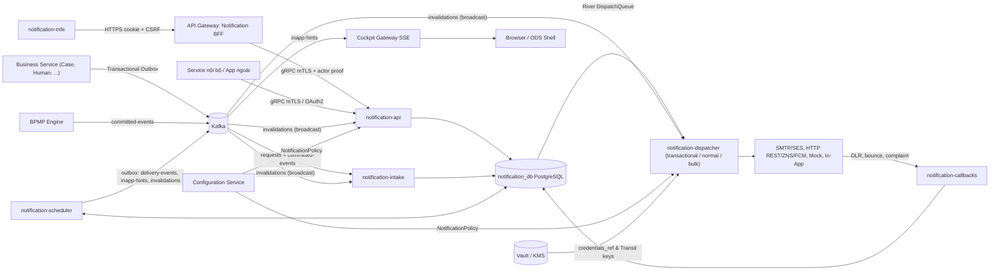
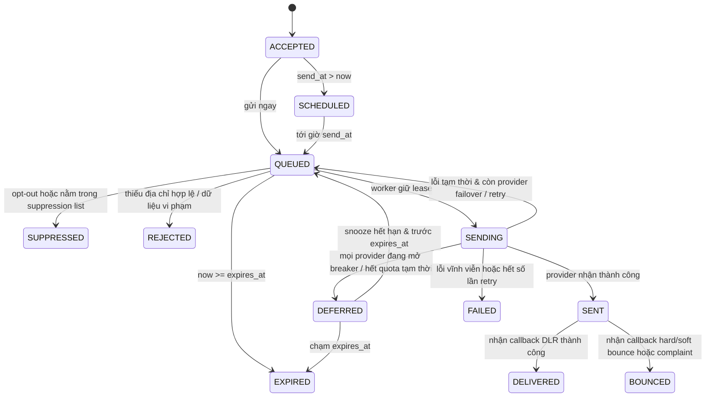

# Notification Service: kiến trúc quản trị template bất biến, định tuyến đa kênh và runtime gửi tin

Trạng thái: **thiết kế đề xuất theo [ADR-013](../../adr/ADR-013-notification-service.md) (ngày 2026-11-26)**, chưa có deployable, Protobuf contract, Kafka topic hay migration chạy thật. Theo quy định của ADR-011 và [data model reference](data-model-reference.md), contract vật lý và migration SQL chỉ được thêm cùng vertical slice đầu tiên.

---

## 1. Tổng quan, mục tiêu và ranh giới sở hữu

Notification Service là một bounded context độc lập trong kiến trúc BPMP/ODS, chịu trách nhiệm toàn trình về:

- **Management**: quản lý Categories, Applications (producers), Templates & Layouts có version bất biến, Service Providers cấu hình động, Routing Rules và Workflow Trigger Rules.
- **Preview & Testing**: biên dịch/render thử theo draft, version đã publish hoặc xem lại một delivery cụ thể (có che PII và ghi audit); gửi tin test có kiểm soát đích nhận.
- **Delivery Runtime**: tiếp nhận yêu cầu bất đồng bộ/đồng bộ, phân giải người nhận/tùy chọn nhận tin/suppression, phân luồng ưu tiên (`transactional`, `normal`, `bulk`), gửi qua các giao thức (`smtp`, `http`, `mock`, `inapp`), đối soát callback/DLR/bounce.
- **Monitoring & Operations**: theo dõi trạng thái từng bản tin (Delivery Monitoring), bảng chỉ số tổng hợp (Metrics Dashboard), nhật ký kiểm toán bất biến (Audit Logs), quản trị/override Circuit Breaker theo từng provider, gửi thủ công (Send Notification) và gửi lại (Resend).

### Ranh giới sở hữu (Ownership Matrix)

| Nhóm dữ liệu / chính sách | Nơi sở hữu | Nguyên tắc biên |
|---|---|---|
| Categories, Applications, Layouts, Templates, Versions, Variants, Releases, Provider Profiles/Revisions, Routing Policies, Trigger Rules, Instance Contexts, Contacts, Preferences, Suppressions, Requests, Deliveries, Payloads, Attempts, Callbacks, In-app Messages, Rollups, Audit Evidence | PostgreSQL riêng `notification_db` (`db/notification-service/migrations`) | Theo ADR-004/011: credential riêng, không cross-DB SQL/JOIN với Case, Human, Access hay MDM. |
| Retry/backoff, ngưỡng Circuit Breaker, Bulkhead, Rate Limit, Batch/Lease, giới hạn kích thước render/payload, TTL lưu trữ (Retention) | Configuration Service (`NotificationPolicy`, `CONFIGURATION_OWNER_NOTIFICATION = 9`) | Theo ADR-007: nghiêm cấm hardcode ngưỡng vận hành trong code hay bảng nghiệp vụ. |
| Credentials của Provider (SMTP password, API key, OAuth2 client secret, Google SA key) và khóa mã hóa payload/PII | Vault / KMS (KV v2 & Transit) | DB chỉ lưu tham chiếu `vault://...` (`credentials_ref`, `key_ref`), resolve lúc mở kết nối hoặc mã hóa/giải mã, không ghi log. |
| Định danh workload/user, capability catalog `notification.*`, policy phân quyền và thu hồi quyền đọc | Authz Control Plane & IdP | Notification là PEP kiểm quyền theo actor proof / workload mTLS (ADR-008/012). |
| Duyệt 4 mắt (Dual-control) khi publish template nhạy cảm hoặc override dài hạn (tùy chọn theo policy) | Governance Service | Tái sử dụng `GovernanceApprovalService`, không viết hệ thống duyệt riêng lần hai. |

### Những điểm hiện trạng trong repo cần điều chỉnh khi triển khai

| Hạng mục | Hiện trạng trong repo | Điều chỉnh theo thiết kế này |
|---|---|---|
| Version template | `schema.dbml` cũ đặt cột `locale` trên `notification_template_versions` (mỗi locale một version rời rạc) | Một `template_versions` đại diện cho một lần phát hành hoàn chỉnh của template (`variable_schema` + `schema_major`); mỗi cặp `channel × locale` là một `template_variants` thuộc version đó. |
| Runtime policy | `ConfigurationOwner` mới dừng ở `8` (`AUTHZ_CONTROL_PLANE`), `ResolvedConfigurationSnapshot` dừng ở field `16` | Bổ sung additive `CONFIGURATION_OWNER_NOTIFICATION = 9` và `NotificationPolicy notification = 17`; cập nhật `go/platform/runtimeconfig` và validator của `configuration-service`. |
| Circuit breaker | `go/platform/grpcclient` tạo breaker gắn cứng theo gRPC client interceptor, không tách theo provider key và không có trạng thái vận hành | Xây dựng package dùng chung `go/platform/circuitbreaker` bọc `sony/gobreaker/v2` theo key `provider_id`, cửa sổ trượt, đẩy chuyển trạng thái vào `provider_health` và nhận manual override qua invalidation stream. |
| In-app realtime | `cockpit-gateway` gom subscriber theo `(tenant, signal)` và labels chung | Mở rộng hub lọc theo `recipient_subject_ref` rút từ actor proof đã xác thực (không bao giờ tin tham số người nhận từ query string của trình duyệt). |
| Gửi tin sau bước BPMN | `sendTask` nằm trong `UNSUPPORTED_EXECUTABLE_ELEMENTS` (`bpmn_profile.rs`); `remote_worker_coordinator.rs` truyền `input_payload` rỗng | Giai đoạn 1–2 dùng **Workflow Trigger Rules** đọc trực tiếp `bpmp.engine.committed-events.v1.<env>` nên không phải sửa Engine/Compiler. Chỉ sửa Engine điền `input_payload` (giới hạn bởi `RemoteWorkerPolicy.max_input_bytes`) ở giai đoạn sau khi có quy trình thực sự cần chờ kết quả ACK. |

---

## 2. Kiến trúc tổng thể và các đường tích hợp



### Một hợp đồng yêu cầu duy nhất (`NotificationRequest`)

Mọi đường tích hợp đều quy về cùng một cấu trúc ngữ nghĩa:

- `application_key` / `application_id`: **rút từ danh tính xác thực** (SPIFFE/mTLS workload principal cho service nội bộ, Kafka principal/header đã kiểm hoặc client credentials cho tích hợp ngoài) — không cho caller tự khai mạo danh ứng dụng khác.
- `idempotency_key`: khóa chống gửi lặp ổn định xuyên suốt các lần retry của caller. Cùng key nhưng khác `request_digest` trả lỗi `ALREADY_EXISTS` / `CONFLICT`.
- `template_key` + `schema_major` (ví dụ `case.submitted@1`), tùy chọn `pinned_version` khi cần tái tạo/kiểm thử cố định.
- `data`: JSON object tuân theo `variable_schema` của version được phân giải; các trường nhạy cảm khai báo `secret: true` được tách mã hóa riêng.
- `recipients`: danh sách người nhận dạng `subject_ref` (nhân sự/khách hàng đã định danh trong hệ thống — Notification tự tra địa chỉ từ `subject_contacts`) hoặc `external_address` (email/SĐT khách vãng lai — băm SHA-256 có pepper tenant để tìm kiếm/suppression và mã hóa AES-256-GCM).
- `category_key`, `lane_override` (chỉ áp dụng nếu application được cấp quyền), `locale`, `send_at`, `expires_at`, `correlation_id`.

### Bốn đường vào (Entry Paths)

| Đường vào | Khi nào sử dụng | Cơ chế và đảm bảo an toàn |
|---|---|---|
| **A. Producer Outbox → `bpmp.notification.requests.v1.<env>`** | **Mặc định** cho mọi microservice nghiệp vụ (Case, Human, Authz, Document) | Service nghiệp vụ ghi yêu cầu gửi tin vào bảng `outbox` của chính nó trong cùng transaction DB với thay đổi nghiệp vụ. Notification dừng bảo trì cũng không chặn hay rollback giao dịch gốc. |
| **B. Workflow / Domain Trigger Rules** | Gửi thông báo khi bước quy trình hoàn tất, kích hoạt hoặc trễ SLA mà không sửa code producer | `notification-intake` đọc `bpmp.engine.committed-events.v1.<env>`, đối chiếu rule CEL trên bộ nhớ, ánh xạ biến và ghi `notification_requests` cùng inbox/checkpoint trong một transaction. Nếu biến từ sự kiện mỏng (ví dụ `WorkItemChangedEvent`), gọi API đọc của owner qua client có breaker + batch cache ngắn hạn. |
| **C. gRPC `SubmitNotification`** | Màn hình "Send Notification" trên UI, Test Send, hoặc tích hợp bên ngoài cần mã biên nhận ngay | Xác thực quyền và schema đồng bộ, ghi `notification_requests` + `deliveries` + `command_receipts` + job River trong một transaction, trả ngay receipt `ACCEPTED` (`request_id`, `delivery_ids`). **Không bao giờ** giữ kết nối chờ provider bên thứ ba. |
| **D. BPMN Remote Worker (`notification.send`)** *(Giai đoạn 3)* | Khi quy trình BPMN bắt buộc chờ xác nhận đã tiếp nhận thông báo trước khi qua cổng tiếp theo | Chỉ mở sau khi bổ sung `input_payload` trên Engine. `idempotency_key = tenant_id + instance_id + activation_event_id`; worker ACK `COMPLETED` ngay sau khi lưu bền `notification_requests`, không chờ nhà mạng trả DLR. |

---

## 3. Categories và quản trị Applications

### 3.1 Categories (`categories`)

Mỗi bản tin thuộc một `category` do quản trị viên định nghĩa theo tenant, quyết định hành vi vận hành xuyên suốt:

- `default_lane`: `TRANSACTIONAL`, `NORMAL`, hoặc `BULK`.
- `user_unsubscribable`: `false` đối với tin bắt buộc/bảo mật/pháp lý (OTP, cảnh báo đăng nhập, thông báo thu hồi nợ/hợp đồng); `true` đối với tin cập nhật chung/khuyến mãi để tôn trọng `recipient_preferences` và gắn header `List-Unsubscribe-Post` (RFC 8058).
- `ambiguous_outcome_policy`: cách xử lý khi lời gọi tới provider bị timeout mạng mà không rõ nhà cung cấp đã nhận tin hay chưa:
  - `RESEND_ON_FAILOVER`: cho phép chuyển sang provider dự phòng gửi lại ngay (phù hợp OTP có mã hoặc thời hạn ngắn).
  - `RECONCILE_BEFORE_RETRY`: đưa vào trạng thái chờ đối soát/kiểm tra trạng thái phía provider trước khi gửi lại (phù hợp thông báo biến động số dư/tài chính nhạy cảm).
  - `NO_RETRY`: đánh dấu cần xử lý thủ công, không tự động phát lại.
- `retention_class` và `retain_rendered_copy`: liên kết với thời hạn lưu payload trong `NotificationPolicy`; bật lưu bản chụp nội dung đã render mã hóa khi pháp chế yêu cầu bằng chứng nguyên văn.

### 3.2 Applications (`applications`, `application_api_keys`)

Mỗi producer gửi thông báo phải được đăng ký thành một `Application`:

- **Định danh xác thực (`auth_mode`)**:
  - `WORKLOAD_MTLS`: khớp `principal_ref` với SPIFFE ID / SAN của chứng chỉ mTLS hoặc Kafka ACL principal cho các service nội bộ.
  - `OIDC_CLIENT`: khớp `client_id` từ Keycloak JWT cho hệ thống đối tác nội bộ.
  - `API_KEY` (chỉ dùng khi hệ thống legacy không hỗ trợ mTLS/OIDC): sinh chuỗi ngẫu nhiên mật mã có prefix nhận diện (`ntf_live_<prefix>_<secret>`), chỉ hiển thị **một lần duy nhất** lúc tạo, DB chỉ lưu `key_prefix` và băm Argon2id/SHA-256 kèm salt (`secret_hash`). Khi xoay khóa (key rotation), cho phép khóa cũ và khóa mới cùng hiệu lực trong cửa sổ chuyển giao (`expires_at`) trước khi thu hồi.
- **Phân vùng quyền gửi**: `allowed_namespaces` (ví dụ `["case.*", "portal.*"]`), `allowed_channels`, `default_lane`, sender identity ghi đè (nếu có), và `quota_config` (RPS/RPM/giới hạn ngày). Khi vượt hạn mức, trả `RESOURCE_EXHAUSTED` kèm `retry_after_ms` mà không làm nghẽn các application khác.
- **Outbound Webhook**: `callback_url` và `callback_secret_ref` (trong Vault) để đẩy sự kiện trạng thái gửi ký HMAC-SHA256 kèm timestamp chống replay cho ứng dụng ngoài Kafka.

---

## 4. Quản lý Version, Layout và cơ chế Publication chung

### 4.1 Cấu trúc phân cấp Template

```text
Template (template_key thuộc namespace của application, category_id, default_locale)
 └─ TemplateVersion (version, schema_major, syntax, layout_version_id?, variable_schema, content_hash, status)
     └─ TemplateVariant (channel × locale)
         ├─ INLINE: subject_tmpl?, html_tmpl?, text_tmpl?, mjml_source?
         └─ PROVIDER_TEMPLATE: provider_template_id + param_mapping (cho Zalo ZNS, SMS Brandname mẫu cố định)
TemplateRelease (template_id, schema_major → template_version_id, ordinal tăng đơn điệu, activate_at)
```

### 4.2 Quy tắc bất biến và tương thích ngược (Schema Compatibility Gate)

1. **Vòng đời version**: `DRAFT → IN_REVIEW → PUBLISHED → DEPRECATED → RETIRED`. Ngay khi chuyển sang `PUBLISHED`, bản ghi `template_versions` và toàn bộ `template_variants` của nó là **bất biến** (enforce bằng cả tầng domain lẫn trigger DB). Mọi chỉnh sửa nội dung hay biến đều phải tạo `version` mới.
2. **Kiểm tra tương thích trong cùng `schema_major`**: khi publish `version` mới thuộc cùng `schema_major` với version đã publish trước đó, trình kiểm tra tương thích chạy tự động (tương tự `buf breaking`):
   - **Được phép**: thêm biến `optional` (không nằm trong `required`), mở rộng `maxLength`/`maxItems`, thêm enum value nếu chỉ dùng để hiển thị có nhánh `default`, thêm locale hoặc kênh mới.
   - **Bị chặn (Breaking)**: xóa biến đang có, thêm biến vào `required` mà không có giá trị mặc định, thu hẹp kiểu dữ liệu (ví dụ `string` sang `integer`), đổi cấu trúc nested object. Thay đổi phá vỡ bắt buộc tăng `schema_major` (ví dụ `case.submitted@2`), trong khi `@1` tiếp tục chạy song song cho tới khi bảng metrics xác nhận không còn producer nào gọi `@1`.
3. **Layout/Partial dùng chung**: header, footer, CSS khung email được quản lý thành `layouts` và `layout_versions` riêng. Khi publish một `TemplateVersion`, hệ thống **pin cứng `layout_version_id`** (không bao giờ resolve layout động theo `latest` lúc gửi) và tính `content_hash` (SHA-256 chuẩn hóa) bao gồm cả template, variants và layout đã pin.
4. **Không fallback ngầm từ Platform xuống Tenant**: bám sát nguyên tắc của [MDM Service](mdm-service.md), hệ thống không dùng `tenant_id = NULL` hay tự động đọc sang kho dùng chung lúc runtime. Các bộ mẫu chuẩn của nền tảng (bao gồm cả mẫu hệ thống khi khởi tạo tenant mới) hoặc việc đưa mẫu từ Staging lên Production đều đi qua cơ chế **Bundle Export / Import có ghi `provenance`** (`source_env`, `source_tenant`, `source_version_id`, `imported_at`) và kiểm chứng giữ nguyên `content_hash`.
5. **Release Pointer & Rollback đơn điệu**: `template_releases` xác định `template_version_id` đang phục vụ cho cặp `(tenant_id, template_id, schema_major)`. Rollback không xóa hay giảm số thứ tự mà tạo một bản ghi release mới trỏ về `template_version_id` ổn định trước đó với `ordinal = current_ordinal + 1`. Hỗ trợ `activate_at` để hẹn giờ kích hoạt thông qua `notification-scheduler`.

### 4.3 Engine Publication dùng chung cho 5 loại cấu hình

Thay vì lặp lại logic quản trị vòng đời ở bốn nơi, package nội bộ `internal/publication` thực thi chung quy trình:

`Draft/Revision → Validate (Schema/AST/CEL/Driver) → [Governance Approval nếu nhạy cảm] → Immutable Version/Revision → Monotonic Release Pointer (publication_releases / template_releases) → Audit Evidence + Outbox Invalidation`

Áp dụng thống nhất cho: **Template**, **Layout**, **Provider Profile**, **Routing Policy** và **Workflow Trigger Rule**.

---

## 5. Cơ chế Placeholder, Variable Schema và Engine Render an toàn

### 5.1 Tập con JSON Schema cho Variable Schema

Mỗi `template_versions` lưu `variable_schema` theo tập con kiểm soát được của JSON Schema 2020-12:

- **Kiểu hỗ trợ**: `string`, `integer`, `boolean`, `decimal` (chuỗi số thập phân chính xác, tránh sai số dấu phẩy động), `money` (`{ "amount": decimal, "currency": "VND" | "USD" | ... }`), `date` (`YYYY-MM-DD`), `datetime` (RFC 3339 UTC), `url` (chỉ chấp nhận scheme `https://`), `html_fragment` (bắt buộc lọc qua sanitizer), `object` và `array<object>` có `maxItems` bắt buộc.
- **Thuộc tính kiểm soát**: `required`, `maxLength`, `pattern` (RE2 an toàn thời gian tuyến tính), `example` (bắt buộc cho mọi biến để phục vụ kiểm tra publish và preview mặc định), `pii: true` (che khi hiển thị log/monitoring), `secret: true` (dành cho mã OTP, link/token đặt lại mật khẩu — xóa ngay khi kết thúc gửi, cấm preview lại và cấm resend).

### 5.2 Không gian tên biến (Placeholder Namespaces)

| Namespace | Nguồn cung cấp lúc render | Ví dụ |
|---|---|---|
| `.data.*` | Payload `data` do producer gửi lên sau khi đã qua JSON Schema validator | `{{ .data.caseTrackingCode }}`, `{{ money .data.loanAmount }}` |
| `.recipient.*` | Notification tự điền từ `subject_contacts` hoặc thông tin người nhận | `{{ .recipient.displayName }}`, `{{ .recipient.locale }}`, `{{ .recipient.timezone }}` |
| `.tenant.*`, `.brand.*` | Cấu hình nhận diện thương hiệu của tenant (tên đơn vị, màu chủ đạo, logo HTTPS) | `{{ .brand.supportHotline }}`, `{{ .brand.logoUrl }}` |
| `.system.*` | Metadata phiên gửi do runtime sinh tự động | `{{ .system.unsubscribeUrl }}`, `{{ .system.correlationId }}`, `{{ .system.sentYear }}` |

### 5.3 Engine Render và kiểm duyệt AST lúc Publish

- Sử dụng `html/template` (cho Email HTML, In-App HTML) và `text/template` (cho Email Subject/Text, SMS, Push, tham số ZNS) từ thư viện chuẩn của Go, gắn định danh `syntax = "gotmpl/v1"`. Trường `syntax` cho phép tương lai bổ sung bộ render khác (như Liquid) mà không ảnh hưởng bất kỳ version nào đã publish.
- **Kiểm duyệt cây cú pháp (`text/template/parse` AST) lúc Publish**:
  - Chỉ cho phép truy cập đường dẫn thuộc 4 namespace hợp lệ và mọi trường dưới `.data.*` phải tồn tại trong `variable_schema` (chặn lỗi gõ sai tên biến âm thầm in `<no value>`; bật `Option("missingkey=error")`).
  - Chỉ cho phép cấu trúc điều khiển `if`, `else`, `range` (trên mảng đã khai báo `maxItems`), `with`. Chặn hoàn toàn `define`, `template`, `block`, `call` tùy ý để ngăn đệ quy vô hạn (billion-laughs template bomb) hoặc gọi hàm ngoài ý muốn.
  - Chỉ mở danh sách hàm lọc (`FuncMap`) cố định, thuần hàm (pure, deterministic, không I/O): `formatDate`, `formatDateTime` (chuyển sang `.recipient.timezone`), `formatMoney`, `upper`, `lower`, `default`, `truncate`, `mask`, `stripAccents` (hỗ trợ SMS không dấu), `safeHTML` (chỉ nhận giá trị đã chạy qua `bluemonday` strict policy cho trường khai báo kiểu `html_fragment`).
- **Kiểm tra ràng buộc kênh lúc Publish bằng dữ liệu `example`**:
  - Render thử toàn bộ `template_variants` với bộ `example` chuẩn và bộ `example` biên cực đại (`maxLength`/`maxItems`).
  - **Email**: cảnh báo nếu HTML sau ghép layout vượt 95 KB và chặn nếu vượt ngưỡng `max_email_html_bytes` (tránh Gmail cắt nội dung ở mốc ~102 KB); kiểm tra mọi liên kết `href`/`src` dùng `https://` (hoặc `mailto:`/`tel:` ở `href`).
  - **SMS**: tự động phát hiện bảng mã GSM-7 (160 ký tự / 153 ký tự nối tin) so với UCS-2 khi có dấu tiếng Việt hoặc ký tự ngoài GSM-7 (70 ký tự / 67 ký tự nối tin), tính chính xác số segment và cảnh báo nếu vượt số segment cho phép trong `NotificationPolicy`.
  - **Push / In-App**: kiểm tra giới hạn byte/ký tự của `title` và `body`.
- **Không bao giờ double-render**: dữ liệu người dùng truyền vào `.data.*` chỉ là giá trị dữ liệu thuần, tuyệt đối không bao giờ được đưa lại vào `Parse()` như mã nguồn template (chống Server-Side Template Injection).

### 5.4 Phân giải Locale lúc gửi

Thứ tự ưu tiên xác định `locale` cho từng người nhận:
1. `locale` chỉ định tường minh trên mục người nhận hoặc trên `NotificationRequest`.
2. `subject_contacts.locale` của người nhận nội bộ.
3. Ngôn ngữ mặc định của Tenant.
4. `templates.default_locale` của chính template đó (bắt buộc luôn có variant ở `default_locale` cho mọi kênh mà template hỗ trợ).

---

## 6. Cơ chế Preview, Test Send và xem lại Delivery

- **Đồng nhất tuyệt đối với luồng gửi thật**: API Preview và worker Dispatcher gọi cùng một package `internal/renderer`, cùng bộ AST validator, cùng `FuncMap` và cùng artifact đã biên dịch.
- **Ba chế độ Preview**:
  1. **Draft Preview**: biên dịch tạm thời trên RAM với giới hạn thời gian CPU/bộ nhớ chặt, không đưa vào cache toàn cục; phục vụ trực tiếp lúc developer đang gõ trong Monaco Editor.
  2. **Published Version Preview**: lấy thẳng template đã biên dịch từ cache bất biến theo `template_version_id`, kết hợp dữ liệu `example` hoặc dữ liệu JSON thử nghiệm do người dùng nhập; tự động che các trường gắn `pii: true` / `secret: true` nếu người gọi không truyền dữ liệu thử riêng.
  3. **Historical Delivery Replay Preview**: tái tạo bản xem từ một `delivery_id` cụ thể. Nếu `delivery_payloads` còn trong hạn lưu giữ (chưa bị xóa theo TTL) và người thao tác có quyền `notification.delivery.inspect_payload`, hệ thống giải mã payload, ghi **bắt buộc một bản ghi `audit_evidence`** (`action = "DELIVERY_PAYLOAD_INSPECTED"`), rồi render lại theo đúng `template_version_id` và `variant_id` đã lưu trên delivery (các biến `secret: true` đã bị xóa hiển thị thành `******`). Nếu payload đã hết hạn TTL, hệ thống render bằng dữ liệu `example` của đúng version đó và gắn cờ rõ `rendered_with_sample_data = true`.
- **Kết quả trả về của Preview**: nội dung theo từng kênh (Email `subject`/`html`/`text` + kích thước KB; SMS text + bảng mã `GSM7`/`UCS2` + số ký tự + số segment + bản gợi ý không dấu; Push JSON; ZNS `provider_template_id` + bảng tham số đã map; In-App card) cùng danh sách `warnings` (biến khai báo không dùng, tiệm cận giới hạn kích thước).
- **Hiển thị an toàn trên UI**: `notification-mfe` chỉ hiển thị HTML preview bên trong `<iframe sandbox="" srcdoc="...">` (không cấp `allow-scripts`, `allow-same-origin` hay `allow-forms`), chặn gửi mạng ra ngoài bằng CSP trong `srcdoc`, hỗ trợ chuyển đổi khung nhìn Desktop / Mobile và Dark Mode giả lập.
- **Test Send có rào chắn**: chỉ cho phép gửi tin thử nghiệm tới địa chỉ đã xác minh của chính actor đang đăng nhập hoặc các địa chỉ/domain nằm trong danh sách allowlist kiểm thử của tenant. Bản ghi tạo ra mang cờ `is_test = true`, đi qua luồng gửi để kiểm chứng kết nối thật nhưng được loại khỏi số liệu nghiệp vụ trên Metrics Dashboard.
- **Cô lập tài nguyên**: nhóm endpoint Preview và Test Send trên `notification-api` đặt dưới `go/platform/bulkhead` riêng và giới hạn tốc độ theo actor để việc mở editor hay chạy preview hàng loạt không bao giờ chiếm tài nguyên của luồng tiếp nhận `SubmitNotification`.

---

## 7. Pipeline gửi tin, phân luồng ưu tiên (Lanes) và hiệu năng

### 7.1 Giả thuyết SLO theo Lane và cổng quyết định hạ tầng (Load-Test Gate)

Thời gian SLO tính từ thời điểm Notification tiếp nhận request (`accepted_at`) tới thời điểm Provider xác nhận đã nhận tin (`sent_at`); thời gian nhà mạng giao tới thiết bị đầu cuối được đo riêng qua callback DLR.

| Lane | Ví dụ nghiệp vụ | Giả thuyết SLO (cần nghiệp vụ xác nhận) | Bảo vệ bổ sung |
|---|---|---|---|
| `transactional` | Mã OTP, đặt lại mật khẩu, cảnh báo bảo mật tài khoản | `p95 ≤ 2 s`, `p99 ≤ 5 s`; quá `expires_at` hủy ngay (`EXPIRED`), không bao giờ gửi muộn | Giới hạn tần suất theo đích nhận (ví dụ tối đa N OTP / SĐT / 10 phút và theo dải đầu số) để chống tấn công SMS pumping. |
| `normal` | Giao việc (`work_item`), cập nhật trạng thái hồ sơ, kết quả phê duyệt | `p95 ≤ 30 s` | Coalescing / dedup cửa sổ ngắn theo rule khi cấu hình. |
| `bulk` | Thông báo bảo trì định kỳ, bản tin vận hành hàng loạt | Hoàn tất trong khung giờ nghiệp vụ cấu hình (quiet-hours aware) | Rate-limit chặt để luôn nhường quota nhà cung cấp cho `transactional` và `normal`. |

**Chiến lược đo tải và chuyển đổi hàng đợi**:
- Với lưu lượng khởi điểm ước tính (ví dụ `200.000 tin/ngày × 20% giờ cao điểm ÷ 3600 × hệ số burst 3 ≈ 33 tin/giây`), PostgreSQL 18 xử lý tốt trong cùng transaction mà không cần tách thêm hop trung gian.
- Ngay từ Slice 1, toàn bộ thao tác đẩy và nhận việc đi qua interface nội bộ `DispatchQueue`. Triển khai mặc định dùng **River** (`v0.51.x`) trên `notification_db` với ba queue tách biệt tương ứng ba Deployment `notification-dispatcher` (`lane=transactional`, `lane=normal`, `lane=bulk`), scale độc lập theo độ sâu hàng đợi và tuổi bản tin chờ lâu nhất.
- Thực hiện load test bằng driver `mock` (giả lập phân phối độ trễ thật của nhà mạng) ở mức **2× lưu lượng đỉnh ước tính**: nếu đạt SLO các lane và CPU PostgreSQL duy trì dưới ~60%, giữ nguyên River trên PostgreSQL; nếu lane `bulk` gây áp lực I/O vượt ngưỡng, chỉ cần viết adapter `KafkaDispatchQueue` cho lane `bulk` mà không đổi bất kỳ logic domain hay dispatcher nào.

### 7.2 Các bước xử lý và máy trạng thái Delivery

1. **Tiếp nhận nguyên tử (Intake Transaction)**: kiểm tra quyền namespace và quota của `Application` → kiểm tra `command_receipts` / `(application_id, idempotency_key)` → phân giải `template_releases` hiện hành cho `(template_key, schema_major)` → kiểm payload theo validator đã biên dịch của `template_version_id` → tách mã hóa `encrypted_data` và `encrypted_secrets` → tạo `notification_requests`, các dòng `deliveries`, `delivery_payloads` và enqueue job River (với `scheduled_at = send_at` nếu hẹn giờ) trong **cùng một PostgreSQL transaction**.
2. **Lập kế hoạch & Kiểm lọc trước gửi (Plan & Guard)**: worker kiểm tra `expires_at` (nếu đã quá hạn chuyển `EXPIRED` và xóa ngay `encrypted_secrets`) → tra cứu địa chỉ người nhận theo batch từ `subject_contacts` → kiểm tra `recipient_preferences` (nếu `category.user_unsubscribable == true`) và bảng `suppressions` (hard bounce / complaint trước đó → chuyển `SUPPRESSED`) → phân giải `routing_policies` chọn danh sách ứng viên provider theo trọng số và trạng thái Circuit Breaker.
3. **Render & Gửi (Render & Dispatch)**: lấy compiled template từ bộ nhớ đệm bất biến (keyed theo `template_version_id + variant_id`, **không bao giờ hết hạn hay phải invalidate**), kết hợp dữ liệu đã giải mã trên RAM → xin phép Bulkhead và Token Bucket của provider (chia sẻ qua Redis khi chạy nhiều replica) → gọi `Sender.Send()` → ghi `delivery_attempts`, `delivery_events`, cập nhật `deliveries` và xếp lịch `outbox` phát sự kiện trạng thái.



### 7.3 Tối ưu hóa đường nóng (Hot-Path Optimizations)

- **Zero invalidation cho artifact nặng**: `template_versions`, `layout_versions`, JSON Schema validators và biểu thức CEL đã biên dịch đều bất biến nên cache vĩnh viễn trong LRU in-process theo UUID version. Chỉ con trỏ nhẹ (`template_releases`, `publication_releases`, `breaker_overrides`) được làm mới qua topic broadcast `bpmp.notification.invalidations.v1.<env>` (mỗi process replica một consumer group riêng giống Configuration Reloader, kèm đối soát định kỳ chống sót tin).
- **Không gọi RPC sang service khác trên từng tin**: thông tin liên hệ của `subject_ref` nội bộ được đồng bộ vào bảng cục bộ `subject_contacts` (hoặc tra cứu gom lô có single-flight cache ngắn hạn khi cold miss).
- **UUIDv7 cho khóa chính bảng lưu lượng lớn**: dùng `uuid.NewV7()` để giá trị ID tăng dần theo thời gian, giữ tính cục bộ trên trang B-tree của PostgreSQL cho `notification_requests`, `deliveries`, `delivery_attempts`, `delivery_events`.

---

## 8. Service Providers cấu hình động, Routing và Failover

### 8.1 Tách Protocol Driver (Code) khỏi Provider Profile (Data)

```go
type Driver interface {
    Kind() string          // "smtp", "http", "mock", "inapp"
    ConfigSchema() []byte  // JSON Schema để UI tự sinh form và backend validate đồng nhất
    Open(ctx context.Context, rev ProviderRevision, secrets SecretResolver) (Sender, error)
}

type Sender interface {
    // OutcomeClass: OK | RETRYABLE | THROTTLED | PERMANENT | AUTH_FAILED | AMBIGUOUS
    Send(ctx context.Context, msg RenderedMessage) (SendResult, error)
    Close() error
}
```

| Driver | Ứng dụng thực tế | Cấu hình chính & Preset đi kèm |
|---|---|---|
| `smtp` | Amazon SES SMTP, Postfix nội bộ, Microsoft Exchange, Google Workspace Relay | `host`, `port`, chế độ TLS (`STARTTLS` bắt buộc verify chứng chỉ hoặc `IMPLICIT_TLS`), cơ chế xác thực, kích thước connection pool, thời gian giữ kết nối ấm. |
| `http` | SMS Brandname REST, Zalo ZNS thật (khi lên hợp đồng), SendGrid/Mailgun REST, Firebase FCM HTTP v1, Webhook Slack/Teams | Method, URL template, headers; xác thực (`basic`, `bearer`, `api_key`, `hmac_sha256`, `oauth2_client_credentials`, `google_service_account`); body mapping; biểu thức **CEL** phân loại HTTP status + response JSON ra `OutcomeClass`, `provider_message_id`, `retry_after_ms` và `error_code`. |
| `mock` | **Zalo ZNS giai đoạn hiện tại**, môi trường staging/load test, diễn tập vận hành Circuit Breaker | Cấu hình phân phối độ trễ (`p50`/`p99`), tỷ lệ trả lỗi theo từng `OutcomeClass`, và tùy chọn tự động bắn ngược callback DLR/bounce giả lập sau `N` giây. |
| `inapp` | Hộp thông báo tích hợp trong ODS Shell | Ghi vào bảng `inapp_messages` và phát tín hiệu nhẹ qua `outbox` sang `bpmp.notification.inapp-hints.v1.<env>`. |
| `smpp` *(để dành)* | Chỉ bổ sung khi nhà mạng viễn thông bắt buộc kết nối trực tiếp SMPP v3.4 | Chưa đưa vào Slice 1–2; đánh giá thư viện (ví dụ `gosmpp`) theo cổng ADR-006 khi phát sinh nhu cầu thật. |

- **Chuyển đổi Zalo ZNS không chạm code**: ở giai đoạn đầu tạo profile `zalo-zns-primary` dùng driver `mock` (preset `zalo-zns-mock`). Template đã khai báo variant `PROVIDER_TEMPLATE` với `provider_template_id` và `param_mapping`. Khi ký hợp đồng ZNS thật, quản trị viên chỉ cần tạo revision mới của profile sang driver `http` (preset `zalo-zns-oa-v3`) hoặc đổi trọng số trên `routing_policies` — toàn bộ template và các microservice gọi gửi tin giữ nguyên 100%.
- **Rào chắn bảo mật cho driver `http`**:
  - Kiểm tra host đích theo allowlist cấu hình cho từng môi trường (`NotificationPolicy.allowed_provider_hosts`).
  - Tùy chỉnh `net.Dialer.Control` kiểm tra địa chỉ IP sau phân giải DNS để **chặn hoàn toàn dải loopback, private RFC1918, link-local, CGNAT và cloud metadata (`169.254.169.254`, IPv6 tương đương)** nhằm chống SSRF và DNS rebinding.
  - Không tự động đi theo HTTP redirect sang host khác, bắt buộc TLS ≥ 1.2 có kiểm chứng CA, giới hạn `io.LimitReader` cho kích thước phản hồi.
- **Hot-swap kết nối an toàn**: khi `provider_revisions` mới được kích hoạt, dispatcher mở `Sender` pool mới, chuyển lưu lượng mới sang revision mới, rồi gọi `Close()` rút cạn (drain) các lời gọi đang dở trên pool cũ.

### 8.2 Routing Policy và quy tắc Failover

- `routing_policies` khớp theo thứ tự độ đặc thù giảm dần: `(tenant, application_id, category_id, channel)` → `(tenant, *, category_id, channel)` → `(tenant, *, *, channel)`.
- Mỗi `routing_policy_versions` định nghĩa các bậc ưu tiên (`tiers`), trong mỗi bậc có thể chia tải theo trọng số (`weight`, ví dụ 80% Provider A / 20% Provider B) và bậc tiếp theo làm dự phòng failover.
- **Nguyên tắc Failover an toàn**:
  - **Có failover ngay trong cùng lần xử lý**: khi provider hiện tại đang mở Circuit Breaker, hết quota cục bộ, hoặc trả lỗi `RETRYABLE` / `THROTTLED` / `AUTH_FAILED`.
  - **Tuyệt đối không failover**: khi lỗi là `PERMANENT` do dữ liệu người nhận (địa chỉ email sai cú pháp, số điện thoại không tồn tại, template tham số bị từ chối) — chuyển thẳng sang `FAILED` để không làm bẩn uy tín (sender reputation) trên cả provider dự phòng.
  - **Khi gặp `AMBIGUOUS` (timeout sau khi đã gửi request trên socket)**: tra cứu `categories.ambiguous_outcome_policy` (mục 3.1) thay vì mù quáng gửi đúp tin tài chính.

---

## 9. Circuit Breaker, Bulkhead và Rate Limit theo Provider

- **Package nền tảng `go/platform/circuitbreaker`**: bọc `sony/gobreaker/v2` quản lý theo khóa `(tenant_id, provider_id)`:
  - Tính tỷ lệ lỗi trên cửa sổ trượt theo thời gian (`rolling_window_ms`) với số mẫu tối thiểu (`min_requests`) lấy từ `NotificationPolicy`.
  - Phân biệt rõ loại lỗi bằng `IsExcluded`: các lỗi `PERMANENT` thuộc về dữ liệu người nhận (ví dụ một lô import có nhiều email sai) **không** được tính làm lỗi hạ tầng để tránh mở nhầm breaker của một provider đang khỏe mạnh; ngược lại `RETRYABLE`, `THROTTLED` kéo dài và `AUTH_FAILED` được tính vào ngưỡng mở mạch.
  - Trạng thái `CLOSED → OPEN → HALF_OPEN` (cho phép `half_open_max_probes` bản tin thăm dò trước khi đóng lại).
- **Quan sát tập trung và Manual Override bền vững**:
  - Mỗi khi `OnStateChange` kích hoạt hoặc theo chu kỳ heartbeat ngắn, dispatcher cập nhật bảng `provider_health` để UI hiển thị thời gian thực trạng thái mạch, tỷ lệ lỗi và mã lỗi gần nhất.
  - Vận hành viên có quyền thực hiện **Manual Override** trên UI (`FORCE_OPEN`, `FORCE_CLOSE`, hoặc chuyển provider sang `DRAINING`), bắt buộc nhập `reason` và thời hạn hiệu lực `expires_at` (giới hạn tối đa bởi `NotificationPolicy.max_breaker_override_ttl_ms`).
  - Lệnh override ghi vào `breaker_overrides`, lưu `audit_evidence`, phát sự kiện ra `bpmp.notification.invalidations.v1.<env>` để mọi replica áp dụng tức thì và tự động hết hiệu lực khi chạm `expires_at`.
- **Không bao giờ đánh rơi bản tin khi cạn đường gửi**: nếu toàn bộ provider trong chuỗi routing đều đang `OPEN` hoặc `FORCE_OPEN`, delivery chuyển sang `DEFERRED` và job River được `JobSnooze` theo khoảng thăm dò có jitter cho tới khi có provider hồi phục hoặc chạm `expires_at` (`EXPIRED`).
- **Bulkhead & Rate Limit**: mỗi provider chạy trong một nhóm `go/platform/bulkhead` riêng (ngăn một cổng SMS treo kết nối làm cạn worker của cổng Email) kèm bộ đếm Token Bucket trên Redis để tổng lưu lượng từ mọi replica không vượt SLA cam kết với nhà cung cấp.

---

## 10. Workflow Notification Rules trên Committed Events (Không sửa Engine)

Để đáp ứng nhu cầu gửi thông báo linh hoạt ngay sau khi một bước quy trình kích hoạt, hoàn tất hoặc trễ hạn mà không làm phình WIR hay sửa Rust Engine:

### 10.1 Mô hình cấu hình Rule (`trigger_rules` & `trigger_rule_revisions`)

| Trường cấu hình | Ví dụ | Ý nghĩa và kiểm tra lúc Publish |
|---|---|---|
| `workflow_type`, `version_selector` | `loan-approval`, `*` hoặc `>= 3` | Lọc nhanh trong bộ nhớ theo khóa quy trình và biểu thức phiên bản. |
| `node_id` | `approve-credit` (hoặc rỗng nếu áp cho cấp workflow) | Đối chiếu với danh mục phần tử lấy từ Authoring Service qua BFF khi cấu hình trên UI. |
| `trigger_kind` | `STEP_ACTIVATED`, `STEP_COMPLETED`, `WORKFLOW_COMPLETED`, `BOUNDARY_TRIGGERED`, `CASE_COMPLETED` | Sự kiện nguồn tương ứng trong `bpmp.engine.v1.EventEnvelope` hoặc sự kiện domain đã commit. |
| `condition_cel` | `event.decision == "APPROVED" && vars.amount > decimal("500000000")` | Biểu thức CEL thuần hàm, không Turing-complete, có giới hạn cost thực thi. |
| `template_id` + `schema_major` | `loan.approved@1` | Template đích sẽ được gọi khi điều kiện thỏa mãn. |
| `recipient_spec` | `["ACTOR", "INITIATOR", "VAR:customerEmail", "ROLE:branch-manager"]` | Quy tắc trích xuất người nhận từ metadata sự kiện, ngữ cảnh quy trình hoặc nhóm. |
| `data_mapping_cel` | `{"amount": "vars.amount", "approvedBy": "meta.actor_id"}` | Type-check tĩnh lúc publish: kiểu đầu ra của từng biểu thức CEL phải khớp kiểu khai báo trong `variable_schema` của `loan.approved@1`; lệch kiểu chặn publish ngay. |
| `delay_seconds`, `dedup_window_seconds` | `300` (gửi sau 5 phút), `3600` (chống gửi lặp trong 1 giờ) | Chuyển thành `send_at` và cửa sổ khóa trùng lặp trên request. |

### 10.2 Cơ chế thực thi hiệu năng cao trên `notification-intake`

1. **Tra cứu O(1) trên RAM**: các rule đang active được lập chỉ mục trong bộ nhớ theo `(tenant_id, workflow_type, trigger_kind)`. Sự kiện từ `bpmp.engine.committed-events.v1.<env>` không khớp bất kỳ rule nào được bỏ qua ngay sau một lần tra bảng băm mà **không phát sinh lệnh ghi DB**.
2. **Projection ngữ cảnh tối giản (`workflow_instance_contexts`)**:
   - Lúc publish rule, bộ phân tích AST của CEL trích xuất danh sách chính xác các biến quy trình được tham chiếu (`referenced_vars`).
   - Chỉ đối với những `workflow_type` có rule đang active, khi gặp `WorkflowStarted` (hoặc các bước cập nhật biến liên quan), `notification-intake` lưu `initiator_subject_ref` và bản mã hóa AES-256-GCM của **đúng tập biến trong `referenced_vars`** vào `workflow_instance_contexts`.
   - Sau khi gặp sự kiện kết thúc workflow một khoảng trễ ngắn (phòng sự kiện đến trễ/replay), `notification-scheduler` xóa sạch ngữ cảnh này theo `expires_at`.
   - *Giới hạn tường minh*: các workflow instance đã khởi chạy trước thời điểm rule đầu tiên của workflow đó được publish sẽ không có biến lịch sử trong `workflow_instance_contexts`; rule khi đó chỉ truy cập được dữ liệu nằm ngay trong payload của sự kiện hiện tại. UI hiển thị rõ lưu ý này và cung cấp nút **Simulate Rule** với sự kiện mẫu.
3. **Đúng đắn giao dịch & Idempotency**: khóa chống trùng là `(tenant_id, rule_id, rule_revision_id, source_event_id)`. `notification-intake` ghi `inbox` + `notification_requests` + `deliveries` + job River trong một transaction rồi mới commit offset Kafka (cùng mẫu với `case-service`). Vì chỉ tiêu thụ `committed-events`, không bao giờ xảy ra việc gửi thông báo cho một bước quy trình chưa commit Raft.

---

## 11. Kênh In-App Realtime và Callback từ Provider

### 11.1 In-App Notifications qua Cockpit Gateway SSE

- Khi dispatcher chạy driver `inapp`, bản tin đã render được lưu bền vào `inapp_messages` của `notification_db` và ghi một bản ghi mỏng (payload-free hint chỉ gồm `tenant_id`, `recipient_subject_ref`, `delivery_id`, `unread_hint_seq`) vào `outbox` để phát lên `bpmp.notification.inapp-hints.v1.<env>`.
- `apps/go/cockpit-gateway` tiêu thụ topic này và chỉ đẩy sự kiện SSE tới các kết nối trình duyệt có `(tenant_id, verified_actor_subject_ref)` trùng khớp với `recipient_subject_ref` (danh tính rút từ phiên đã xác thực qua BFF, không nhận từ query parameter).
- Giữ đúng bất biến của `cockpit-gateway`: SSE chỉ là tín hiệu báo làm mới (invalidation hint); trình duyệt khi nhận tín hiệu hoặc khi kết nối lại sẽ gọi REST qua Notification BFF để lấy danh sách tin chưa đọc thực tế từ `notification-api`.

### 11.2 Tiếp nhận Callback / DLR / Bounce (`notification-callbacks`)

- Dịch vụ `notification-callbacks` chỉ mở các route HTTP nhận webhook từ các provider đã cấu hình qua Gateway công khai có giới hạn kích thước body và rate limit.
- **Xác thực chữ ký bắt buộc**: mỗi preset HTTP/email webhook định nghĩa bộ kiểm chữ ký riêng (ví dụ AWS SNS message signature cho SES bounce/complaint, HMAC-SHA256 header kèm kiểm tra độ lệch timestamp cho cổng SMS/Zalo ZNS). Request sai chữ ký bị từ chối `401/403` trước khi chạm tầng nghiệp vụ.
- **Chống xử lý lặp (Idempotent Callback)**: ghi `provider_callbacks` với ràng buộc duy nhất `(tenant_id, provider_id, provider_event_id)` trong cùng transaction cập nhật trạng thái `deliveries` (`DELIVERED` hoặc `BOUNCED`) và `delivery_events`.
- **Tự động bảo vệ uy tín gửi (Auto-Suppression)**: khi nhận `HARD_BOUNCE` hoặc `SPAM_COMPLAINT`, hệ thống tự động thêm `address_hash` vào bảng `suppressions` để chặn các lần gửi tiếp theo tới địa chỉ hỏng/khiếu nại cho tới khi quản trị viên xác minh gỡ bỏ có ghi audit.

---

## 12. Monitoring, Metrics Dashboard, Audit Logs và Operations

| Màn hình vận hành | Nguồn dữ liệu và cơ chế tối ưu | Quyền & Bảo vệ PII |
|---|---|---|
| **Delivery Monitoring** | Truy vấn phân trang keyset `(created_at, id)` trên `notification_requests` → `deliveries` → `delivery_attempts` → `delivery_events`. Lọc theo ứng dụng, `template_key`, version, kênh, provider, lane, trạng thái, `correlation_id`, khoảng thời gian. Tra cứu người nhận bằng `recipient_subject_ref` hoặc băm chuẩn hóa `address_hash` — **không bao giờ quét `ILIKE` trên PII rõ**. | Hiển thị mặc định `masked_address` (`n***@domain.com`, `090****123`). Xem payload thật yêu cầu quyền riêng và ghi `audit_evidence`. |
| **Metrics Dashboard** | Kết hợp hai lớp: (1) **Prometheus / OpenTelemetry metrics** thời gian thực cho độ trễ, độ sâu hàng đợi, trạng thái breaker với tập nhãn ít giá trị (`channel`, `provider_key`, `lane`, `outcome_class`) — tuân thủ nghiêm ngặt `backend-operations.md` (cấm gắn `tenant_id` không giới hạn, `template_id`, `user_id` làm label OTel); (2) Bảng tổng hợp **`delivery_metrics_hourly`** trong `notification_db` do `notification-scheduler` cuốn chiếu cho phép drill-down chi tiết theo từng Tenant, Application, Template và Category trong 25 tháng. | Không chứa bất kỳ dữ liệu cá nhân (PII) nào trong metrics và bảng rollup. |
| **Audit Logs** | Đọc từ bảng bất biến chỉ ghi thêm (`append-only`) `audit_evidence`, đồng thời phát sự kiện sang luồng Audit Search chung khi triển khai. Ghi nhận mọi thao tác nhạy cảm: publish/rollback template/provider/routing/rule, xoay khóa application, manual send, resend, mở xem payload thật, override circuit breaker, gỡ suppression. | Kèm `actor_ref`, `command_id`, `before_digest`, `after_digest` và thời điểm UTC. |
| **Circuit Breaker Ops** | Đọc `provider_health` và lịch sử `breaker_overrides`. Cho phép thực hiện `Force Open`, `Force Close`, `Drain` và chạy `Test Connection` trực tiếp tới provider. | Bắt buộc nhập lý do + thời hạn TTL; ghi audit và đồng bộ tức thì tới mọi dispatcher. |
| **Send Notification & Resend** | Form gửi thủ công gọi `SubmitNotification` thông qua application nội bộ quản trị (kiểm quyền `notification.operations.send`). Thao tác **Resend** trên một delivery lỗi tạo một bản ghi `deliveries` mới có `resend_of_delivery_id` trỏ về bản gốc (chỉ khả dụng khi payload còn hạn lưu và template không chứa biến `secret: true`). | Bắt buộc idempotency key từ BFF; không ghi đè lịch sử của lần gửi cũ. |

---

## 13. Đặc tả Contract Protobuf đề xuất

> **Lưu ý triển khai**: Các định nghĩa dưới đây là thiết kế chuẩn để đưa vào `contracts/proto/` trong Vertical Slice 1 kèm chạy `buf lint`, `buf breaking --against contracts/baseline/v1.binpb` và sinh lại mã Go/Rust.

### 13.1 Mở rộng additive cho `contracts/proto/bpmp/configuration/v1/configuration.proto`

```protobuf
// Thêm vào enum ConfigurationOwner (sau CONFIGURATION_OWNER_AUTHZ_CONTROL_PLANE = 8):
CONFIGURATION_OWNER_NOTIFICATION = 9;

// Thêm message NotificationPolicy:
message NotificationLanePolicy {
  uint32 worker_concurrency = 1;
  uint32 claim_batch_size = 2;
  uint64 lease_duration_ms = 3;
  RetryPolicy retry = 4;
  uint64 max_queue_lag_alert_ms = 5;
}

message NotificationBreakerPolicy {
  uint64 rolling_window_ms = 1;
  uint32 min_requests = 2;
  uint32 failure_rate_threshold_bps = 3;
  uint64 open_state_duration_ms = 4;
  uint32 half_open_max_probes = 5;
  uint64 max_manual_override_ttl_ms = 6;
}

message NotificationRenderLimits {
  uint32 max_payload_bytes = 1;
  uint32 max_email_html_bytes = 2;
  uint32 max_sms_segments = 3;
  uint32 max_push_body_bytes = 4;
  uint32 max_array_items = 5;
  uint64 preview_timeout_ms = 6;
  uint32 preview_bulkhead_concurrency = 7;
  uint32 preview_rate_limit_per_minute = 8;
}

message NotificationRetentionPolicy {
  uint32 transactional_payload_days = 1;
  uint32 bulk_payload_days = 2;
  uint32 delivery_metadata_months = 3;
  uint32 attempt_callback_days = 4;
  uint32 metrics_hourly_months = 5;
  uint32 idempotency_inbox_days = 6;
  uint32 inapp_message_days = 7;
  uint32 instance_context_retention_hours = 8;
  uint32 cleanup_batch_size = 9;
  uint64 cleanup_interval_ms = 10;
}

message NotificationPolicy {
  NotificationLanePolicy transactional_lane = 1;
  NotificationLanePolicy normal_lane = 2;
  NotificationLanePolicy bulk_lane = 3;
  NotificationBreakerPolicy default_breaker = 4;
  NotificationRenderLimits render_limits = 5;
  NotificationRetentionPolicy retention = 6;
  uint32 default_provider_bulkhead_concurrency = 7;
  uint64 provider_call_timeout_ms = 8;
  repeated string allowed_provider_hosts = 9;
  uint32 otp_per_recipient_limit = 10;
  uint64 otp_rate_window_ms = 11;
}

// Thêm vào ResolvedConfigurationSnapshot (sau AuthzControlPlanePolicy authz_control_plane = 16):
NotificationPolicy notification = 17;
```

### 13.2 Package mới `contracts/proto/bpmp/notification/v1/`

Chia làm ba file rõ trách nhiệm:

1. **`notification.proto` (`NotificationDispatchService` & `NotificationInboxService`)**:
   - `SubmitNotification(SubmitNotificationRequest) returns (SubmitNotificationResponse)` — nhận yêu cầu gửi đơn/lô nhỏ, trả `request_id`, danh sách `delivery_ids` và trạng thái `ACCEPTED`.
   - `GetNotificationRequest(GetNotificationRequestRequest) returns (GetNotificationRequestResponse)` — truy vấn trạng thái tổng hợp và các `deliveries` thuộc request.
   - `ListInAppMessages`, `MarkInAppMessagesRead`, `ArchiveInAppMessage` — phục vụ hộp thư In-App của người dùng cuối trên ODS Shell.
   - `GetMyPreferences`, `UpdateMyPreferences` — quản lý tùy chọn nhận tin cá nhân theo `categories` cho phép tắt.
2. **`admin.proto` (`NotificationAdminService` & `NotificationMonitoringService`)**:
   - Quản trị Categories & Applications (`CreateApplication`, `UpdateApplication`, `RotateApplicationKey`, `RevokeApplicationKey`).
   - Quản trị Layouts & Templates (`CreateTemplate`, `SaveTemplateVersionDraft`, `ValidateTemplateVersion`, `PublishTemplateVersion`, `CreateTemplateRelease`, `RollbackTemplateRelease`, `ExportTemplateBundle`, `ImportTemplateBundle`).
   - Preview & Test (`RenderPreview`, `RenderDeliveryPreview`, `SendTestNotification`).
   - Quản trị Providers, Routing & Circuit Breaker (`CreateProviderProfile`, `SaveProviderRevision`, `TestProviderConnection`, `ActivateProviderRevision`, `SaveRoutingPolicyVersion`, `ActivateRoutingPolicyVersion`, `SetBreakerOverride`, `ClearBreakerOverride`, `GetProviderHealth`).
   - Quản trị Workflow Trigger Rules (`CreateTriggerRule`, `SaveTriggerRuleRevision`, `SimulateTriggerRule`, `ActivateTriggerRuleRevision`).
   - Monitoring & Operations (`QueryDeliveries`, `GetDeliveryDetail`, `ResendDelivery`, `QueryMetricsSeries`, `QueryAuditEvidence`, `ManageSuppression`).
3. **`events.proto`** (các thông điệp bất đồng bộ trên Kafka):
   - `NotificationRequestCommand` (cho topic `requests`).
   - `NotificationDeliveryEvent` (cho topic `delivery-events`).
   - `InAppNotificationHint` (cho topic `inapp-hints`).
   - `NotificationCacheInvalidationEvent` (cho topic `invalidations`).

---

## 14. Thiết kế Kafka Topics và Event Contracts

Tuân thủ quy ước đặt tên bắt buộc trong [Kafka Topology](../../kafka-topology.md) (`bpmp.<bounded-context>.<stream-or-purpose>.v<schema-version>.<environment>`) và quy tắc ADR-011 (chỉ khai báo vào `platform/e2e/manifest.json` khi triển khai producer/consumer thật; thay thế tên tạm `bpmp.ods-notification.delivery.v1` của tài liệu Phase 0):

| Topic | Producer | Consumer & Group Strategy | Partition Key | Mục đích & Đảm bảo |
|---|---|---|---|---|
| `bpmp.notification.requests.v1.<env>` | Outbox của Case, Human, Authz, Document... | `notification-intake` (một consumer group chia tải theo môi trường) | `tenant_id + idempotency_key` | Tiếp nhận yêu cầu gửi tin bất đồng bộ không làm chậm/chặn giao dịch nghiệp vụ. |
| `bpmp.notification.delivery-events.v1.<env>` | Outbox của Notification (`notification-scheduler`) | Case, Projection/Report, hoặc consumer nghiệp vụ cần đối soát kết quả gửi | `tenant_id + request_id` | Phát trạng thái chuyển tiếp (`ACCEPTED`, `SENT`, `DELIVERED`, `BOUNCED`, `FAILED`, `EXPIRED`) không kèm nội dung PII. |
| `bpmp.notification.inapp-hints.v1.<env>` | Outbox của Notification | `cockpit-gateway` (group riêng của gateway) | `tenant_id + recipient_subject_ref` | Tín hiệu nhẹ không chứa nội dung nhạy cảm để đẩy SSE tới đúng trình duyệt người nhận. |
| `bpmp.notification.invalidations.v1.<env>` | Outbox của Notification khi đổi Release hoặc Breaker Override | **Mỗi replica** của `notification-api`, `notification-intake`, `notification-dispatcher` dùng một group định danh riêng | `tenant_id` | Broadcast làm mới tức thì cache con trỏ release (`ordinal`) và trạng thái override của Circuit Breaker. |

Ngoài các topic sở hữu trên, `notification-intake` tiêu thụ:
- `bpmp.engine.committed-events.v1.<env>` (group riêng `bpmp-notification-workflow-rules-<env>`) cho tính năng Workflow Trigger Rules.
- Stream sự kiện danh tính từ Authz/Identity (khi sẵn sàng) để cập nhật bảng cục bộ `subject_contacts`.

---

## 15. Thiết kế cơ sở dữ liệu vật lý, Partitioning và chiến lược Migration

### 15.1 Tổng quan 35 bảng trong `notification_db`

Mô hình logic đầy đủ nằm trong [schema.dbml](../schema.dbml) và từ điển cột/ERD nằm trong [data-model-reference.md](data-model-reference.md#notification), chia làm 6 cụm:

1. **Phân loại & Producer (3 bảng)**: `categories`, `applications`, `application_api_keys`.
2. **Template, Layout & Release (7 bảng)**: `layouts`, `layout_versions`, `templates`, `template_versions`, `template_variants`, `template_releases`, `publication_releases` (bảng con trỏ phát hành dùng chung có `ordinal` đơn điệu cho Layout, Provider, Routing, Trigger Rule).
3. **Provider, Routing & Breaker (6 bảng)**: `provider_profiles`, `provider_revisions`, `provider_health`, `breaker_overrides`, `routing_policies`, `routing_policy_versions`.
4. **Workflow Trigger Rules (3 bảng)**: `trigger_rules`, `trigger_rule_revisions`, `workflow_instance_contexts`.
5. **Người nhận & Hộp thư In-App (4 bảng)**: `subject_contacts`, `recipient_preferences`, `suppressions`, `inapp_messages`.
6. **Vận hành gửi tin, Thống kê & Hạ tầng Owner (11 bảng)**: `notification_requests`, `deliveries`, `delivery_payloads`, `delivery_attempts`, `delivery_events`, `provider_callbacks`, `delivery_metrics_hourly`, cùng 4 bảng chuẩn `outbox`, `inbox`, `command_receipts`, `audit_evidence`.

Toàn bộ 41 quan hệ khóa ngoại nội bộ đều là **DAG không chu trình** (acyclic), ghép khóa `(tenant_id, <fk>) -> (tenant_id, id)` để đảm bảo cô lập tuyệt đối theo tenant ngay ở tầng ràng buộc quan hệ.

### 15.2 Tách biệt schema hàng đợi kỹ thuật của River

- Bảng nghiệp vụ tuân thủ `entity-conventions.md` với khóa chính ghép `(tenant_id, id)`.
- Các bảng nội bộ của River (`river_job`, `river_leader`, `river_queue`, `river_migration`) là hạ tầng hàng đợi kỹ thuật dùng khóa `bigserial` toàn cục để tối ưu `FOR UPDATE SKIP LOCKED`. Khi xuất SQL migration của River vào `db/notification-service/migrations/`, đặt chúng trong schema riêng `notification_queue` (cùng database `notification_db` để giữ nguyên tính nguyên tử `EnqueueTx` trong một local transaction với `deliveries`), và lưu `tenant_id` + `delivery_id` trong payload job đã định kiểu.

### 15.3 Partitioning và các chỉ mục cốt lõi (Physical Design)

- **Time-range Partitioning**:
  - Phân vùng **theo ngày (`RANGE (created_at)`)** cho `delivery_payloads` và `workflow_instance_contexts` để việc xóa dữ liệu nhạy cảm hết hạn thực hiện bằng `DROP TABLE ...` (tức thì, không gây bloat bảng hay tốn I/O autovacuum).
  - Phân vùng **theo tháng (`RANGE (created_at)`)** cho `notification_requests`, `deliveries`, `delivery_attempts`, `delivery_events` và `provider_callbacks`. `notification-scheduler` tự động tạo trước các phân vùng của 2 tháng kế tiếp và cảnh báo nếu thiếu phân vùng.
- **Chỉ mục quan trọng**:
  - `notification_requests`: `UNIQUE (tenant_id, application_id, idempotency_key, created_at)` (hoặc kiểm qua `command_receipts` có cửa sổ 14 ngày cho khóa toàn cục không phụ thuộc tháng); chỉ mục `(tenant_id, correlation_id)`.
  - `deliveries`: chỉ mục phân trang keyset `(tenant_id, created_at DESC, id DESC)`; lọc theo `(tenant_id, status, created_at DESC)`; tra cứu người nhận `(tenant_id, recipient_subject_ref, created_at DESC)` và `(tenant_id, address_hash, created_at DESC)`; partial index cho các bản ghi đang hoạt động `WHERE status IN ('ACCEPTED', 'SCHEDULED', 'QUEUED', 'SENDING', 'DEFERRED')`.
  - `provider_callbacks`: `UNIQUE (tenant_id, provider_id, provider_event_id, created_at)`.
  - `suppressions`: `UNIQUE (tenant_id, channel, address_hash) WHERE is_deleted = false`.
  - `outbox`: partial index `(tenant_id, created_at) WHERE published_at IS NULL`.
  - Mọi truy vấn quan trọng viết tay bằng SQL tường minh với `pgx/v5` và phải có bằng chứng `EXPLAIN (ANALYZE, BUFFERS)` trước khi đưa lên môi trường thật.

---

## 16. Bảo vệ dữ liệu cá nhân, mã hóa và chính sách lưu giữ (Retention)

Thiết kế tuân thủ nguyên tắc tối thiểu hóa dữ liệu và giới hạn thời gian lưu trữ theo Nghị định 13/2023/NĐ-CP. Mọi con số cụ thể được cấu hình động qua `NotificationPolicy.retention` và cần bộ phận Pháp chế xác nhận trước golive:

| Loại dữ liệu | Thời hạn đề xuất ban đầu | Cơ chế lưu trữ & xóa an toàn |
|---|---|---|
| **Biến `secret: true` (mã OTP, token/link đặt lại mật khẩu)** | **Xóa ngay** khi delivery sang trạng thái kết thúc (`SENT`/`DELIVERED`/`FAILED`/`EXPIRED`) | Cột riêng `delivery_payloads.encrypted_secrets` (AES-256-GCM với AAD gắn `tenant_id + delivery_id`); cập nhật `NULL` ngay trong transaction kết thúc; cấm preview lại, cấm resend, cấm ghi log. |
| **Payload dữ liệu còn lại (`encrypted_data`)** | **30 ngày** cho `transactional`/`normal` (phục vụ điều tra lỗi & resend); **7 ngày** cho `bulk` | Nằm ở bảng riêng `delivery_payloads` partition theo ngày; xóa hàng loạt bằng `DROP PARTITION`. |
| **Nội dung bản tin sau render** | **Không lưu mặc định** (chỉ lưu `content_hash`) | Chỉ khi `categories.retain_rendered_copy = true` (thông báo pháp lý/hợp đồng) mới lưu bản mã hóa `rendered_copy_encrypted` theo thời hạn pháp chế quy định. |
| **Metadata của Delivery** (trạng thái, mốc thời gian, `template_version_id`, `variant_id`, `masked_address`, `address_hash`, mã thông điệp provider) | **13 tháng** (đủ đối soát khiếu nại và so sánh cùng kỳ) | Partition theo tháng trên `deliveries` và `notification_requests`. |
| **Lịch sử Attempts & Provider Callbacks** | **90 ngày** | Partition theo tháng trên `delivery_attempts`, `delivery_events`, `provider_callbacks`. |
| **Ngữ cảnh biến của Workflow Rule (`workflow_instance_contexts`)** | **24 giờ** sau khi workflow kết thúc (hoặc trần tối đa theo policy) | Mã hóa AES-256-GCM; xóa qua partition ngày / job dọn dẹp. |
| **Hộp thư In-App (`inapp_messages`)** | **90 ngày** hoặc khi người dùng xóa | Job dọn dẹp định kỳ có giới hạn batch. |
| **Idempotency Receipts & Inbox Dedup** | **14 ngày** (dài hơn retention Kafka và cửa sổ retry của producer) | Cleanup worker theo chuẩn [backend-operations.md](backend-operations.md). |
| **Số liệu tổng hợp theo giờ (`delivery_metrics_hourly`)** | **25 tháng** | Không chứa bất kỳ PII nào. |
| **Nhật ký kiểm toán (`audit_evidence`)** | Theo chính sách lưu trữ kiểm toán nền tảng (có archive sang kho lạnh) | Chỉ ghi thêm (`append-only`), không cho phép soft-delete hay chỉnh sửa. |

**Hỗ trợ Crypto-Shredding (khi yêu cầu xóa cả trong bản sao lưu)**: khóa mã hóa dữ liệu (DEK) cho `delivery_payloads` được bọc bởi KEK trên Vault Transit phân tách theo `(tenant_id, YYYY_MM)`. Khi toàn bộ phân vùng của tháng đó đã hết hạn lưu giữ và không có lệnh phong tỏa pháp lý (`retention_hold`), khóa tháng tương ứng có thể được hủy để vô hiệu hóa vĩnh viễn bản mã trong các bản backup cũ.

---

## 17. Kiến trúc Frontend `notification-mfe` và CLI `notifyctl`

### 17.1 Microfrontend `apps/web/notification-mfe`

Tuân thủ đầy đủ ADR-009 (React 19, TypeScript 5.8, MUI 7 qua `@ods/shared-ui`, SWR qua `@ods/call-api`, Formik/Yup, Module Federation 2) và kết nối qua `Notification BFF` trong `apps/go/api-gateway` (ADR-010):

- Đăng ký trong `mfe-catalog.json` dưới phân nhánh `/notifications/*`:
  - `/notifications/templates`: Danh mục Template & Layout, Monaco Editor lazy-loaded (chỉ tải chunk Monaco khi mở màn hình soạn thảo/so sánh), autocomplete biến từ `variable_schema`, `DiffEditor` đối chiếu hai version, khung Preview đa kênh cạnh bên (`<iframe sandbox srcdoc>`), quản lý Release & Rollback.
  - `/notifications/rules`: Quản trị Workflow Trigger Rules tích hợp danh sách workflow/node từ Authoring BFF, trình kiểm tra biểu thức CEL và hộp thoại Simulate.
  - `/notifications/applications`: Quản lý Producer Applications, hạn mức quota, namespace được phép và xoay khóa API/webhook.
  - `/notifications/providers`: Quản lý Provider Profiles từ JSON Schema của từng Driver, chọn Preset (`SES SMTP`, `FCM v1`, `Zalo ZNS Mock`, ...), cấu hình chuỗi Routing/Failover và chạy Test Connection.
  - `/notifications/monitoring/deliveries`: Tra cứu Delivery Monitoring phân trang keyset, timeline chi tiết `Accepted → Queued → Attempt → Sent → Callback`, xem lại preview có kiểm soát quyền và nút Resend.
  - `/notifications/monitoring/metrics`: Biểu đồ lưu lượng, tỷ lệ thành công, độ trễ theo kênh/lane/provider và bảng thống kê theo template/application (dùng biểu đồ chuẩn của `@ods/shared-ui`).
  - `/notifications/monitoring/circuit-breakers`: Trạng thái thời gian thực của từng Provider, lịch sử mở mạch và thao tác Manual Override có TTL.
  - `/notifications/monitoring/audit`: Tra cứu nhật ký `audit_evidence` của riêng Notification context.
  - `/notifications/operations/send`: Màn hình Send Notification thủ công theo mẫu đã phát hành, tự sinh form nhập dữ liệu từ `variable_schema`, xem preview trước khi xác nhận gửi.
- Tích hợp thêm biểu tượng chuông thông báo (Notification Bell + Drawer) trên `ods-shell` lắng nghe tín hiệu SSE `inapp-hints` từ `cockpit-gateway`.

### 17.2 Công cụ Template-as-Code `notifyctl`

Cung cấp binary CLI nhẹ `cmd/notifyctl` trong cùng Go module `apps/go/notification-service`, dùng lại trực tiếp `internal/renderer` và `internal/schema`:

- `notifyctl lint ./templates`: kiểm tra cú pháp JSON Schema, AST allowlist của `gotmpl/v1`, kiểm tra tương thích ngược với baseline version và kiểm ràng buộc kích thước/segment bằng dữ liệu `example` ngay trong pipeline CI của từng team phát triển.
- `notifyctl preview ./templates/case.submitted --locale vi-VN --channel EMAIL --out preview.html`: xuất file xem nhanh cục bộ không cần chạy server.
- `notifyctl push --env staging`: đẩy bản mới lên `notification-api` ở trạng thái `IN_REVIEW` kèm `source_commit` Git để reviewer duyệt và kích hoạt release trên UI.
- Hỗ trợ biên dịch MJML tại thời điểm soạn thảo/CI: lưu đồng thời `mjml_source` và `html_tmpl` đã biên dịch vào `template_variants` để runtime gửi tin không bao giờ phụ thuộc Node.js hay trình biên dịch MJML.

---

## 18. Tech Stack, điều kiện tiên quyết và lộ trình triển khai

### 18.1 Bảng lựa chọn công nghệ (Tuân thủ ADR-006)

| Lớp | Thành phần lựa chọn | Lý do kiến trúc và ràng buộc phiên bản |
|---|---|---|
| Ngôn ngữ & Toolchain | **Go 1.27.4** (tối thiểu 1.26.11) | Workload thuần I/O đồng thời cao, tái sử dụng trọn bộ `go/platform` (`runtimeconfig`, `kafkaconfig`, `requestmeta`, `actorcontext`, `bulkhead`, mTLS, OTel) và `html/template` an toàn ngữ cảnh. |
| Giao vận nội bộ & HTTP | `grpc-go`, `protobuf-go`, Buf + stdlib `net/http` | Không đưa thêm Gin/Echo/Fiber để tương thích trực tiếp với chuỗi middleware chuẩn của `go/platform`. |
| Cơ sở dữ liệu | PostgreSQL 18 + `pgx/v5` | Không dùng ORM; viết truy vấn SQL tường minh và kiểm duyệt query plan. |
| Hàng đợi công việc & Lập lịch | **River `v0.51.x`** (bọc sau port `DispatchQueue`) | Enqueue nguyên tử cùng transaction với `deliveries`, tách lane theo queue, hỗ trợ sẵn scheduled job (`send_at`), `JobSnooze` khi mở mạch, batch `COPY` và xuất SQL migration tường minh. |
| Event Streaming | `franz-go` qua `go/platform/kafkaconfig` | Đồng nhất cấu hình mTLS/SASL, manual offset commit và phân loại lỗi với các service Go hiện hữu. |
| Rate Limit dùng chung | Redis + `go-redis/v9` | Chia sẻ hạn mức Token Bucket theo tài khoản provider giữa nhiều replica dispatcher; không dùng Redis làm nguồn sự thật trạng thái gửi. |
| Schema & Biểu thức | `santhosh-tekuri/jsonschema/v6` + `google/cel-go` | Biên dịch một lần, cache bất biến; dùng một ngôn ngữ biểu thức CEL duy nhất cho cả Workflow Trigger Rules lẫn phân loại phản hồi HTTP driver. |
| Circuit Breaker | `sony/gobreaker/v2` trong `go/platform/circuitbreaker` | MIT license, hỗ trợ cửa sổ trượt, loại trừ lỗi dữ liệu (`IsExcluded`) và hook chuyển trạng thái. |
| Giao thức gửi & Sanitizer | `wneessen/go-mail` (`>= v0.8.2`), `golang.org/x/oauth2`, `microcosm-cc/bluemonday` | `go-mail >= v0.8.2` đã vá lỗi CRLF injection ở helper `List-Unsubscribe`; `bluemonday` chỉ áp cho biến kiểu `html_fragment`. |
| Định danh & Bảo mật dữ liệu | `google/uuid` (`NewV7`) + stdlib `crypto/aes` (`GCM`) + Vault HTTPS | Không thêm Vault SDK cồng kềnh; gọi trực tiếp API Vault chuẩn như adapter hiện có của repo. |
| Kiểm thử & Local Sink | `testing/synctest`, `k6` + driver `mock`, **Mailpit** trong `platform/local` | Kiểm thử tất định logic thời gian (breaker/retry/snooze), đo tải có kiểm soát và bắt hộp thư SMTP trực quan khi phát triển local. |

### 18.2 Hai điều kiện tiên quyết trước khi thêm code module mới

1. **Nâng cấp Go Workspace (`go.work` và các `go.mod`) lên Go 1.27.4 trong một PR độc lập**: hiện tại `go.work` đang khai báo `go 1.25.12` (đã ngừng hỗ trợ sau khi Go 1.27 phát hành tháng 08/2026) và thiếu các bản vá bảo mật `html/template` mới hơn, đồng thời `wneessen/go-mail` v0.8.2 yêu cầu tối thiểu Go 1.26.10. PR nâng cấp phải vượt qua đầy đủ cổng kiểm thử Rust/Go/Buf/E2E theo ADR-006 trước khi mở nhánh Notification.
2. **Phê duyệt giấy phép MPL-2.0 và khóa phiên bản cho River**: pin chính xác phiên bản `v0.51.x` trong `go.mod`, bọc hoàn toàn dưới interface `DispatchQueue` để cô lập phụ thuộc pre-1.0, và kiểm soát các file SQL migration xuất ra cùng bảng checksum của `db/notification-service/migrations`.

### 18.3 Thứ tự triển khai theo 3 Vertical Slices

1. **Slice 1 — Nền tảng cốt lõi, Preview, Email & In-App**:
   - Mở rộng `configuration.proto` (`NotificationPolicy`), tạo `contracts/proto/bpmp/notification/v1/`, cập nhật `tools/build-api-design.py`.
   - Khởi tạo `db/notification-service/migrations/` và module `apps/go/notification-service` (`-api`, `-intake`, `-dispatcher`, `-scheduler`), thêm Mailpit vào `platform/local`.
   - Hoàn thiện quản lý Categories, Applications, Layouts/Templates/Versions/Releases, engine render + Preview 3 chế độ, driver `smtp` + `inapp` + `mock`, đường vào **A** (Outbox → Kafka `requests`) và **C** (gRPC `SubmitNotification`), tích hợp `cockpit-gateway` lọc `inapp-hints` theo actor đã xác thực, Delivery Monitoring cơ bản, Audit Logs và khung `notification-mfe` cho Templates/Operations/Deliveries.
2. **Slice 2 — Động hóa Provider, Circuit Breaker, Callback & Workflow Trigger Rules**:
   - Xây dựng `go/platform/circuitbreaker`, driver `http` (với CEL classifier, OAuth2, SSRF guard) và preset `Zalo ZNS (mock)` / SMS REST / FCM.
   - Hoàn thiện `routing_policies` có trọng số & failover, `notification-callbacks` (verify chữ ký, dedup, auto-suppression), màn hình Providers/Circuit Breaker trên `notification-mfe`.
   - Triển khai **Workflow Trigger Rules** trên `bpmp.engine.committed-events` kèm `workflow_instance_contexts`, type-check CEL lúc publish và màn hình Rules + Simulate.
3. **Slice 3 — Tối ưu hóa quy mô lớn, Dashboard tổng hợp & Mở rộng BPMN**:
   - Triển khai tách Deployment riêng cho lane `bulk`, rollup `delivery_metrics_hourly`, màn hình Metrics Dashboard đầy đủ và CLI `notifyctl` trong CI.
   - Thực hiện chiến dịch load test 2× đỉnh bằng `k6` + driver `mock` để chốt giữ River hay bật adapter `KafkaDispatchQueue` cho lane `bulk`.
   - *(Chỉ khi có yêu cầu nghiệp vụ)* Mở rộng Engine điền `input_payload` có giới hạn byte để hỗ trợ BPMN Remote Worker `notification.send` (đường **D**).

### 18.4 Tiêu chí nghiệm thu bắt buộc (Acceptance Gates)

- **Contract & Immutability tests**: sửa bản `PUBLISHED` bị từ chối ở cả API và DB; thay đổi phá vỡ `variable_schema` trong cùng `schema_major` bị chặn; rollback luôn tăng `ordinal`; render từ cache cho kết quả bit-identical với preview.
- **Security & Isolation tests**: tenant A không thể xem/gửi/preview dữ liệu của tenant B; SSTI qua `.data.*` bị vô hiệu hóa; biến `secret: true` bằng `NULL` ngay sau khi gửi xong; driver `http` chặn kết nối tới IP nội bộ/metadata; SSE `inapp-hints` không rò rỉ sang kết nối của user khác cùng tenant.
- **Resilience & Crash recovery tests**: producer vẫn commit thành công khi dừng toàn bộ Notification; kill ngang `notification-dispatcher` giữa lúc giữ lease không làm mất tin và không gửi lặp khi `OutcomeClass` đã xác định; mở/đóng Circuit Breaker và Manual Override có hiệu lực xuyên các replica và tự hết hạn đúng TTL.
