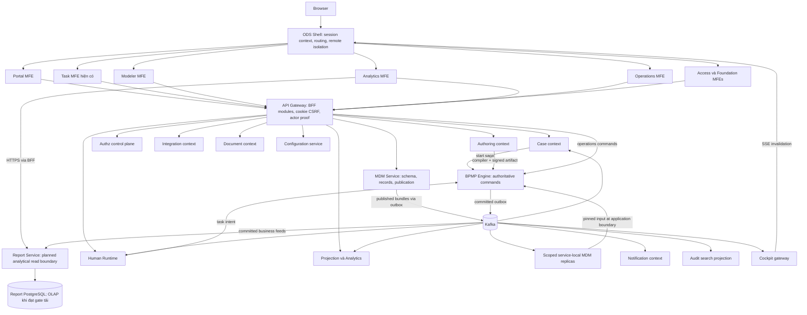
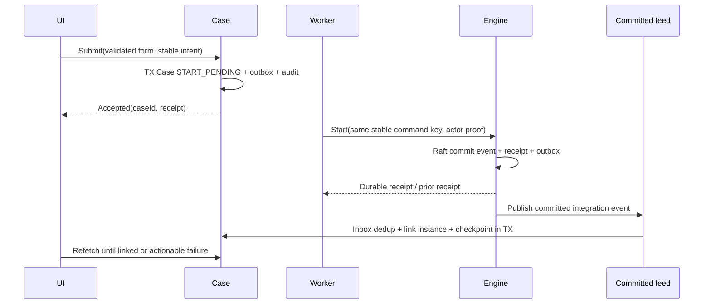

# Kiến trúc đích: ownership trước deployment

Trạng thái: proposed extension; kế thừa ADR-011 và architecture baseline. Không chia service theo từng button, bảng SQL hay từng tab. Các context mới ban đầu có thể deploy chung theo module có ownership rõ ràng; tách process khi có nhu cầu release, tải hoặc trust độc lập.

Định hướng sản phẩm là BPMP Platform đa lĩnh vực: tái sử dụng tối đa cơ chế kỹ thuật, tránh duplicate code và dùng versioned configuration/policy/schema để biểu diễn khác biệt nghiệp vụ trong capability đã hỗ trợ. Tính linh hoạt không đồng nghĩa generic CRUD, arbitrary script/SQL hoặc xóa bounded-context ownership. Mỗi capability configurable phải có owner, schema/semantics, validation, version, audit, publish/rollback và compatibility contract; logic cần bảo đảm invariant hoặc semantics chưa thể biểu diễn an toàn vẫn nằm trong code/domain adapter có owner.

## Component và service map

## Ownership, tái sử dụng và phần thiếu

| Context / deployable | Tái sử dụng hiện tại | Đích và ranh giới |
|---|---|---|
| Shell, Task | `apps/web/ods-shell`, `task-mfe`, frontend packages | Giữ signed catalog, compatibility, render isolation; bổ sung route slices theo capability |
| BFF | `apps/go/api-gateway` | Modules portal/task/design/operations/admin/query; HTTP aggregation và session, không business authority hoặc DB chung |
| Engine | Rust engine/server, compiler, RocksDB/Raft | Transition, tokens, idempotency, signed artifacts; không biến runtime events thành SQL source of truth |
| Human | `apps/go/human-runtime`, work_items/assignment_policies | Worklist/assignment/SLA; projection và command orchestration theo contract hiện tại |
| Authz / Identity | Rust authz-control-plane + external identity lifecycle | Typed policy publication/revocation; directory facade cho IdP, không tự triển khai password/MFA provider |
| Authoring | Compiler có, authoring repository/API chưa thấy trong deployable inventory | Draft BPMN/DMN, immutable versions, forms/templates, deployment jobs; tách editor khỏi runtime |
| Case | Planned trong ADR-011 | Customer/request/business lifecycle, comments, document references, workflow-start saga; không sở hữu task decision |
| Document | Planned | Upload/object storage, scan, version, access/retention; Case giữ reference, không blob |
| Integration | Planned | Endpoint/credential refs, probes, callbacks, delivery retries; outbound worker không được quyết định transition |
| Notification | Planned | Template/subscription/delivery; lỗi gửi không rollback workflow đã commit |
| MDM | Planned Master Data context trong ADR-011 | Model/dataset admin, immutable publications; consumer-local replicas + batched resolve; [thiết kế MDM](mdm-service.md). Không network lookup trong deterministic core. |
| Configuration | Go service có | Config version/scope/publication; không chứa mọi aggregate nghiệp vụ |
| Projection / Analytics | Go projection có | Query, saved views/export; thêm read models facts/metrics. Không triển khai analytics microservice mới nếu chưa có nhu cầu tải riêng |
| Audit search | Planned | Search từ evidence events; evidence vẫn ở owner. Không dùng search index làm audit authority |
| Governance | Rust service có | Approval, revoke/KMS barrier; tái sử dụng cho thao tác nhạy cảm thay vì một approval service thứ hai |

Foundation là nhóm UI gồm templates, allocation, documents, notifications, integrations và MDM admin; không phải bounded context hoặc database. Access MFE gọi directory và Authz nhưng không gộp hai authority.

Authorization theo [đặc tả phân quyền và truy cập dữ liệu](authorization-and-data-access.md): Authz Control Plane là PDP/policy authority; resource-owning service là PEP, thực thi action, tenant, row và field constraints tại nơi đọc/ghi. Dùng RBAC + ABAC, deny-by-default, explicit-deny precedence và tenant guard bắt buộc. Action/resource catalog được cấu hình động trong phạm vi capability manifests do owner service phát hành; Configuration Service quản lý lifecycle snapshot khi contract phù hợp, Authz vẫn giữ semantic authority. BFF/UI không phải enforcement boundary cuối. Engine tiếp tục quyết định transition runtime; policy check không thay `decide/evolve` hoặc commit authority.

## Command, query và event contract

REST dưới BFF theo resource, versioned contract; gRPC/Protobuf giữa services theo quy chuẩn repo. Ví dụ **đề xuất**, cần diff với RPC/route đã tồn tại trước khi chốt:

| Intent | Public facade | Owner / output |
|---|---|---|
| Submit case | `POST /api/v1/cases` | Case; receipt + orchestrationState + caseVersion |
| Task action | Reuse Task BFF đang có; mở rộng typed outcome | Human/Engine; command receipt + committedVersion |
| Save draft | `PATCH /api/v1/models/{id}/draft` | Authoring; expectedRevision, validated revision |
| Publish/deploy | `POST /api/v1/models/{id}/deployments` | Authoring job; artifact hash, target capability report |
| Cancel/migrate/move | Reuse Engine RPC qua operations facade; batch job khi cần | Engine; dry-run/approval refs, per-item receipt |
| Upload | `POST /api/v1/documents/uploads` | Document; upload session, bounded signed URL |
| Policy publish | Reuse Authz contract | Authz; immutable policy version, revoke/publication evidence |
| Analytics/export | Extend existing query/export API | Projection; authorized data + asOf/checkpoint |

Command metadata: tenant từ trusted context, actor proof, commandId/idempotency intent, expectedVersion, correlation/trace, deadline. Không tin `actorId`, tenant, role hoặc assignee truyền từ UI. DTO phải phân biệt public/customer và staff views; không trả nguyên internal aggregate.

Events thêm khi có producer/consumer thật: `CaseSubmitted`, `WorkflowStartLinked`, `DocumentScanCompleted`, `ModelVersionPublished`, `DeploymentCompleted`, `NotificationDeliveryFailed`. Đây là logical names; topic/envelope/schema theo `docs/kafka-topology.md` và Protobuf compatibility gate, không tạo topic theo tên này ngay. Event có eventId, tenant, aggregate ID/version, timestamp, schema version, causation/correlation. Chỉ đảm bảo thứ tự trong aggregate partition; consumer dedup và phát hiện gap.

## Case start saga và recovery

Timeout sau submit/start: truy vấn receipt hoặc retry cùng key; không tạo case/instance mới. Actor proof hết hạn phải reauthorize theo contract, không giả danh actor bằng workload identity. Kết quả chưa rõ không đánh dấu failed và không xóa case để “rollback”. Worker có bounded retry/deadline, lease và DLQ/manual reconciliation. Inbox/effect/checkpoint cùng transaction; outbox chỉ phát sau commit. Kafka/SSE outage chỉ làm tăng lag; không đổi tính hợp lệ của Engine commit.

## MFE release và failure

Remote route độc lập, không import source của remote khác, không dùng mutable global store chung. Shell chỉ cung cấp platform services; không truyền toàn bộ processes/instances như App prototype. Giữ React runtime compatibility và contractVersion/minShellVersion của catalog; thêm service fields bằng versioned compatibility change, không sửa tùy ý interface hiện hữu.

Signed immutable remote catalog + previous catalog cho rollback; remote failure có error boundary/retry riêng; session/telemetry failure không retry business intent. Same-origin remotes không phải security sandbox: privileged extensions không tin cậy cần isolation riêng. Shell giữ navigation/SSE invalidation router; remote refetch theo tenant/query scope, không nhận event rồi tự hoàn tất workflow.

## Quyết định còn mở

Camunda/Flowable trong prototype chỉ là lựa chọn UI. Mặc định thiết kế dùng BPMP Engine đang có; hỗ trợ engine ngoài cần adapter contract, semantics/conformance và ADR riêng. Cần chốt identity provider, branch/org hierarchy, retention/document policy, phân quyền customer vs officer, SLA calendars và SLO/cardinality trước physical design và capacity test. Không đưa ra claim production capacity khi chưa có dữ liệu.

## MDM và business data path

Theo [thiết kế MDM](mdm-service.md), central authority quản lý master schemas/records/publication nhưng không buộc mọi command gọi service. Warm path resolve local pinned bundle; cache miss gom batch; consumer sync bằng versioned publications và snapshot recovery. Strict-current validation là contract riêng, không thể suy ra từ TTL. Engine chỉ nhận resolved evidence tường minh, lưu cùng durable decision để replay không phụ thuộc MDM online.

## Database ownership và Reporting

[Ma trận service–database và Reporting](databases-and-reporting.md) xác định đầy đủ owner, relational/object/ephemeral stores, nguồn dữ liệu report và concrete sync/async contract. Tên DB trong ma trận là logical deployment names đề xuất, không khẳng định DSN hiện tại.

Projection tiếp tục phục vụ operational typed queries/aggregates/exports hiện có. Report là proposed analytical boundary, chỉ tách deployable/OLAP sau workload gate và authorization parity. Report ingest committed domain events qua Kafka, join facts/dimensions cục bộ và không query database nghiệp vụ. Reporting failure không nằm trên business commit path. Cross-source reporting có freshness/source cuts và không tự tạo global transaction snapshot.

## Entity và API contracts bắt buộc

Mọi business entity mới/refactor tuân [audit/soft-delete/version contract](entity-conventions.md); CAS kiểm tại authority, không chỉ ở UI. Immutable history và technical dedup/checkpoint có safety mapping riêng. [API Spec](api-spec.md) là target planning catalog ưu tiên BPMP core, có exact existing Gateway contract snapshot và operations proposed. Namespace target chuẩn hóa `/v1`; các `/api/v1` ví dụ trước đó chỉ là logical route, không phải namespace deployed thứ hai. UI control/event map theo operationId để tránh endpoint có mà chưa có workflow semantics.

## Backend operations contract

Mọi backend long-running deployable tuân [UUID, healthz/metrics và periodic cleanup](backend-operations.md). New entity IDs là UUID; management endpoints là per-service surface, không business Gateway routes; cleanup owner-local phải có schedule/retention/lease/safe checkpoint và bảo toàn immutable evidence. Đây là yêu cầu đích, không xác nhận runtime hiện tại đã wire đầy đủ.
