# Data model và ERD

**Proposed logical model; không chạy như migration.** Tất cả bảng bên dưới là target names, kể cả tên giống bảng hiện có. Mỗi schema DBML biểu diễn database/credential/migration owner riêng. Không tạo một PostgreSQL database chung cho tất cả context.

## Quy ước dữ liệu

**Bắt buộc:** mọi business entity dùng [AuditEntity + SoftDeletable + VersionedEntity](entity-conventions.md). DBML đã bổ sung created_by/updated_by, is_deleted, deleted_at/deleted_by/delete_reason và row_version. Các dictionary/ERD bên dưới lược common fields; row_version là concurrency counter, không model/release version. Immutable evidence/technical records có storage mapping riêng được quy định trong tài liệu entity, không cho mutable soft delete làm hỏng replay/dedup.

- Mỗi bảng có `tenant_id uuid`, `id uuid`, `created_at timestamptz`, `updated_at timestamptz`, `row_version bigint`; PK `(tenant_id, id)`. FK nội owner phải ghép tenant. External refs chỉ là logical links, không FK hoặc cross-database JOIN.
- `?` là nullable; còn lại NOT NULL. UUID là surrogate design key, không thay engine string reference. Key nghiệp vụ unique theo tenant và scope; thời gian UTC, render locale ở UI; amount dùng decimal + currency, không chuỗi VND hoặc floating point.
- Published versions immutable. Draft có revision CAS; process graph/XML là canonical editor document, normalized elements/flows phục vụ validation/query và được ghi cùng publication transaction. Không cho sửa hai representation độc lập.
- Snapshot/diff DMN dùng stable rule/clause IDs và immutable version. Clause/rule/cell phải cùng decision version; flow source/target phải cùng process version. Constraint bằng composite scope key hoặc deferred constraint trigger trong physical migration.
- Reference array trong candidate configuration là immutable authoring config; runtime membership dùng bảng liên kết. Không dùng JSON thay role/permission relation. JSONB dành cho expression, schemas, typed variables, graph và event payload có schema version/size cap.
- Credentials chỉ lưu secret reference; PII có classification/encryption và field-level masking. Delete theo retention/hold; audit và published artifacts không cascade-delete tùy tiện.

## Mapping schema hiện có

| Target context | Evidence hiện tại | Quy tắc chuyển đổi |
|---|---|---|
| Human | `db/human-runtime/migrations/001_human_runtime.sql`: work_items, assignment_policies, human_cases, human_case_plan_items, human_audit_log, human_event_inbox, escalation_outbox | Extend bằng additive migrations; không tạo work_items thứ hai. Human case-plan là runtime context, không đồng nhất customer Case. |
| Projection | `db/projection-service/migrations/`: workflow_event_read_models, projection_saved_queries, projection_query_exports | Extend/rebuild authorized read models; map saved_queries/export_jobs sang bảng hiện hữu. |
| Configuration | `db/configuration-service/migrations/`: profiles, versions, active scopes, audit/outbox/idempotency | Giữ service và lifecycle hiện có; endpoint secrets, Case hay user không chuyển vào config profile. |
| Governance | `db/governance-service/migrations/`: approval requests, signed approvals, audit | Tái sử dụng approval/evidence; không nhân bản trong Case. |
| Access | `apps/rust/authz-control-plane/db/` và owning Rust migrations | Schema ở đây là logical vocabulary; phải map typed policy, subject, tenant lifecycle vào owner hiện có, không tạo parallel Authz DB. External IdP vẫn sở hữu credential/MFA. |
| Authoring, customer Case, Document, Integration, Notification | Chưa có deployable owners tương ứng trong architecture inventory | New bounded contexts theo ADR-011; migrations chỉ thêm khi triển khai vertical slice. |
| MDM | Context planned trong ADR-011, chưa có deployable | Schema động có kiểm soát, immutable release/bundle, read replicas scoped; chi tiết [MDM](mdm-service.md). |
| Engine | RocksDB/Raft, không phải SQL | Runtime event/state/snapshot/token/idempotency không có authoritative SQL tables; instance_views và work_items là projections. |

## Bảng và quan hệ theo owner

Các cột chung được lược khỏi dictionary để dễ đọc; có đầy đủ trong DBML. ERD liệt kê mọi bảng, cạnh chỉ FK nội owner. Bảng đứng riêng liên hệ qua external references/event, không phải thiếu FK cần bổ sung.

### access

| Bảng | Cột riêng (`?`: nullable) |
|---|---|
| organizations | `code: text`; `name: text`; `parent_id: @organizations?`; `status: text` |
| subjects | `external_subject: text`; `kind: text`; `display_name: text`; `email: text?`; `status: text`; `organization_id: @organizations?` |
| memberships | `subject_id: @subjects`; `organization_id: @organizations`; `status: text` |
| roles | `code: text`; `name: text`; `role_type: text`; `status: text` |
| permissions | `code: text`; `resource_type: text`; `action: text`; `mandatory_audit: boolean` |
| role_permissions | `role_id: @roles`; `permission_id: @permissions` |
| role_bindings | `role_id: @roles`; `subject_id: @subjects`; `scope_type: text`; `scope_id: text`; `expires_at: timestamptz?` |
| direct_grants | `subject_id: @subjects`; `permission_id: @permissions`; `scope_type: text`; `scope_id: text`; `effect: text`; `expires_at: timestamptz?` |
| policy_versions | `policy_key: text`; `version: bigint`; `rules: jsonb`; `digest: text`; `status: text`; `published_at: timestamptz?` |
| policy_bindings | `policy_version_id: @policy_versions`; `resource_type: text`; `resource_id: text` |
| workload_principals | `external_subject: text`; `name: text`; `status: text`; `credential_ref: text` |
| certificate_rotations | `principal_id: @workload_principals`; `external_job_id: text?`; `fingerprint: text?`; `not_after: timestamptz?`; `status: text` |
| outbox | `event_id: uuid`; `aggregate_id: uuid`; `aggregate_version: bigint`; `event_type: text`; `payload: jsonb`; `published_at: timestamptz?`; `attempts: int` |
| inbox | `source: text`; `event_id: text`; `payload_digest: text`; `applied_at: timestamptz` |
| command_receipts | `command_id: uuid`; `intent_digest: text`; `actor_ref: uuid`; `aggregate_id: uuid`; `status: text`; `result: jsonb`; `expires_at: timestamptz?` |
| audit_evidence | `actor_ref: uuid`; `action: text`; `resource_ref: text`; `command_id: uuid?`; `before_digest: text?`; `after_digest: text?`; `occurred_at: timestamptz` |

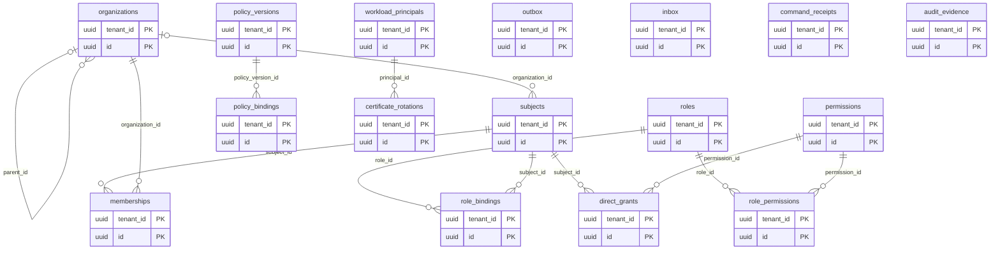

### authoring

| Bảng | Cột riêng (`?`: nullable) |
|---|---|
| process_models | `model_key: text`; `name: text`; `category: text`; `description: text?`; `status: text` |
| process_drafts | `model_id: @process_models`; `base_version_id: @process_versions?`; `revision: bigint`; `graph: jsonb`; `xml: text?`; `validation: jsonb` |
| process_versions | `model_id: @process_models`; `version: bigint`; `source_uri: text`; `digest: text`; `engine_profile: text`; `compiler_version: text` |
| process_elements | `process_version_id: @process_versions`; `element_key: text`; `element_type: text`; `name: text`; `properties: jsonb` |
| process_flows | `process_version_id: @process_versions`; `source_id: @process_elements`; `target_id: @process_elements`; `condition: text?`; `waypoints: jsonb` |
| process_pools | `process_version_id: @process_versions`; `pool_key: text`; `participant_ref: text`; `geometry: jsonb` |
| process_lanes | `pool_id: @process_pools`; `lane_key: text`; `actor_role_ref: text`; `geometry: jsonb` |
| node_assignments | `element_id: @process_elements`; `lane_id: @process_lanes?`; `candidate_subjects: jsonb`; `candidate_roles: jsonb`; `sla_policy_ref: text?`; `form_version_id: @form_versions?` |
| decision_models | `decision_key: text`; `name: text`; `description: text?` |
| decision_drafts | `decision_id: @decision_models`; `base_version_id: @decision_versions?`; `revision: bigint`; `definition: jsonb` |
| decision_versions | `decision_id: @decision_models`; `version: bigint`; `version_tag: text`; `summary: text`; `hit_policy: text`; `digest: text`; `source_uri: text` |
| decision_clauses | `decision_version_id: @decision_versions`; `clause_key: text`; `direction: text`; `ordinal: int`; `label: text`; `expression: text`; `type_ref: text`; `allowed_values: jsonb` |
| decision_rules | `decision_version_id: @decision_versions`; `rule_key: text`; `ordinal: int`; `active: boolean`; `annotation: text?` |
| decision_cells | `rule_id: @decision_rules`; `clause_id: @decision_clauses`; `expression: text`; `value: jsonb?` |
| decision_evaluations | `decision_version_id: @decision_versions`; `input_digest: text`; `result: jsonb`; `status: text`; `duration_ms: bigint`; `expires_at: timestamptz` |
| form_definitions | `form_key: text`; `name: text` |
| form_versions | `form_id: @form_definitions`; `version: bigint`; `schema: jsonb`; `ui_schema: jsonb`; `digest: text` |
| workflow_templates | `template_key: text`; `name: text`; `domain: text` |
| workflow_template_versions | `template_id: @workflow_templates`; `version: bigint`; `graph: jsonb`; `parameter_schema: jsonb`; `digest: text` |
| model_dependencies | `process_version_id: @process_versions`; `decision_version_id: @decision_versions?`; `form_version_id: @form_versions?`; `called_process_version_id: @process_versions?`; `binding_type: text` |
| deployments | `process_version_id: @process_versions`; `environment_ref: text`; `engine_profile: text`; `artifact_digest: text?`; `status: text`; `command_id: uuid`; `receipt_ref: text?`; `error_code: text?` |
| outbox | `event_id: uuid`; `aggregate_id: uuid`; `aggregate_version: bigint`; `event_type: text`; `payload: jsonb`; `published_at: timestamptz?`; `attempts: int` |
| inbox | `source: text`; `event_id: text`; `payload_digest: text`; `applied_at: timestamptz` |
| command_receipts | `command_id: uuid`; `intent_digest: text`; `actor_ref: uuid`; `aggregate_id: uuid`; `status: text`; `result: jsonb`; `expires_at: timestamptz?` |
| audit_evidence | `actor_ref: uuid`; `action: text`; `resource_ref: text`; `command_id: uuid?`; `before_digest: text?`; `after_digest: text?`; `occurred_at: timestamptz` |

```mermaid
erDiagram
  process_models {
    uuid tenant_id PK
    uuid id PK
  }
  process_drafts {
    uuid tenant_id PK
    uuid id PK
  }
  process_versions {
    uuid tenant_id PK
    uuid id PK
  }
  process_elements {
    uuid tenant_id PK
    uuid id PK
  }
  process_flows {
    uuid tenant_id PK
    uuid id PK
  }
  process_pools {
    uuid tenant_id PK
    uuid id PK
  }
  process_lanes {
    uuid tenant_id PK
    uuid id PK
  }
  node_assignments {
    uuid tenant_id PK
    uuid id PK
  }
  decision_models {
    uuid tenant_id PK
    uuid id PK
  }
  decision_drafts {
    uuid tenant_id PK
    uuid id PK
  }
  decision_versions {
    uuid tenant_id PK
    uuid id PK
  }
  decision_clauses {
    uuid tenant_id PK
    uuid id PK
  }
  decision_rules {
    uuid tenant_id PK
    uuid id PK
  }
  decision_cells {
    uuid tenant_id PK
    uuid id PK
  }
  decision_evaluations {
    uuid tenant_id PK
    uuid id PK
  }
  form_definitions {
    uuid tenant_id PK
    uuid id PK
  }
  form_versions {
    uuid tenant_id PK
    uuid id PK
  }
  workflow_templates {
    uuid tenant_id PK
    uuid id PK
  }
  workflow_template_versions {
    uuid tenant_id PK
    uuid id PK
  }
  model_dependencies {
    uuid tenant_id PK
    uuid id PK
  }
  deployments {
    uuid tenant_id PK
    uuid id PK
  }
  outbox {
    uuid tenant_id PK
    uuid id PK
  }
  inbox {
    uuid tenant_id PK
    uuid id PK
  }
  command_receipts {
    uuid tenant_id PK
    uuid id PK
  }
  audit_evidence {
    uuid tenant_id PK
    uuid id PK
  }
  process_models ||--o{ process_drafts : "model_id"
  process_versions |o--o{ process_drafts : "base_version_id"
  process_models ||--o{ process_versions : "model_id"
  process_versions ||--o{ process_elements : "process_version_id"
  process_versions ||--o{ process_flows : "process_version_id"
  process_elements ||--o{ process_flows : "source_id"
  process_elements ||--o{ process_flows : "target_id"
  process_versions ||--o{ process_pools : "process_version_id"
  process_pools ||--o{ process_lanes : "pool_id"
  process_elements ||--o{ node_assignments : "element_id"
  process_lanes |o--o{ node_assignments : "lane_id"
  form_versions |o--o{ node_assignments : "form_version_id"
  decision_models ||--o{ decision_drafts : "decision_id"
  decision_versions |o--o{ decision_drafts : "base_version_id"
  decision_models ||--o{ decision_versions : "decision_id"
  decision_versions ||--o{ decision_clauses : "decision_version_id"
  decision_versions ||--o{ decision_rules : "decision_version_id"
  decision_rules ||--o{ decision_cells : "rule_id"
  decision_clauses ||--o{ decision_cells : "clause_id"
  decision_versions ||--o{ decision_evaluations : "decision_version_id"
  form_definitions ||--o{ form_versions : "form_id"
  workflow_templates ||--o{ workflow_template_versions : "template_id"
  process_versions ||--o{ model_dependencies : "process_version_id"
  decision_versions |o--o{ model_dependencies : "decision_version_id"
  form_versions |o--o{ model_dependencies : "form_version_id"
  process_versions |o--o{ model_dependencies : "called_process_version_id"
  process_versions ||--o{ deployments : "process_version_id"
```

### human

| Bảng | Cột riêng (`?`: nullable) |
|---|---|
| queues | `queue_key: text`; `name: text`; `process_key: text`; `status: text` |
| queue_memberships | `queue_id: @queues`; `subject_ref: uuid?`; `role_ref: uuid?`; `scope: jsonb` |
| assignment_policy_versions | `queue_id: @queues`; `version: bigint`; `strategy: text`; `max_active: int`; `escalation_seconds: bigint`; `target_group_ref: text`; `active: boolean` |
| work_items | `instance_ref: text`; `element_key: text`; `queue_id: @queues?`; `assignee_ref: uuid?`; `status: text`; `priority: text`; `due_at: timestamptz?`; `engine_version: bigint`; `form_version_ref: uuid?` |
| work_item_candidates | `work_item_id: @work_items`; `subject_ref: uuid?`; `role_ref: uuid?` |
| assignment_history | `work_item_id: @work_items`; `from_subject_ref: uuid?`; `to_subject_ref: uuid?`; `command_id: uuid`; `reason: text?`; `effective_at: timestamptz` |
| delegations | `work_item_id: @work_items`; `from_subject_ref: uuid`; `to_subject_ref: uuid`; `depth: int`; `expires_at: timestamptz?`; `command_id: uuid` |
| sla_policies | `policy_key: text`; `version: bigint`; `calendar_ref: text?`; `warning_seconds: bigint`; `deadline_seconds: bigint`; `escalation_action: jsonb` |
| sla_timers | `work_item_id: @work_items`; `policy_id: @sla_policies`; `due_at: timestamptz`; `status: text`; `attempt: int`; `lease_until: timestamptz?` |
| outbox | `event_id: uuid`; `aggregate_id: uuid`; `aggregate_version: bigint`; `event_type: text`; `payload: jsonb`; `published_at: timestamptz?`; `attempts: int` |
| inbox | `source: text`; `event_id: text`; `payload_digest: text`; `applied_at: timestamptz` |
| command_receipts | `command_id: uuid`; `intent_digest: text`; `actor_ref: uuid`; `aggregate_id: uuid`; `status: text`; `result: jsonb`; `expires_at: timestamptz?` |
| audit_evidence | `actor_ref: uuid`; `action: text`; `resource_ref: text`; `command_id: uuid?`; `before_digest: text?`; `after_digest: text?`; `occurred_at: timestamptz` |

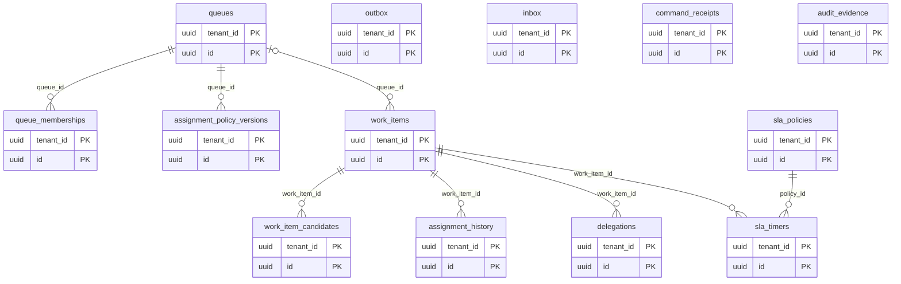

### case

| Bảng | Cột riêng (`?`: nullable) |
|---|---|
| service_offerings | `service_key: text`; `name: text`; `category: text`; `description: text`; `status: text` |
| service_offering_versions | `offering_id: @service_offerings`; `version: bigint`; `process_version_ref: uuid`; `form_version_ref: uuid`; `document_requirements: jsonb`; `sla_policy_ref: uuid?`; `presentation: jsonb` |
| customers | `external_customer_ref: text?`; `subject_ref: uuid`; `name: text`; `organization_name: text?`; `tax_id_ciphertext: text?`; `phone_ciphertext: text?`; `email_ciphertext: text?` |
| cases | `tracking_code: text`; `offering_version_id: @service_offering_versions`; `customer_id: @customers`; `business_key: text`; `branch_ref: text?`; `status: text`; `orchestration_state: text`; `assigned_officer_ref: uuid?`; `amount: decimal?`; `currency: text?`; `term_months: int?`; `purpose: text?`; `deadline_at: timestamptz?` |
| case_variables | `case_id: @cases`; `name: text`; `type_ref: text`; `value: jsonb`; `classification: text` |
| case_workflow_links | `case_id: @cases`; `instance_ref: text`; `process_version_ref: uuid`; `start_command_id: uuid`; `engine_receipt_ref: text?`; `status: text` |
| case_steps | `case_id: @cases`; `element_key: text`; `execution_ref: text?`; `name: text`; `status: text`; `handler_ref: uuid?`; `started_at: timestamptz?`; `completed_at: timestamptz?` |
| case_comments | `case_id: @cases`; `author_ref: uuid`; `visibility: text`; `body: text`; `edited_at: timestamptz?` |
| case_document_links | `case_id: @cases`; `document_ref: uuid`; `document_version_ref: uuid`; `category: text`; `requirement_key: text?`; `status_projection: text` |
| case_decisions | `case_id: @cases`; `task_ref: text`; `command_id: uuid`; `outcome: text`; `reason: text`; `engine_receipt_ref: text?`; `status: text` |
| workflow_start_jobs | `case_id: @cases`; `command_id: uuid`; `payload_digest: text`; `attempts: int`; `next_attempt_at: timestamptz?`; `lease_until: timestamptz?`; `status: text`; `last_error: text?` |
| outbox | `event_id: uuid`; `aggregate_id: uuid`; `aggregate_version: bigint`; `event_type: text`; `payload: jsonb`; `published_at: timestamptz?`; `attempts: int` |
| inbox | `source: text`; `event_id: text`; `payload_digest: text`; `applied_at: timestamptz` |
| command_receipts | `command_id: uuid`; `intent_digest: text`; `actor_ref: uuid`; `aggregate_id: uuid`; `status: text`; `result: jsonb`; `expires_at: timestamptz?` |
| audit_evidence | `actor_ref: uuid`; `action: text`; `resource_ref: text`; `command_id: uuid?`; `before_digest: text?`; `after_digest: text?`; `occurred_at: timestamptz` |

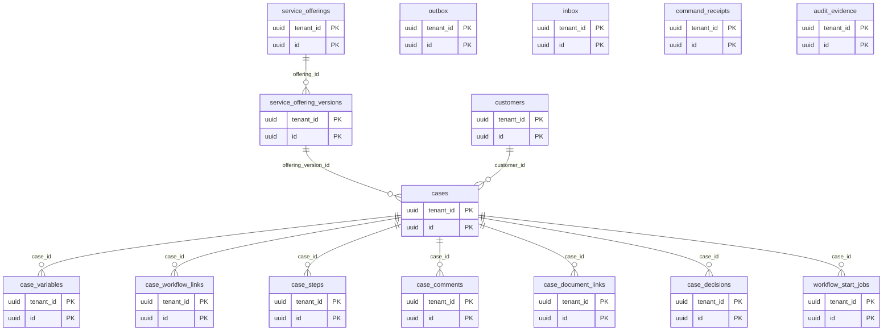

### document

| Bảng | Cột riêng (`?`: nullable) |
|---|---|
| documents | `document_key: text`; `owner_kind: text`; `owner_ref: text`; `classification: text`; `retention_policy_ref: text?`; `status: text` |
| document_versions | `document_id: @documents`; `version: bigint`; `object_key: text`; `checksum: text`; `media_type: text`; `byte_size: bigint`; `original_name: text`; `scan_status: text`; `verified_by: uuid?`; `verified_at: timestamptz?` |
| upload_sessions | `document_id: @documents`; `expected_size: bigint`; `expected_checksum: text?`; `expires_at: timestamptz`; `status: text`; `object_key: text` |
| scan_jobs | `document_version_id: @document_versions`; `scanner_profile: text`; `verdict: text?`; `attempts: int`; `status: text`; `lease_until: timestamptz?` |
| document_access_grants | `document_id: @documents`; `subject_ref: uuid`; `action: text`; `expires_at: timestamptz?` |
| retention_holds | `document_id: @documents`; `reason: text`; `placed_by: uuid`; `released_at: timestamptz?` |
| outbox | `event_id: uuid`; `aggregate_id: uuid`; `aggregate_version: bigint`; `event_type: text`; `payload: jsonb`; `published_at: timestamptz?`; `attempts: int` |
| inbox | `source: text`; `event_id: text`; `payload_digest: text`; `applied_at: timestamptz` |
| command_receipts | `command_id: uuid`; `intent_digest: text`; `actor_ref: uuid`; `aggregate_id: uuid`; `status: text`; `result: jsonb`; `expires_at: timestamptz?` |
| audit_evidence | `actor_ref: uuid`; `action: text`; `resource_ref: text`; `command_id: uuid?`; `before_digest: text?`; `after_digest: text?`; `occurred_at: timestamptz` |

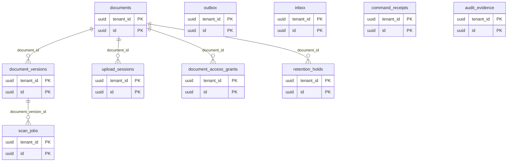

### integration

| Bảng | Cột riêng (`?`: nullable) |
|---|---|
| endpoints | `endpoint_key: text`; `name: text`; `service_type: text`; `status: text` |
| endpoint_versions | `endpoint_id: @endpoints`; `version: bigint`; `url: text`; `http_method: text`; `auth_type: text`; `secret_ref: text?`; `timeout_ms: int`; `retry_policy: jsonb`; `allowed_destinations: jsonb` |
| integration_bindings | `endpoint_version_id: @endpoint_versions`; `process_version_ref: uuid`; `element_key: text`; `mapping: jsonb` |
| probe_jobs | `endpoint_id: @endpoints`; `status: text`; `latency_ms: int?`; `observed_at: timestamptz?`; `error_code: text?` |
| delivery_attempts | `endpoint_version_id: @endpoint_versions`; `command_id: uuid`; `request_digest: text`; `attempt: int`; `status: text`; `next_attempt_at: timestamptz?`; `response_code: int?` |
| callback_receipts | `endpoint_id: @endpoints`; `external_event_id: text`; `signature_key_ref: text`; `payload_digest: text`; `received_at: timestamptz`; `status: text` |
| outbox | `event_id: uuid`; `aggregate_id: uuid`; `aggregate_version: bigint`; `event_type: text`; `payload: jsonb`; `published_at: timestamptz?`; `attempts: int` |
| inbox | `source: text`; `event_id: text`; `payload_digest: text`; `applied_at: timestamptz` |
| command_receipts | `command_id: uuid`; `intent_digest: text`; `actor_ref: uuid`; `aggregate_id: uuid`; `status: text`; `result: jsonb`; `expires_at: timestamptz?` |
| audit_evidence | `actor_ref: uuid`; `action: text`; `resource_ref: text`; `command_id: uuid?`; `before_digest: text?`; `after_digest: text?`; `occurred_at: timestamptz` |

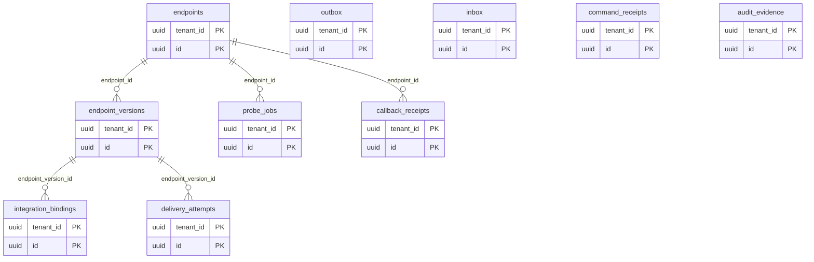

### notification

| Bảng | Cột riêng (`?`: nullable) |
|---|---|
| notification_templates | `template_key: text`; `channel: text`; `name: text` |
| notification_template_versions | `template_id: @notification_templates`; `version: bigint`; `locale: text`; `subject: text?`; `body: text`; `variable_schema: jsonb` |
| notification_subscriptions | `subject_ref: uuid`; `event_type: text`; `channel: text`; `enabled: boolean` |
| notification_deliveries | `template_version_id: @notification_template_versions`; `recipient_ref: uuid`; `source_event_id: text`; `channel: text`; `status: text`; `provider_ref: text?`; `attempts: int`; `next_attempt_at: timestamptz?` |
| outbox | `event_id: uuid`; `aggregate_id: uuid`; `aggregate_version: bigint`; `event_type: text`; `payload: jsonb`; `published_at: timestamptz?`; `attempts: int` |
| inbox | `source: text`; `event_id: text`; `payload_digest: text`; `applied_at: timestamptz` |
| command_receipts | `command_id: uuid`; `intent_digest: text`; `actor_ref: uuid`; `aggregate_id: uuid`; `status: text`; `result: jsonb`; `expires_at: timestamptz?` |
| audit_evidence | `actor_ref: uuid`; `action: text`; `resource_ref: text`; `command_id: uuid?`; `before_digest: text?`; `after_digest: text?`; `occurred_at: timestamptz` |

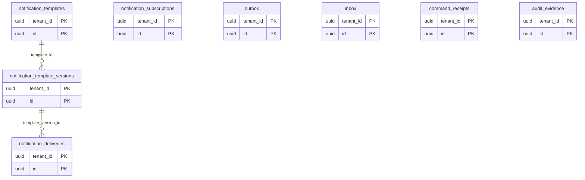

### projection

| Bảng | Cột riêng (`?`: nullable) |
|---|---|
| instance_views | `instance_ref: text`; `process_key: text`; `process_version: bigint`; `business_key: text`; `case_ref: uuid?`; `status: text`; `branch_ref: text?`; `started_at: timestamptz`; `completed_at: timestamptz?`; `source_version: bigint` |
| node_execution_facts | `instance_view_id: @instance_views`; `execution_ref: text`; `element_key: text`; `started_at: timestamptz?`; `completed_at: timestamptz?`; `wait_ms: bigint?`; `processing_ms: bigint?`; `outcome: text?` |
| incident_views | `instance_view_id: @instance_views`; `element_key: text`; `error_code: text`; `retry_count: int`; `status: text`; `source_version: bigint` |
| metric_buckets | `process_key: text`; `process_version: bigint`; `element_key: text?`; `bucket_start: timestamptz`; `bucket_seconds: int`; `dimensions: jsonb`; `measures: jsonb`; `watermark: text` |
| saved_queries | `owner_subject_ref: uuid`; `name: text`; `resource_type: text`; `query: jsonb`; `visibility: text` |
| export_jobs | `owner_subject_ref: uuid`; `query: jsonb`; `status: text`; `object_ref: text?`; `expires_at: timestamptz?`; `watermark: text?`; `policy_version: text` |
| consumer_checkpoints | `consumer: text`; `partition: int`; `offset: bigint`; `source_event_id: text`; `applied_at: timestamptz` |
| inbox | `source: text`; `event_id: text`; `payload_digest: text`; `applied_at: timestamptz` |

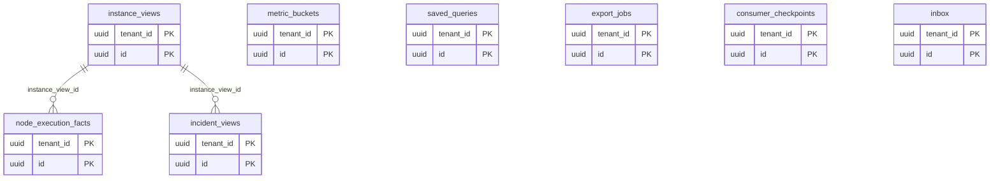

### audit_search

| Bảng | Cột riêng (`?`: nullable) |
|---|---|
| audit_entries | `source_service: text`; `source_event_id: text`; `actor_ref: uuid`; `action: text`; `resource_type: text`; `resource_ref: text`; `before_digest: text?`; `after_digest: text?`; `evidence_ref: text`; `occurred_at: timestamptz` |
| consumer_checkpoints | `consumer: text`; `partition: int`; `offset: bigint`; `source_event_id: text`; `applied_at: timestamptz` |
| inbox | `source: text`; `event_id: text`; `payload_digest: text`; `applied_at: timestamptz` |

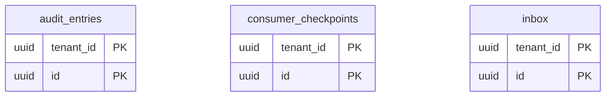

### mdm

MDM sở hữu model/dataset publication; details về UI, distribution và freshness trong [MDM service](mdm-service.md). Các quan hệ bên dưới nội tenant; shared publisher references phải dùng explicit scoped publication links, không tạo FK cross-tenant.

| Bảng | Cột riêng (`?`: nullable) |
|---|---|
| data_models | `model_key: text`; `name: text`; `description: text?`; `status: text` |
| model_drafts | `model_id: @data_models`; `base_version_id: @model_versions?`; `revision: bigint`; `field_schema: jsonb`; `constraints: jsonb`; `ui_schema: jsonb` |
| model_versions | `model_id: @data_models`; `version: bigint`; `field_schema: jsonb`; `constraints: jsonb`; `ui_schema: jsonb`; `digest: text`; `compatibility: text` |
| master_datasets | `dataset_key: text`; `model_id: @data_models`; `name: text`; `status: text`; `source_owner: text` |
| record_drafts | `dataset_id: @master_datasets`; `model_version_id: @model_versions`; `record_key: text`; `revision: bigint`; `payload: jsonb`; `valid_from: timestamptz`; `valid_to: timestamptz?`; `operation: text` |
| master_records | `dataset_id: @master_datasets`; `record_key: text`; `status: text` |
| record_versions | `record_id: @master_records`; `model_version_id: @model_versions`; `version: bigint`; `payload: jsonb`; `digest: text`; `valid_from: timestamptz`; `valid_to: timestamptz?`; `tombstone: boolean` |
| record_references | `source_version_id: @record_versions`; `field_key: text`; `target_record_version_id: @record_versions`; `relation_type: text` |
| source_mappings | `record_version_id: @record_versions`; `source_system: text`; `external_code: text`; `valid_from: timestamptz`; `valid_to: timestamptz?` |
| dataset_releases | `dataset_id: @master_datasets`; `model_version_id: @model_versions`; `release_number: bigint`; `manifest_ref: text`; `digest: text`; `status: text`; `published_at: timestamptz` |
| release_members | `release_id: @dataset_releases`; `record_version_id: @record_versions` |
| publication_bundles | `publication_scope: text`; `generation: bigint`; `previous_generation: bigint?`; `digest: text`; `manifest_ref: text`; `approval_ref: text?`; `active_at: timestamptz`; `status: text` |
| bundle_items | `bundle_id: @publication_bundles`; `dataset_release_id: @dataset_releases` |
| publication_heads | `publication_scope: text`; `generation: bigint`; `bundle_id: @publication_bundles` |
| validation_reports | `dataset_id: @master_datasets`; `draft_revision_digest: text`; `schema_digest: text`; `result: jsonb`; `status: text`; `expires_at: timestamptz?` |
| consumer_subscriptions | `workload_ref: text`; `dataset_id: @master_datasets`; `view_scope: jsonb`; `supported_schemas: jsonb`; `distribution_policy_epoch: bigint`; `lease_policy: jsonb`; `status: text` |
| consumer_sync_status | `subscription_id: @consumer_subscriptions`; `consumer_instance_ref: text`; `generation: bigint`; `checkpoint: text`; `last_seen_at: timestamptz`; `status: text` |
| mdm_jobs | `job_type: text`; `dataset_id: @master_datasets?`; `command_id: uuid`; `expected_revision_digest: text?`; `status: text`; `result: jsonb?`; `attempts: int`; `next_attempt_at: timestamptz?`; `lease_until: timestamptz?` |
| outbox | `event_id: uuid`; `aggregate_id: uuid`; `aggregate_version: bigint`; `event_type: text`; `payload: jsonb`; `published_at: timestamptz?`; `attempts: int` |
| inbox | `source: text`; `event_id: text`; `payload_digest: text`; `applied_at: timestamptz` |
| command_receipts | `command_id: uuid`; `intent_digest: text`; `actor_ref: uuid`; `aggregate_id: uuid`; `status: text`; `result: jsonb`; `expires_at: timestamptz?` |
| audit_evidence | `actor_ref: uuid`; `action: text`; `resource_ref: text`; `command_id: uuid?`; `before_digest: text?`; `after_digest: text?`; `occurred_at: timestamptz` |

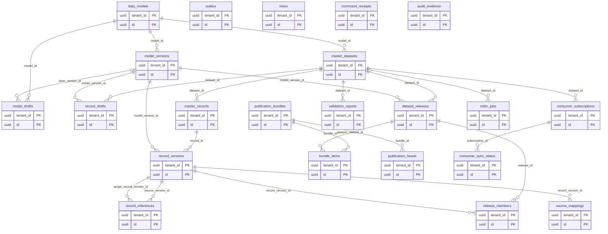

RecordVersions/payload và modelVersions là immutable sau publication. Current draft, publication_heads và consumer_sync_status là mutable CAS. Mọi publication đóng manifest snapshot, head generation, audit/outbox trong owner transaction; không để readers thấy partial bundle. Record draft revision được digest vào validation report; chỉ publish đúng revision đã kiểm. Release members phải thuộc đúng dataset và model version; bundle không chứa hai release của cùng dataset. Các scope/uniqueness constraints chi tiết trong tài liệu MDM; DBML chưa encode đầy đủ CHECK/unique/index.

Consumer-local read model (không phải MDM authority): snapshot staging theo scope/bundle, immutable record lookup index, active bundle pointer, inbox/checkpoint và distribution authorization lease. Consumer tự sở hữu migration; không thêm các bảng đó vào MDM database để các services dùng chung.

## Quan hệ cross-context (logical, không FK)

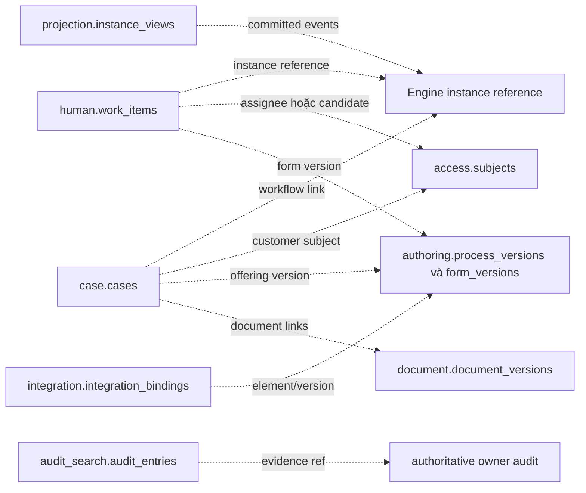

## Constraint và index bắt buộc khi physical design

| Phạm vi | Constraint / index |
|---|---|
| Natural keys | UNIQUE tenant + org code, external subject, role code, permission code, process/decision/form/template/service/endpoint key; version tables UNIQUE tenant + parent_id + version. |
| Membership/grant | UNIQUE tenant + subject + org; role_permission tenant+role+permission; role binding và direct grant phải có scope/effect uniqueness; expires_at > created_at khi có expiry. |
| BPMN/DMN | UNIQUE tenant+process_version+element_key; tenant+decision_version+clause_key; tenant+decision_version+rule_key; rule+clause cell unique; ordinal unique trong version/direction; clause/rule scope phải đồng nhất. |
| Case | UNIQUE tenant+tracking_code; business_key uniqueness scope cần chốt với Engine start contract; case_workflow_links UNIQUE tenant+start_command_id và instance_ref; workflow_start_jobs UNIQUE tenant+command_id. |
| Worklist | Index tenant+assignee+status+due_at+id và tenant+queue+status+priority+id. Source engine_version monotonic; reject stale event; one live claim bằng owner CAS, không browser lock. |
| SLA/assignment | max_active > 0; escalation/deadline >= 0; timer unique theo task/policy/trigger; queue_memberships và candidates đúng một subject hoặc role; delegation depth bounded, không vòng. |
| Documents | byte_size >= 0, checksum bắt buộc khi finalize; UNIQUE tenant+document+version; object_key immutable; scan verdict enum; upload expiry; no attach/download before permitted scan state. |
| Queries/metrics | Index tenant+process_key+started_at+id, tenant+instance_ref; metric bucket unique theo full dimensions hash+bucket; monotonic watermark. Không index PII plaintext. |
| Delivery/callback | UNIQUE tenant+endpoint+external_event_id; intent/event+recipient+channel uniqueness; attempt/deadline cap; retry index status+next_attempt_at; lease expiry index. |
| Infrastructure | Outbox event_id unique per owner/tenant, unpublished partial index; inbox UNIQUE tenant+source+event_id; receipts UNIQUE tenant+command_id with payload digest comparison; checkpoint UNIQUE tenant+consumer+partition. |
| Lifecycle | CHECK state/outcome/type enums, allowed state transitions trong owner; optimistic UPDATE WHERE row_version=expected; immutable version constraints; audit retention và evidence signing theo policy. |

## Physical design gates

Chưa có migration SQL để tránh biến đề xuất thành schema chạy thật. Trước migration cần chốt nullability theo use case, version scope composite constraints, key type tương thích schema hiện có, RLS/tenant guards, phân vùng/retention, cardinality, query plans, encryption và backup/recovery. DBML mô tả PK/FK và nullability; các uniqueness/check/index ở bảng trên là yêu cầu bổ sung chưa được encode hết vào DBML.

Chỉ triển khai migration additive theo owner: expand schema → dual-compatible readers/writers nếu cần → backfill idempotent → verify counts/digests + tenant scope → switch read/write → contract sau cửa sổ rollback. Không dùng mock array làm nguồn backfill production.

## Database placement và reporting extension

Xem [service–database matrix](databases-and-reporting.md) để phân biệt storage của Engine, service-owned PostgreSQL, object storage và reporting read stores. Các bảng `projection.*` trong DBML vẫn thuộc Projection; không chuyển ngầm sang Report. Report facts/metadata là proposed extension được mô tả trong mục 7 của tài liệu Reporting, chưa có physical schema hoặc ERD/DBML chi tiết. Các local replicas là derived data, không cross-service FK và không owner mới cho business state.

## UUID và retention operations

New platform-owned entity PK/FK dùng native UUID; existing external/legacy refs có compatibility mapping riêng. Outbox/log tables bắt buộc có scheduled cleanup owner-local với eligibility/checkpoint/retention/archive rules trong [backend standards](backend-operations.md). Common soft-delete metadata không thay thế technical retention protocol và không cho phép purge business/audit history tùy ý.
